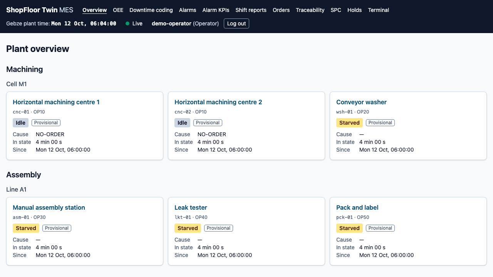
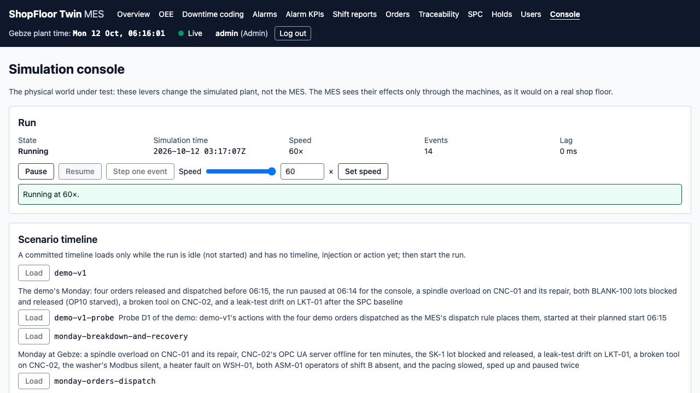
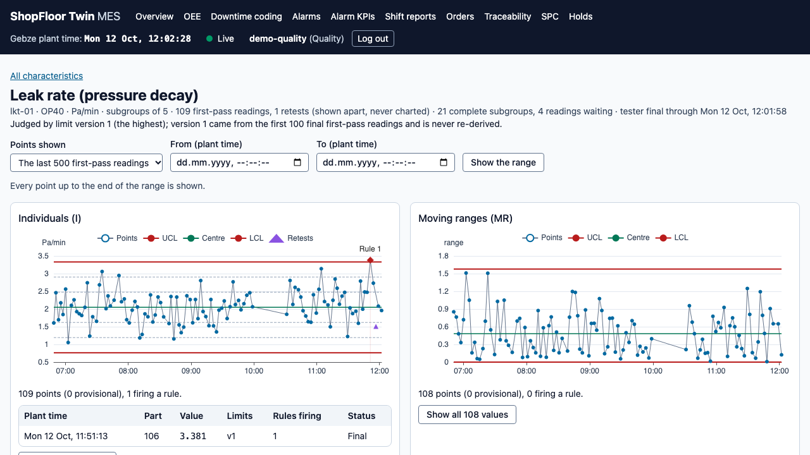
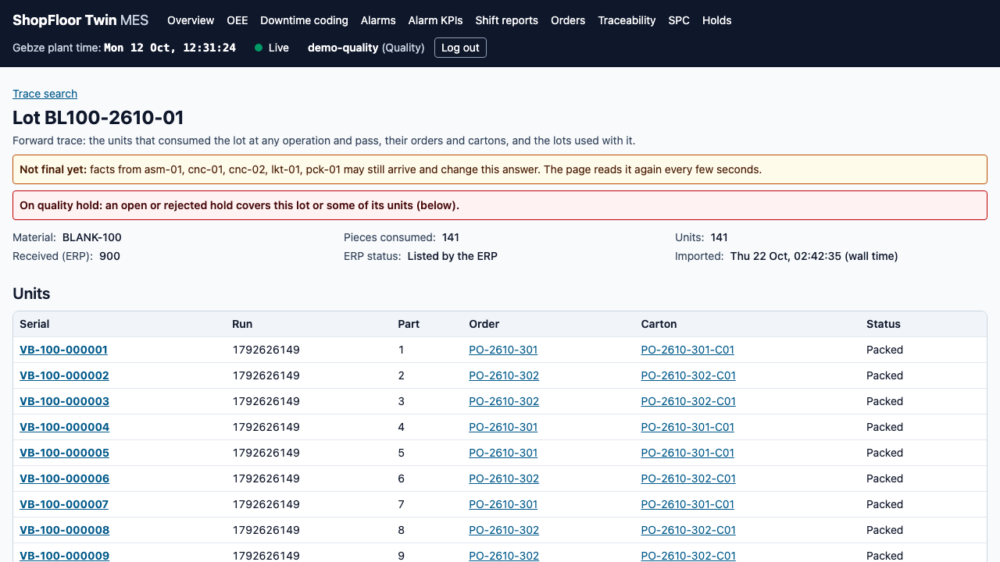

# ShopFloor Twin

A deterministic simulation of a discrete-manufacturing plant with an edge gateway, MQTT Unified Namespace and MES core, built in TypeScript.

The plant is a fictional automotive-hydraulics supplier making two variants of a hydraulic valve block on six machines: two CNC machining centres, a washer, a manual assembly station, a leak tester and a packing station, in two work centers (Cell M1 and Line A1). The simulator plays the shop floor: it is seeded and deterministic, so the same seed and scenario always give the same events, and it records its own ground truth. The machines speak OPC UA (SignAndEncrypt) and, for the washer, Modbus TCP.

Everything above the simulator is built the way it would be in a real plant: an edge gateway publishes every machine's state, cycles, alarms and telemetry to an ISA-95 Unified Namespace on an MQTT broker, with store-and-forward through broker outages; the MES core stores them in PostgreSQL with TimescaleDB and derives OEE, downtime, alarm KPIs (ISA-18.2), shift reports, production orders from an ERP mock, execution, genealogy and traceability, SPC and quality holds; a web app gives operators, supervisors, quality and admins their screens over HTTPS. Every derived figure is reconciled against the simulator's ground truth by tests.

The [master plan](docs/project-plan.md) sets the goals, the six v1 success criteria and the roadmap; [docs/STATUS.md](docs/STATUS.md) says where the project stands. **Release 1.0.0** ([`v1.0.0`](https://github.com/kubilayture/shopfloor-twin/releases/tag/v1.0.0), 2026-10-22) completes the v1 scope; the [final report](docs/final-report.md) gives each success criterion with its proof.

## Run it

Requires Docker with Compose v2 (give its VM 4 GiB of memory), git and a POSIX shell; no Node.js and no pnpm. One command line starts the whole system on a fresh clone:

<!-- quick-start -->

```sh
git clone https://github.com/kubilayture/shopfloor-twin.git
cd shopfloor-twin
sh scripts/stack-init.sh && docker compose up -d --wait
```

<!-- quick-start -->

With Colima, clone under your home directory: Colima shares only that with its VM, and the stack bind-mounts files of the clone. The first part runs once: `scripts/stack-init.sh` writes `.env` from `.env.example` with a new random value for every password and token (mode 600; it never replaces an existing `.env`, and on a rerun it only checks that every required secret is set and not `change-me`). `docker compose up -d --wait` then builds the images and starts the system, and returns once every service is healthy: PostgreSQL + TimescaleDB (migrated by a one-shot `migrate` step), the Mosquitto MQTT broker, the plant simulator at 60×, the edge gateway, the ERP mock, the MES server and the web app. `pnpm test:fresh-clone` runs exactly this block on a clone of the commit (runbook, "Fresh-clone test").

- **HTTPS and the dev CA.** The web is HTTPS only, on <https://localhost:8443>, with a certificate of the stack's own dev CA. Trust that CA once, for SSL only, or accept the browser's warning once. Export it without Node with `docker compose exec -T web cat /etc/nginx/tls/ca.pem > dev-ca.pem` (or `pnpm stack:ca`, which also prints its fingerprint); how to trust it and remove the trust again is in the runbook, "HTTPS and the dev CA".
- **Log in.** Every screen needs a login. Log in as `admin` at <https://localhost:8443/login> with the password the init printed (or `MES_BOOTSTRAP_ADMIN_PASSWORD` in `.env`), change it as the first login requires, and create users with their roles in `/admin/users` (runbook, "Identity"). Open the app as `localhost`, not `127.0.0.1` (the session cookie is per host name).
- **Production mode.** By default the CNCs run a fixed weekly schedule (`SIM_PRODUCTION=schedule`). Production orders from the ERP mock, their dispatch, the terminal's order work, order OEE and cartons run in orders mode: set `SIM_PRODUCTION=orders` in `.env` before starting (or start over, below).
- **Stop and start over.** `docker compose down` stops the system and keeps its data; `docker compose down --volumes` (`pnpm stack:reset`) deletes every volume, data, certificates and the dev CA included, so the next start begins empty (trust the new CA again).
- **Ports.** Everything listens on `127.0.0.1` only. The default stack publishes the web (8443), the broker (1883), the simulator's control API (4800, token), the OPC UA servers (4841–4845), Modbus (5020) and the ERP mock (4600, token); change a port in `.env` if another program uses it (runbook, "Full stack"). The MES, the gateway and the database are not published.

## Screens

At <https://localhost:8443>, each behind the login and the roles' permissions:

| Screen                     | Path                                        | What it shows                                                                                  |
| -------------------------- | ------------------------------------------- | ---------------------------------------------------------------------------------------------- |
| Plant overview             | `/`                                         | Every machine's live state, with the plant clock and the connection                            |
| Machine detail             | `/equipment/<id>`, e.g. `/equipment/cnc-01` | One machine's state timeline, time per state and telemetry trends                              |
| OEE dashboard              | `/oee`                                      | OEE, A, P and Q per work center and machine, hours, loss waterfall, Pareto, line OEE           |
| Downtime coding            | `/downtime`                                 | The shift's downtime records, uncoded first, to split and code with reasons                    |
| Alarms                     | `/alarms`                                   | Active, acknowledged, shelved and history; acknowledge, comment, shelve                        |
| Alarm KPIs                 | `/alarms/kpi`                               | ISA-18.2 KPIs per scope: rates, floods, chattering, bad actors                                 |
| Shift reports              | `/shifts`, `/shifts/<date>/<shift>`         | The shift report (OEE, production, downtime, alarms) and handover notes; print and JSON        |
| Production orders          | `/orders`, `/orders/<id>`                   | Orders from the ERP mock: release, dispatch, close; each order's OEE and first-pass yield      |
| Operator terminal          | `/terminal`, `/terminal/<work center>`      | Sign-on per work center, the orders in progress, start, pause, sign-off, scrap coding, signals |
| Traceability               | `/trace`                                    | Serials back to their lots, machines, operators and leak readings; lots and cartons forward    |
| SPC                        | `/quality/spc`, `/quality/spc/leak-rate`    | The leak test's control charts with the Nelson rules' episodes                                 |
| Quality holds              | `/quality/holds`                            | Holds on lots, serials, cartons and orders: open, release or reject                            |
| Simulation console (admin) | `/console`                                  | The run (pause, speed, step), scenario timelines, failure and fault injection, lots, operators |
| Account and users          | `/account`, `/admin/users` (admin)          | Own session and password; users, roles, resets                                                 |

[docs/demo.md](docs/demo.md) walks through them in eight scenes on a scenario of its own (`pnpm demo` plays the same walkthrough as a test). The screenshots below come from its recording, made by `pnpm demo:record`. The whole walkthrough is in the video [docs/demo/shopfloor-twin-v1.webm](docs/demo/shopfloor-twin-v1.webm), with captions in [demo-v1.vtt](docs/demo/demo-v1.vtt).

| Plant overview (operator, scene 1)                        | Simulation console (admin, scene 3)                |
| --------------------------------------------------------- | -------------------------------------------------- |
|               |     |
| **SPC: the leak test's drift episode (quality, scene 6)** | **Traceability: a serial back (quality, scene 8)** |
|                         |             |

The other scenes' screenshots: [an order's dispatch](docs/demo/02-orders.png), [downtime coding](docs/demo/04-alarms.png), [the machines' OEE (scene 5)](docs/demo/05-oee.png) and [the close refused under a quality hold](docs/demo/07-hold.png). More on each screen: the runbook, "Run the web app", and [apps/web/README.md](apps/web/README.md).

## Develop

Requires Node.js 26 (`nvm use` reads `.nvmrc`) and pnpm 11 or newer, which switches itself to the version pinned in `package.json`, beside Docker.

```sh
pnpm install   # dependencies, and the pre-commit hook (format and lint the staged files)
pnpm verify    # format check, Dockerfile check, lint, typecheck, tests, build
pnpm gate      # the merge gate: verify, golden, end-to-end, stack smoke, reconciliation
```

- **`pnpm verify`** takes the host-wide heavy lock (one heavy suite at a time on the machine) and refuses to start below 25 GiB free on the host or 15 GiB in Docker, whose Testcontainers suites need Docker running; uncached it takes about ten minutes. It prints one fast-check seed per workspace; `FC_SEED=<seed>` reproduces a run (runbook, "Property seeds").
- **`pnpm gate`** runs every job of the merge gate locally, one at a time, on disposable Compose projects, and writes its record to `e2e/results/gate.json`. It is the merge gate while GitHub Actions is unavailable (runbook, "Merge gate" and "Continuous integration").
- **The stack from the workspace:** `pnpm stack:init` is the init above, `pnpm stack:up` the start; `pnpm stack:up:dev` also publishes the MES, the gateway and the database on `127.0.0.1` (4700, 4900, 5442) for development; `pnpm stack:up:observability` adds Prometheus and Grafana on `127.0.0.1` (9090, 3000; set `GRAFANA_ADMIN_PASSWORD` first). `pnpm stack:smoke` checks a running stack.
- **The other suites**, each in the runbook: `pnpm test:golden`, `pnpm test:e2e`, `pnpm test:reconcile`, `pnpm test:console`, `pnpm test:resilience`, `pnpm test:perf`, `pnpm test:trace-perf`, `pnpm test:fresh-clone`, `pnpm demo`, `pnpm demo:probe` and `pnpm demo:record`.

## Documentation

- [docs/README.md](docs/README.md): the documentation index, every document with its purpose, its update trigger and the test that checks it.
- [docs/runbook.md](docs/runbook.md): starting, stopping and resetting the stack, every command, the merge gate, the test harnesses, upgrading an older stack, troubleshooting.
- [docs/demo.md](docs/demo.md): the demo scenario and its scenes.
- [docs/architecture.md](docs/architecture.md): the architecture; [docs/data-model.md](docs/data-model.md): the MES database (generated); [docs/contracts/](docs/contracts/) and [docs/api/](docs/api/): the UNS, OPC UA, Modbus, control API, MES and ERP mock interfaces.
- [docs/adr/](docs/adr/README.md): the architecture decision records.
- [docs/phases/](docs/phases/): each phase's plan, log and report (the latest report: [Phase 10](docs/phases/phase-10-report.md)); [docs/learning/](docs/learning/): the learning notes per phase.
- [docs/security-review.md](docs/security-review.md), [docs/glossary.md](docs/glossary.md), [CHANGELOG.md](CHANGELOG.md). The v1.0 final report: [docs/final-report.md](docs/final-report.md) (each success criterion with its proof and the closing gate's records, known limits, and the register of decisions with the sign-off).
