# Architecture

arc42-lite, with C4-style views drawn as Mermaid flowcharts and sequence diagrams (Phase 10 plan, "Architecture views"; written by P10-05, [#280](https://github.com/kubilayture/shopfloor-twin/issues/280)). The why behind each element is in the [ADRs](adr/README.md); terms are defined in the [glossary](glossary.md); the master plan's [section 5](project-plan.md#5-system-architecture) gives the intent and the UNS topic tree.

**Checked against the code.** `scripts/check-architecture.ts` runs in `pnpm verify` (`pnpm check:architecture` alone) and reads the Mermaid blocks of this document by their node ids. An id with a prefix names something real: `svc_` a Compose service, `vol_` a named volume, `mod_` an MES module folder, `pkg_` a workspace package (a `-` in the name is written `_`). A prefixed id that names nothing fails the check anywhere in this document; on top of that, the container view must show exactly the services of `docker-compose.yml`, the observability view every service of `compose.observability.yml`, the deployment view exactly the named volumes, the MES component view exactly the module folders **and exactly the cross-module imports**, and the package view exactly the workspace packages **and their `@shopfloor/*` dependencies**. Networks, ports, edge labels and the runtime sequences are prose: checked by review, not by the script (section 9).

**Updated** whenever a service, module, package, interface or data flow changes, in the same pull request; `pnpm verify` fails until the views it checks agree with the code.

Contents: [1. Context](#1-system-context) · [2. Containers](#2-containers) · [3. Observability](#3-observability-profile) · [4. Components](#4-components) · [5. Packages](#5-workspace-packages) · [6. Runtime](#6-runtime-views) · [7. Deployment](#7-deployment) · [8. Cross-cutting concepts](#8-cross-cutting-concepts) · [9. The check](#9-how-the-views-are-checked)

## 1. System context

ShopFloor Twin simulates one plant (Orbis Components, Gebze: six machines, ISA-95 levels 0–2) and runs the software above it: the edge gateway, the MQTT Unified Namespace, the MES with its database, and the web UI. Two systems sit outside what an MES deployment would own: the plant itself, played by the **simulator** (in a real factory: the machines and their controllers), and the **ERP**, played by the **ERP mock**.

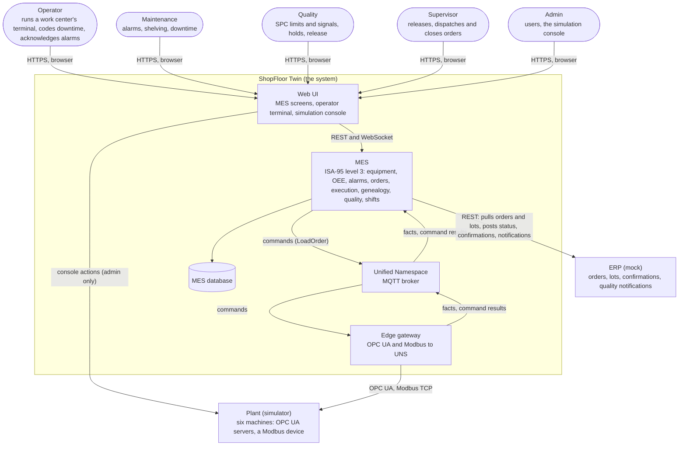

Key: a rounded box is a person (one per role of [ADR-0026](adr/0026-identity-sessions-roles-and-auth-switch.md), `ROLES` in `@shopfloor/contracts/identity`); the outlined group is the system; an arrow points from the side that starts the conversation and is labelled with what flows. The simulator knows nothing of the MES; only the gateway talks to machines and only the MES talks to the database. The one exception, the console reaching the simulator, is deliberate: the console steers the physical world under test, not the plant's software ([ADR-0037](adr/0037-console-actions-as-new-event-variants.md)), and only the `admin` role holds `sim:control`.

## 2. Containers

Every service of `docker-compose.yml` (Compose project `shopfloor-twin`), with what it speaks and how it is secured. `pnpm stack:up` (`docker compose up -d --wait`) starts all of them but `opcua-tools`.

<!-- architecture-check: containers -->

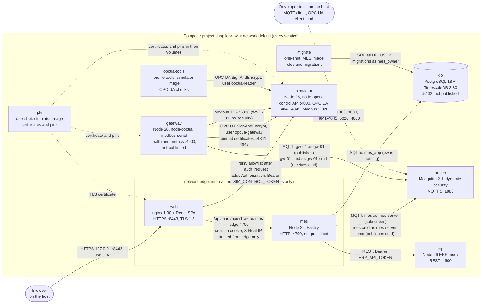

Key: a box is a container (long-running unless it says one-shot or profile), a cylinder is a data store; a solid arrow is a connection its tail opens, labelled with protocol, port and credential; a dotted arrow from `pki` is a file handed over in a volume (section 7), and the developer tools' arrow stands for every port published on `127.0.0.1` (the simulator's, the ERP mock's and the broker's). Every service is on the `default` network; `web` and `mes` are on `edge` too.

| Service       | Image                                     | Published on the host (default stack)                 | Starts after                                             | Volumes                                                                |
| ------------- | ----------------------------------------- | ----------------------------------------------------- | -------------------------------------------------------- | ---------------------------------------------------------------------- |
| `db`          | `timescale/timescaledb:2.30.2-pg18`       | – (`pnpm stack:up:dev`: 5442)                         | –                                                        | `db-data`                                                              |
| `broker`      | `eclipse-mosquitto:2.1.2-alpine`          | `127.0.0.1:1883` (`MQTT_PORT`)                        | –                                                        | `broker-data`; `config/mosquitto` read-only                            |
| `pki`         | `shopfloor-twin/simulator` (built)        | –                                                     | –                                                        | `simulator-pki`, `gateway-pki`, `opcua-tools-pki`, `pki-ca`, `web-tls` |
| `simulator`   | `shopfloor-twin/simulator`                | `127.0.0.1:4800`, `4841-4845`, `5020` (`SIM_*_PORT*`) | `pki` exited 0                                           | `simulator-pki`                                                        |
| `gateway`     | `shopfloor-twin/edge-gateway`             | – (`pnpm stack:up:dev`: 4900)                         | `broker` healthy, `pki` exited 0, `simulator` healthy    | `gateway-data` (outbox, command inbox), `gateway-pki`                  |
| `opcua-tools` | `shopfloor-twin/simulator` (never pulled) | –                                                     | `simulator` healthy; only with `docker compose run --rm` | `opcua-tools-pki`                                                      |
| `migrate`     | `shopfloor-twin/mes-server`               | –                                                     | `db` healthy                                             | –                                                                      |
| `mes`         | `shopfloor-twin/mes-server`               | – (`pnpm stack:up:dev`: 4700)                         | `db` healthy, `migrate` exited 0, `broker` healthy       | –                                                                      |
| `erp`         | `shopfloor-twin/erp-mock`                 | `127.0.0.1:4600` (`ERP_HTTP_PORT`)                    | –                                                        | `erp-data`                                                             |
| `web`         | `shopfloor-twin/web` (nginx-unprivileged) | `127.0.0.1:8443` (`WEB_HTTPS_PORT`)                   | `mes` healthy, `pki` exited 0                            | `web-tls` read-only                                                    |

Every service has CPU and memory limits and runs as a non-root user (security review S8). The host ports are variables of `.env` so a second stack can run beside the first (#277); `compose.dev-ports.yml` publishes the MES, the gateway and the database again on `127.0.0.1` for development.

### Trust boundaries

1. **The host's loopback.** Everything published binds `127.0.0.1` only ([ADR-0039](adr/0039-mqtt-dynamic-security-https-front-and-login-throttling.md)); nothing listens on another interface.
2. **The HTTPS front.** The browser reaches the MES only through nginx on 8443: TLS 1.3, a certificate from the stack's own dev CA (made by `pki`, exported with `pnpm stack:ca`), no plain-HTTP listener. The MES's session cookie is `__Host-sft_session` (`Secure`, `HttpOnly`, `SameSite=Strict`; [ADR-0026](adr/0026-identity-sessions-roles-and-auth-switch.md)); the MES checks `Host` and `Origin` on `/api`.
3. **The `edge` network.** nginx and the MES only, `internal: true` and without an IPv4 gateway. The MES learns the network's subnet at start from its alias `mes-edge` (and refuses to start without it) and trusts proxy headers (`X-Original-Method`, `X-Real-IP` for the login throttle) only from it.
4. **The console's proxy.** `/sim/` reaches the simulator's control API only for allowlisted routes and methods, same-origin, after nginx's `auth_request` asks the MES whether the session holds `sim:control`; nginx then adds the control token, which the browser never sees. The control API needs the token on every route but `/health/*` and `/metrics`.
5. **OPC UA.** SignAndEncrypt only, each side's certificate pinned by the other, users `opcua-gateway` (the only one allowed `LoadOrder`) and `opcua-reader` ([ADR-0038](adr/0038-opcua-signandencrypt-pinned-certificates-and-users.md)). Modbus TCP has no security of its own; WSH-01's port is published to loopback only.
6. **MQTT.** No anonymous access; Mosquitto's dynamic security binds every user to one client id and grants topics per role: only the MES's users (`mes`, `mes-cmd`) may publish `cmd`, only the gateway's (`gw-01`, `gw-01-cmd`) facts and `cmd-res` ([UNS contract](contracts/uns.md), "Broker"). The broker listens without TLS, inside the Compose network and on loopback.
7. **The database.** Not published; the MES connects as `mes_app`, which owns nothing; `migrate` alone runs DDL ([ADR-0027](adr/0027-database-roles-and-one-audit-log.md)).
8. **The ERP mock.** A shared bearer token guards `/api/v1` ([ADR-0028](adr/0028-erp-mock-rest-feed-and-idempotent-messages.md)).

## 3. Observability profile

Opt-in and off by default (`pnpm stack:up:observability`, [ADR-0012](adr/0012-metrics-with-prom-client.md) amendment, P9-17): `compose.observability.yml` adds Prometheus (profile `observability`) and Grafana (profile `grafana`).

<!-- architecture-check: observability -->

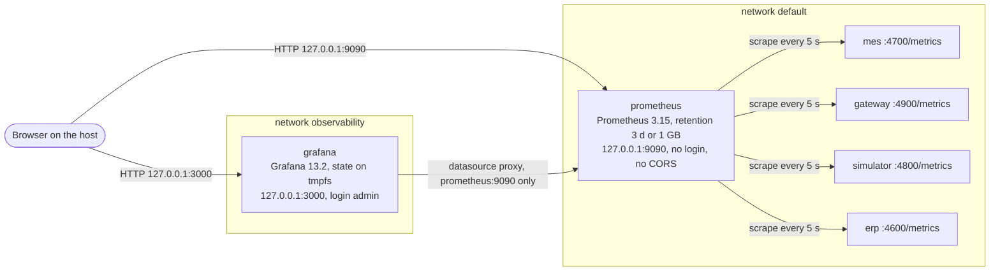

Key: as the container view. Prometheus is on `default` and `observability`, Grafana on `observability` only, so Grafana has no route to the plant's containers by name; neither is on `edge`. Not scraped: the broker, the database and nginx (no exporter: `config/prometheus/prometheus.yml`). The metrics are `prom-client`'s ([ADR-0012](adr/0012-metrics-with-prom-client.md)); the performance suite reads them ([ADR-0040](adr/0040-load-testing-with-a-node-script-and-measured-targets.md)).

## 4. Components

### 4.1 MES modules

The MES is a modular monolith ([ADR-0003](adr/0003-monorepo-layout.md), master plan section 7): twelve modules under `apps/mes-server/src/modules`, each owning its schema and tables but `oee` and `realtime`, which own none ([ADR-0016](adr/0016-sql-migrations-and-module-schemas.md)), importing each other only through `index.ts` ([ADR-0005](adr/0005-dependency-rules-with-no-restricted-imports.md)). The arrows are exactly those imports in the modules' source (tests and test support left out): an arrow from A to B means A's code imports B's public interface.

<!-- architecture-check: mes-components -->

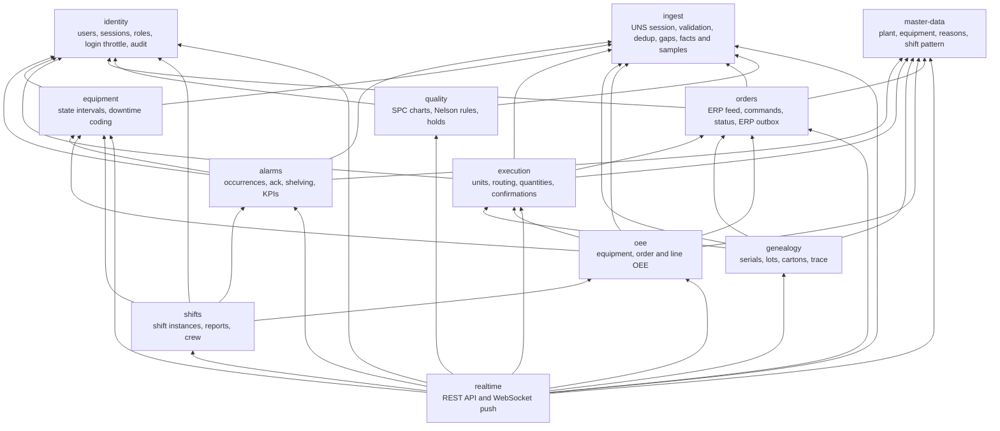

Key: a box is a module (its folder name and responsibilities); an arrow is a compile-time import. **Imports are not all the wiring:** `main.ts` is the composition root and also hands modules each other's objects through structural interfaces that need no import, for example the holds (`quality`) get `genealogy`, `execution` and `orders` (scope, close guard, the ERP outbox), and `orders` gets the holds' close guard and execution's blank counter back. Those runtime links are in the sequences of section 6.

How the modules meet the outside:

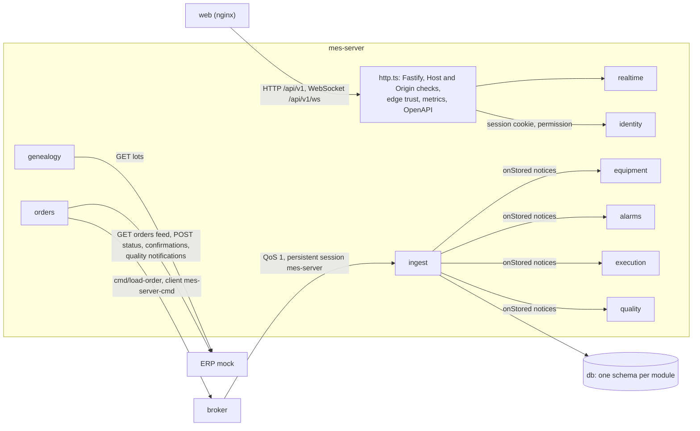

Key: as the container view; the inner arrows show the notice flow ([ADR-0017](adr/0017-mes-ingest-acks-anchors-and-gaps.md)): ingest commits a fact, acknowledges it to the broker and announces it; the consuming modules derive their tables from ingest's, catching up from the tables at start ([ADR-0018](adr/0018-equipment-intervals-provisional-and-catch-up.md)). Every module but `oee` and `realtime` (which own no tables) reads and writes its own schema in `db`; only ingest's arrow is drawn.

### 4.2 Edge gateway

`apps/edge-gateway/src`: one process, ISA-95 level 2 ([ADR-0014](adr/0014-store-and-forward-in-sqlite.md), [ADR-0015](adr/0015-uns-identity-epochs-and-dedup.md), [ADR-0029](adr/0029-command-path-at-least-once-with-device-dedup-and-settled-outcomes.md)).

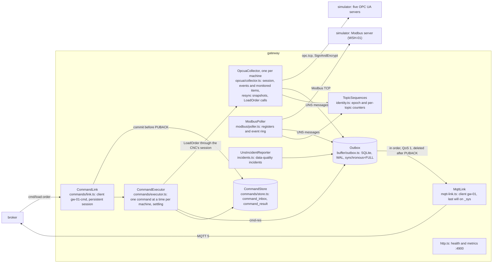

Key: a box is a class with its file, a cylinder keeps state in the `gateway-data` volume (both tables share the outbox's SQLite file, each on a connection of its own). The normalisation to UNS payloads ([UNS contract](contracts/uns.md), "Sources") happens inside the collector and the poller; the gateway's own `_sys/…/status` goes straight through `MqttLink`, never through the outbox.

### 4.3 Simulator

`apps/simulator/src` with the kernel in `packages/sim-core`: discrete-event, seeded ([ADR-0006](adr/0006-simulation-time.md), [ADR-0007](adr/0007-random-streams.md), [simulation model](simulation-model.md)).

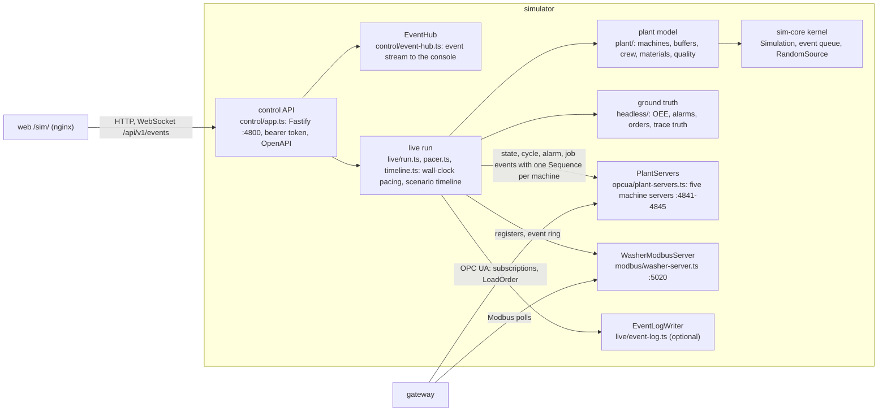

Key: as the gateway view. The same model runs headless (`pnpm sim:headless`, the golden scenarios) without servers or pacing; the address space is [contracts/opcua-address-space.md](contracts/opcua-address-space.md), the register map [contracts/modbus-register-map.md](contracts/modbus-register-map.md), the control API [contracts/simulator-control-api.md](contracts/simulator-control-api.md).

### 4.4 Web

`apps/web`: a React 19 single-page app (TanStack Router and Query, ECharts and uPlot) built by Vite and served by nginx, which is also the HTTPS front (section 2). Its API client and the live cache (`src/live/`, [ADR-0020](adr/0020-web-shared-api-schemas-code-routes-live-cache.md)) speak the MES's REST API and WebSocket with schemas from `@shopfloor/contracts`; the console (`src/screens/console*`, `src/api/sim.ts`) speaks the simulator's control API through `/sim/`.

## 5. Workspace packages

The pnpm workspace ([ADR-0003](adr/0003-monorepo-layout.md)): five apps, the end-to-end harness and thirteen packages. The pure packages (`sim-core`, `oee-core`, `shift-calendar`, `alarm-core`, `spc-core`, `trace-core`) import only each other ([ADR-0005](adr/0005-dependency-rules-with-no-restricted-imports.md) as amended by [ADR-0024](adr/0024-alarm-kpis-definitions-and-pure-package-imports.md) and [ADR-0032](adr/0032-spc-charts-frozen-limits-nelson-rules-and-episodes.md)); `scripts/check-dockerfiles.ts` keeps each image's copies in step with this graph.

<!-- architecture-check: packages -->

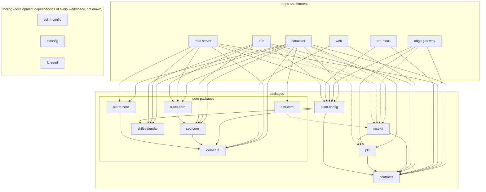

Key: a solid arrow is a `dependencies` entry, a dotted one a `devDependencies` entry (tests only), both on `workspace:*`. The three tooling packages are development dependencies of nearly every workspace (`fc-seed` of those with property tests, [P10-01](phases/phase-10-plan.md)); the check exempts exactly those edges. The repository root (`shopfloor-twin`) is the workspace, not a package of it.

## 6. Runtime views

The six data paths of master plan section 5, the alarm lifecycle, a trace query, the two outages and the start. Participants with a `svc_` or `mod_` id are the containers and modules above. Times are the defaults of `docker-compose.yml`.

### 6.1 Start-up and the `pki` step

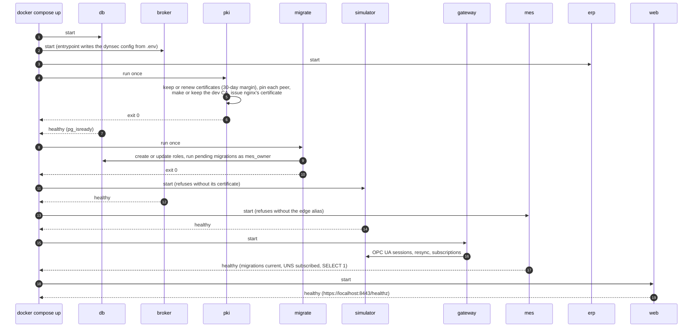

`depends_on` gives exactly these orders (`service_completed_successfully` for the one-shot steps, `service_healthy` otherwise); nothing waits for the ERP mock, which the MES retries ([runbook](runbook.md), "Full stack"). A rerun of `up` reruns `pki`, which keeps every pin when nothing is renewed (#265); after a renewal the simulator and the gateway must be restarted ([runbook](runbook.md), "OPC UA certificates"; glossary: _`pki` step_, _Pinned certificate_, _Dev CA_).

### 6.2 Telemetry and events ingest (data paths 1 and 2)

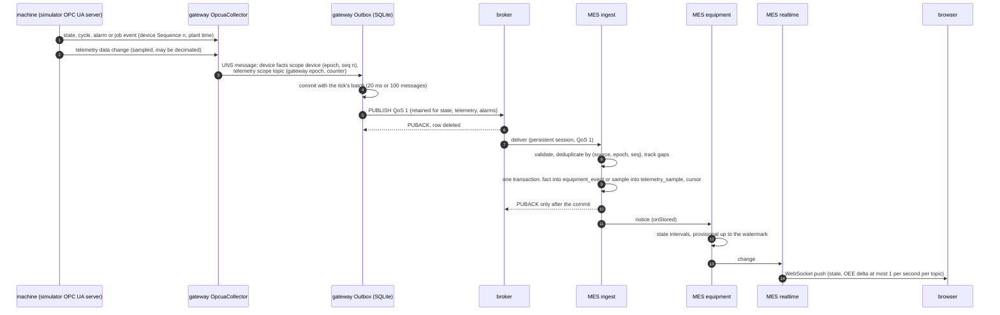

Delivery is at least once end to end and exactly once in the tables: QoS 1 everywhere, the outbox removes a row only after its PUBACK, the MES acknowledges only what it committed and drops what it has already seen ([ADR-0015](adr/0015-uns-identity-epochs-and-dedup.md), [ADR-0017](adr/0017-mes-ingest-acks-anchors-and-gaps.md)). State, cycles and alarms are OPC UA events, never merged ([ADR-0009](adr/0009-lossless-opcua-delivery.md)); WSH-01's come from the Modbus event ring the same way. A hole in a device's sequence becomes a `sequence-gap` incident after 30 s (`INGEST_GAP_GRACE_MS`). OEE is computed from the intervals and cycles ([ADR-0021](adr/0021-oee-definitions-exact-arithmetic-and-micro-stops.md), [ADR-0022](adr/0022-hourly-aggregates-refreshed-explicitly.md)).

### 6.3 Orders down: the `LoadOrder` round trip (data path 3)

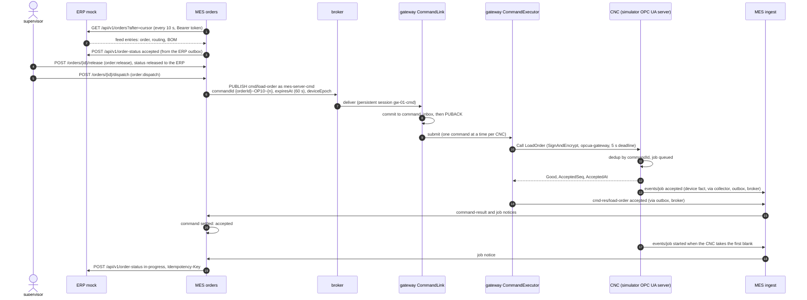

Each step is safe to repeat ([ADR-0029](adr/0029-command-path-at-least-once-with-device-dedup-and-settled-outcomes.md), [ADR-0030](adr/0030-order-driven-simulator-loadorder-and-job-facts.md)): the MES resends an unsettled command (`COMMAND_RESEND_MS`), the gateway answers a known command from its result memory without calling, and the device answers a repeated id `Duplicate`. An outcome the gateway can't know is settled after `expiresAt` by reading the device's epoch, clock and sequence and calling once more; the MES never re-dispatches before the device's facts prove the job never started. Only the MES may publish `cmd`, only the gateway `cmd-res` (glossary: _Command envelope_, _Job, job facts_, _Dispatch_).

### 6.4 Confirmations up (data path 4)

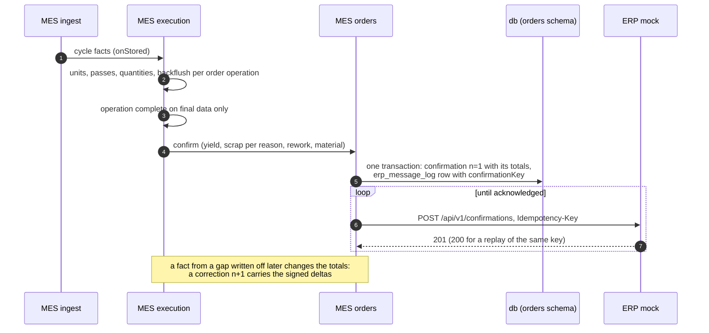

[ADR-0031](adr/0031-execution-units-completion-and-confirmations.md) defines units, completion and confirmations; [ADR-0028](adr/0028-erp-mock-rest-feed-and-idempotent-messages.md) the idempotency keys (glossary: _Confirmation_, _Idempotency key_, _Final, provisional, final through_).

### 6.5 Alarm lifecycle

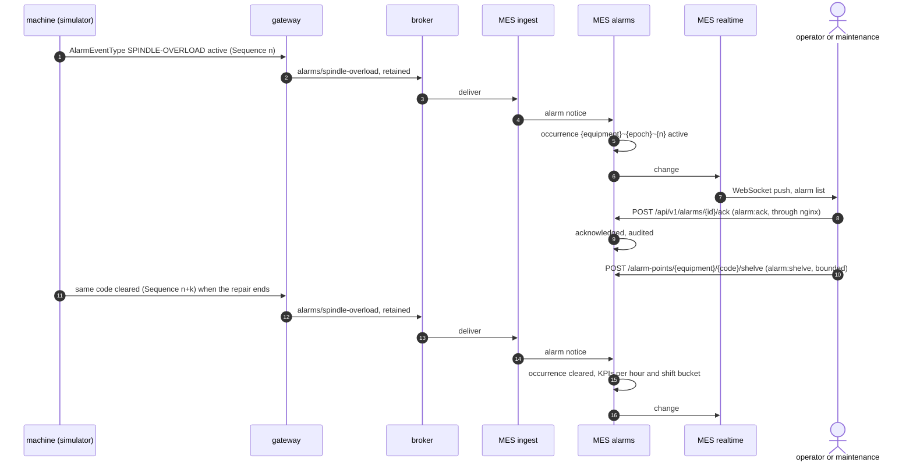

The device only raises and clears; acknowledgement, shelving, priorities and flood detection live in the MES ([ADR-0010](adr/0010-alarms-as-state-variables-and-events.md), [ADR-0024](adr/0024-alarm-kpis-definitions-and-pure-package-imports.md)). On a restart or resync the MES restores active alarms from retained **alarm anchors** and the gateway's alarm snapshots, ordered by sequence; a stale epoch's are never listed ([ADR-0017](adr/0017-mes-ingest-acks-anchors-and-gaps.md) amendment; glossary: _Alarm occurrence_, _Shelving_, _Alarm flood_).

### 6.6 Quality hold (data path 5)

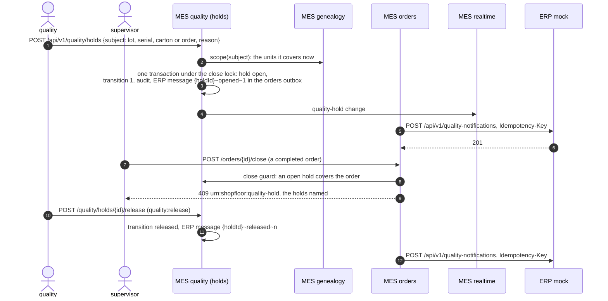

The scope is derived from genealogy, never listed by hand, and grows while the hold is open (a unit that consumes a held lot later joins it and raises `held-material-consumed`); a rejection changes no quantity; a supervisor may open a hold but only quality decides it ([ADR-0035](adr/0035-quality-holds-derived-scope-and-close-guard.md); glossary: _Hold, hold scope, close guard_). SPC signals that suggest a hold are [ADR-0032](adr/0032-spc-charts-frozen-limits-nelson-rules-and-episodes.md).

### 6.7 Traceability query

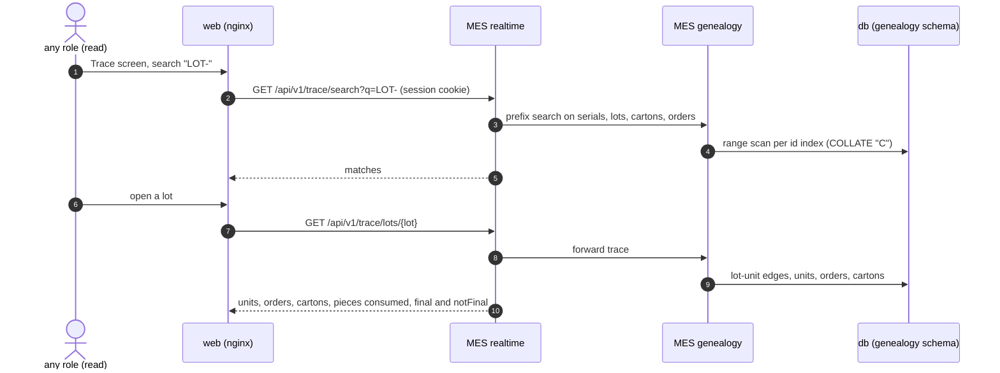

Genealogy rebuilds its links from execution's units and ingest's cycle facts (lots, operator, measurement) and keeps a processed watermark per machine, so every answer says whether it is **final**: every machine of the routing final through the answer's latest record and genealogy past it ([ADR-0034](adr/0034-genealogy-serial-identity-cartons-by-rule-and-trace-finality.md), [ADR-0033](adr/0033-traceability-facts-leak-drift-and-scenario-stock.md); glossary: _Genealogy_, _Unit, serial_, _Lot_, _Carton_). Backward from a serial and from a carton work the same way.

### 6.8 The browser: push and the console (data path 6)

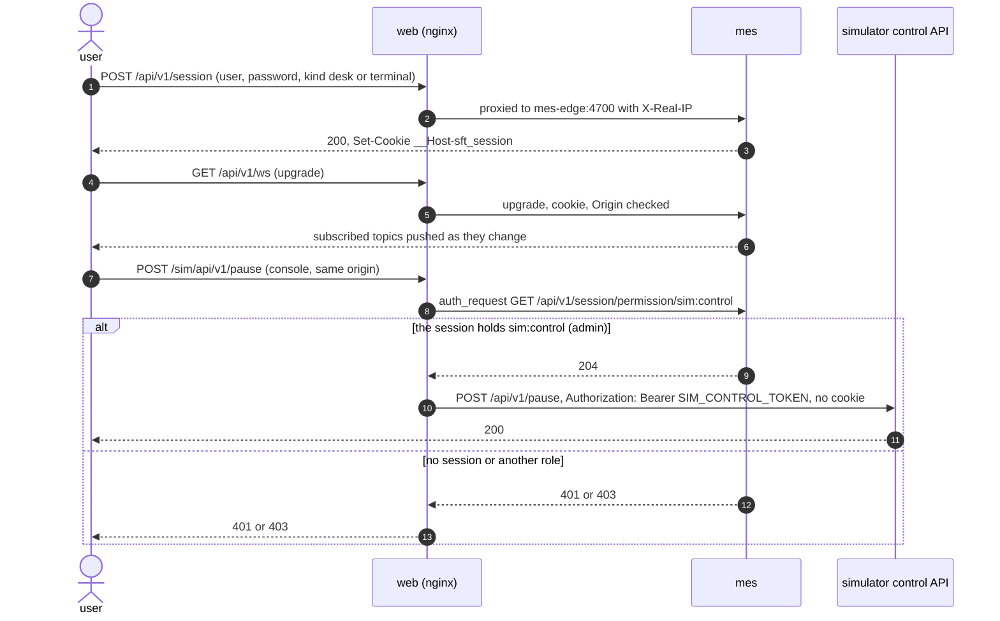

The console talks only to the simulator, through nginx's allowlist (`apps/web/nginx/default.conf.template`; [runbook](runbook.md), "Console run"); a route outside it is 404 and a cross-origin write 403. The WebSocket's topics, limits and close codes are in [api/realtime.md](api/realtime.md) ([ADR-0019](adr/0019-mes-api-decimation-and-push-backpressure.md)); logins are throttled per account and client address ([ADR-0039](adr/0039-mqtt-dynamic-security-https-front-and-login-throttling.md)).

### 6.9 Broker outage: store-and-forward

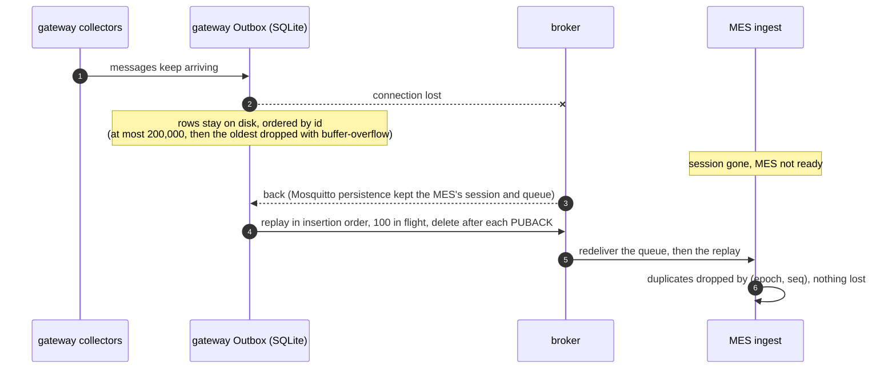

The resilience suite's run R1 restarts the broker and must lose nothing ([runbook](runbook.md), "Resilience suite"; [ADR-0014](adr/0014-store-and-forward-in-sqlite.md); glossary: _Store-and-forward_). The same replay follows a gateway restart for everything committed before it.

### 6.10 Gateway outage: detected loss, resync and replay

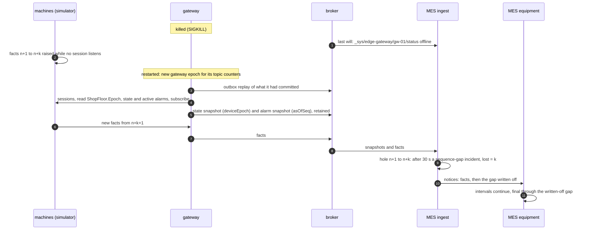

Facts raised while no gateway session listens are history: OPC UA keeps no event history here ([ADR-0009](adr/0009-lossless-opcua-delivery.md) amendment), so the loss is **detected and counted, never hidden**; a late fact still fills its gap. The resilience suite's run R3 kills the gateway while the line runs and checks that the MES's gap numbers equal the facts raised minus those stored ([runbook](runbook.md), "Resilience suite"; glossary: _Gap incident, write-off_, _Anchor_). A machine's OPC UA server going away while the gateway lives loses nothing: the subscription republishes its queue on the reconnect.

## 7. Deployment

One machine, Docker in a Colima VM, one Compose project per stack.

<!-- architecture-check: deployment -->

```mermaid
flowchart TB
    subgraph host ["Developer machine (macOS): the checkout, pnpm, Node 26"]
        loop127["127.0.0.1: 8443, 1883, 4800, 4841-4845, 5020, 4600<br/>(observability: 9090, 3000)"]
        cfg["bind mounts from the checkout:<br/>config/mosquitto, config/prometheus, config/grafana"]
        lock["~/.cache/shopfloor-twin/heavy.lock: one heavy suite at a time"]
        subgraph vm ["Colima VM: Docker Engine, about 4 GiB"]
            subgraph dev ["Compose project shopfloor-twin (the dev stack), images :dev"]
                vol_db_data[("db-data")]
                vol_broker_data[("broker-data")]
                vol_gateway_data[("gateway-data: outbox, command inbox")]
                vol_erp_data[("erp-data")]
                vol_simulator_pki[("simulator-pki")]
                vol_gateway_pki[("gateway-pki")]
                vol_opcua_tools_pki[("opcua-tools-pki")]
                vol_pki_ca[("pki-ca: the dev CA's key")]
                vol_web_tls[("web-tls")]
                vol_prometheus_data[("prometheus-data (observability)")]
            end
            gate["disposable projects of the gate and harnesses<br/>gateNNN, fresh-hex, shopfloor-demo-run, ...<br/>own images :prNNN, generated secrets, ephemeral ports"]
        end
    end
    svc_pki["pki"] -->|"writes"| vol_simulator_pki & vol_gateway_pki & vol_opcua_tools_pki & vol_pki_ca & vol_web_tls
    svc_db["db"] --> vol_db_data
    svc_broker["broker"] --> vol_broker_data
    svc_gateway["gateway"] --> vol_gateway_data & vol_gateway_pki
    svc_simulator["simulator"] --> vol_simulator_pki
    svc_opcua_tools["opcua-tools"] --> vol_opcua_tools_pki
    svc_erp["erp"] --> vol_erp_data
    svc_web["web"] -->|"read-only"| vol_web_tls
    svc_prometheus["prometheus"] --> vol_prometheus_data
    loop127 -->|"published ports, forwarded by Colima"| dev
    cfg --> dev
```

Key: a cylinder is a named volume, a box a service using it (from `docker-compose.yml`, `compose.observability.yml`). Notes:

- **Start:** `sh scripts/stack-init.sh && docker compose up -d --wait` on a fresh clone (README; tested by `pnpm test:fresh-clone`, #277): the init writes `.env` with generated secrets, `up` builds the five images and runs `pki` and `migrate` (section 6.1). `pnpm stack:reset` removes the volumes, so the next `up` makes a new CA and new certificates.
- **Colima shares only the home directory** with its VM: the bind mounts need the checkout under `~` ([runbook](runbook.md)).
- **The gate and the harnesses** (`pnpm gate`, `test:reconcile`, `test:resilience`, `demo`, `test:fresh-clone`, …) run their own projects beside the dev stack, never `shopfloor-twin` and never the `:dev` tag, under the heavy lock with disk floors (25 GiB on the host, 15 GiB in Docker), and remove their containers, volumes and images afterwards ([runbook](runbook.md), "Merge gate"; [ADR-0011](adr/0011-claude-merges-after-independent-review.md) note; glossary: _Gate_, _Heavy lock_).
- **Not in v1:** CI runs (GitHub Actions has not run since PR #149; the local gate stands in), a second host, TLS on MQTT, OpenTelemetry tracing.

## 8. Cross-cutting concepts

**Simulation time, epochs and anchors.** The plant runs on simulated time, 60× by default; every fact carries its plant time (`sourceTime`) and the gateway's wall time (`receivedAt`) ([ADR-0006](adr/0006-simulation-time.md)). A **device epoch** is the simulator process's start: every machine numbers its facts in one sequence per epoch, so a restart shows as a new epoch, not as loss or duplicates; the gateway has an epoch of its own for its topic counters ([ADR-0015](adr/0015-uns-identity-epochs-and-dedup.md)). Retained state and alarm deliveries are **anchors**: they restore current state for a consumer that subscribes, carry their device epoch and never enter dedup or gap checks; an old epoch's anchors are marked stale ([ADR-0017](adr/0017-mes-ingest-acks-anchors-and-gaps.md)). The MES's **plant clock** is the newest epoch's watermark, the latest plant time of any fact in it ([ADR-0018](adr/0018-equipment-intervals-provisional-and-catch-up.md)). Glossary: _Device epoch_, _Anchor_, _Plant clock, watermark_, _Simulation time, speed_.

**Finality.** A machine is **final through** a sequence number when every number up to it has arrived or been written off as a gap; what rests on later numbers is **provisional** and may still change ([ADR-0018](adr/0018-equipment-intervals-provisional-and-catch-up.md)). Order completion and confirmations ([ADR-0031](adr/0031-execution-units-completion-and-confirmations.md)), carton placement and trace answers ([ADR-0034](adr/0034-genealogy-serial-identity-cartons-by-rule-and-trace-finality.md)), the hold close guard ([ADR-0035](adr/0035-quality-holds-derived-scope-and-close-guard.md)) and shift reports ([ADR-0025](adr/0025-shift-instances-report-finality-and-handover-notes.md)) act only on final data, and every API answer that could change says whether it is final. Glossary: _Final, provisional, final through_, _Shift instance, report finality_.

**Delivery guarantees and idempotency.** At least once on every hop, exactly once in effect: QoS 1 everywhere; the gateway's outbox and command inbox commit before they acknowledge ([ADR-0014](adr/0014-store-and-forward-in-sqlite.md), [ADR-0029](adr/0029-command-path-at-least-once-with-device-dedup-and-settled-outcomes.md)); the MES acknowledges only committed facts and deduplicates by (source, epoch, sequence) ([ADR-0017](adr/0017-mes-ingest-acks-anchors-and-gaps.md)); commands are deduplicated by command id on the device and answered from the gateway's result memory; every MES message to the ERP is written to the orders outbox in the transaction that causes it and posted with an idempotency key the ERP mock answers 200 on a replay ([ADR-0028](adr/0028-erp-mock-rest-feed-and-idempotent-messages.md)). A loss that can't be prevented (facts raised while no gateway listens) is detected by the sequence and reported as an incident. Glossary: _Idempotency key_, _Store-and-forward_, _Gap incident, write-off_.

**Identity and the auth model.** People: five roles and twenty permissions (`ROLE_PERMISSIONS`, one table for the MES's checks and the web's menus), sessions in an `HttpOnly` cookie, scrypt passwords, a throttle per account and client address, a bootstrap admin who must change the password, every write audited ([ADR-0026](adr/0026-identity-sessions-roles-and-auth-switch.md), [ADR-0027](adr/0027-database-roles-and-one-audit-log.md), [ADR-0039](adr/0039-mqtt-dynamic-security-https-front-and-login-throttling.md)). The admin role holds only user administration and the console (separation of duties). Machines and services: OPC UA certificates pinned both ways plus two OPC UA users ([ADR-0038](adr/0038-opcua-signandencrypt-pinned-certificates-and-users.md)); MQTT users bound to client ids with per-role topic rights; bearer tokens for the control API and the ERP mock; database roles that separate the migration owner from the application. All secrets come from `.env`, generated by `scripts/stack-init.sh` and never committed ([security review](security-review.md), S7). Glossary: _SignAndEncrypt_, _Pinned certificate_, _Dynamic security_, _Dev CA_.

**Determinism.** A seed and a scenario fix a headless run's event log byte for byte: named random streams per purpose ([ADR-0007](adr/0007-random-streams.md)), simulated time without wall-clock reads in the model ([ADR-0006](adr/0006-simulation-time.md)), the golden scenarios compared by `pnpm test:golden`, and the ground truth (`trace.json`, `line-oee.json`, …) reconciled with what the MES derives live (`pnpm test:reconcile`). A live run is paced by the wall clock, so the MES's view of it is checked against facts, not bytes. Glossary: _Golden scenario_, _Ground truth_, _Reconciliation_, _Timeline_.

## 9. How the views are checked

`scripts/check-architecture.ts` ([source](../scripts/check-architecture.ts); unit tests in `e2e/src/check-architecture.test.ts`) reads the code and this document and fails `pnpm verify` with one line per disagreement:

| View (marker)    | Compared with                                                                                            | Both directions                                       |
| ---------------- | -------------------------------------------------------------------------------------------------------- | ----------------------------------------------------- |
| `containers`     | the `services` of `docker-compose.yml`                                                                   | yes                                                   |
| `observability`  | the `services` of `compose.observability.yml`                                                            | every service shown; it may show the services scraped |
| `deployment`     | the named `volumes` of both Compose files                                                                | yes                                                   |
| `mes-components` | the folders of `apps/mes-server/src/modules`, and the relative imports between them in non-test sources  | yes, nodes and edges                                  |
| `packages`       | the workspace packages and their `workspace:` dependencies (solid) and development dependencies (dotted) | yes, nodes and edges (tooling dev edges exempt)       |
| every block      | any `svc_`, `vol_`, `mod_` or `pkg_` id must name an existing service, volume, module or package         | –                                                     |

Each marked view must occur exactly once (`<!-- architecture-check: <view> -->` just before its block). A flowchart line the script can't read fails it rather than being skipped. Not checked: networks, ports, labels, the other component views, the sequences and the prose; they are kept true by review. The rerun row for `scripts/check-*.ts` is `verify` (runbook, "Merge gate").
