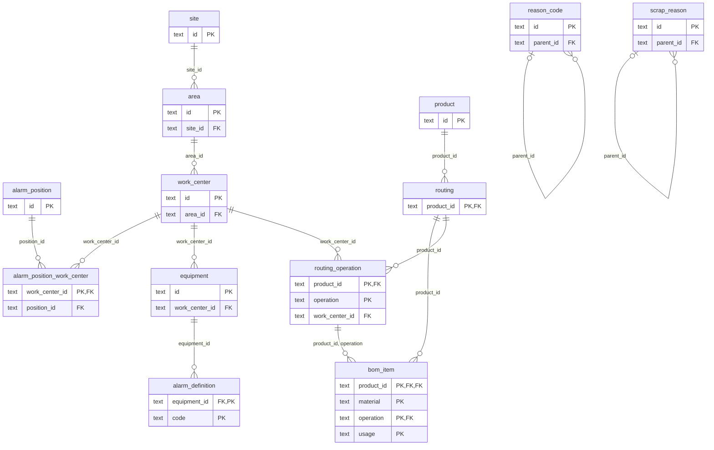
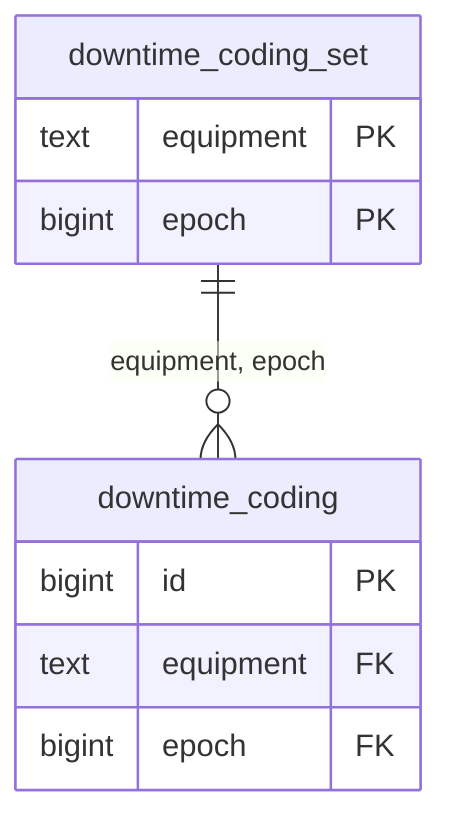
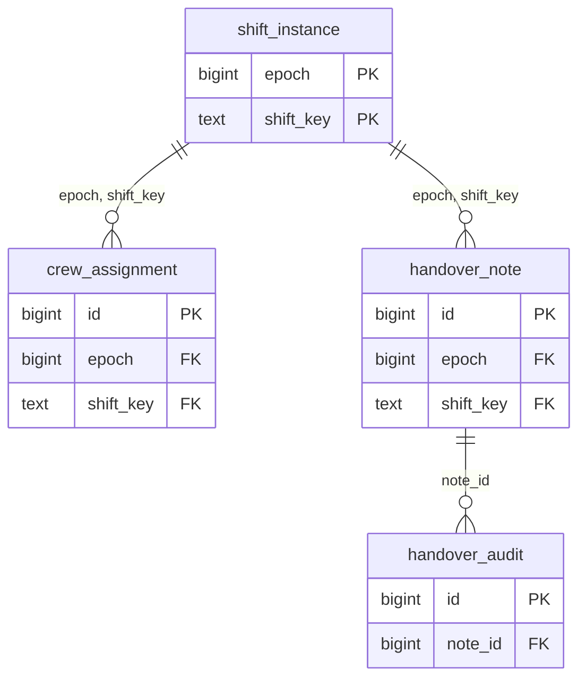
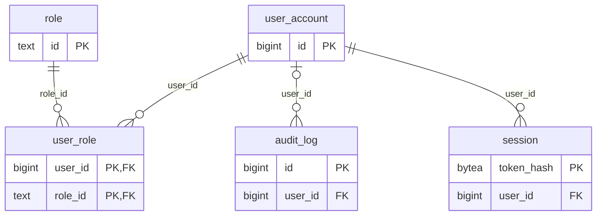
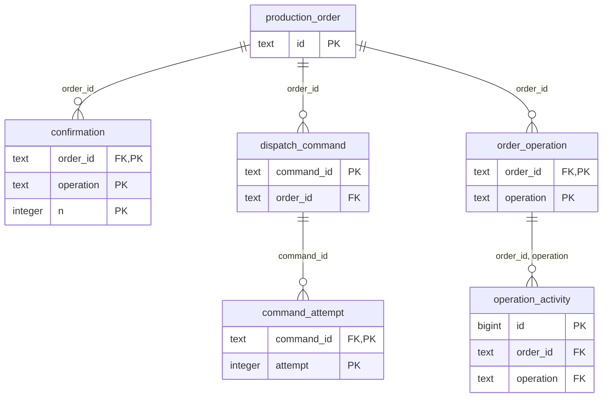
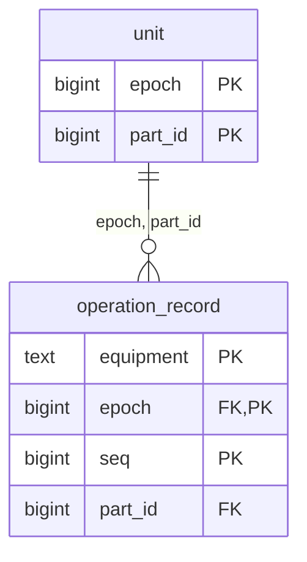
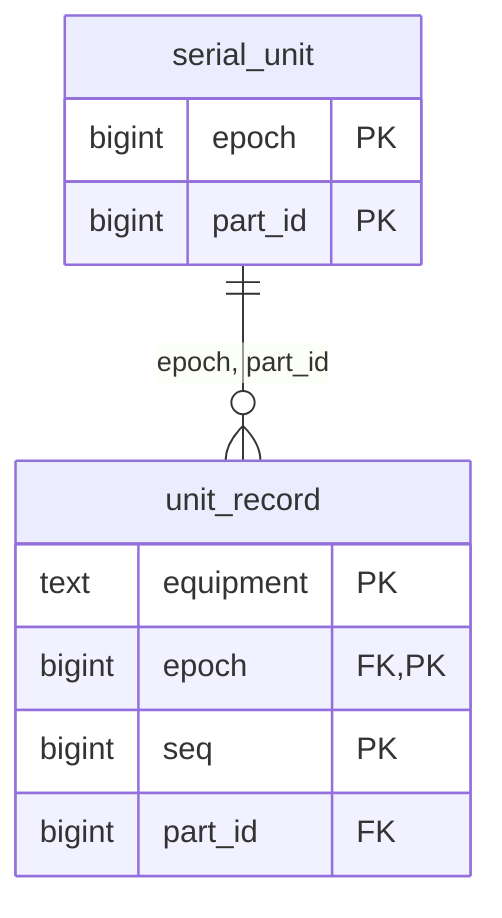
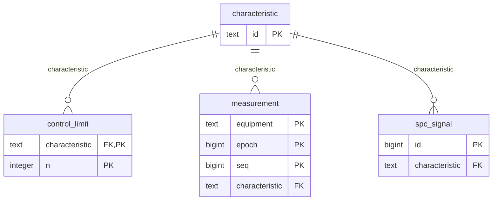

# Data model

<!-- Generated by apps/mes-server/src/db/data-model.ts; do not edit by hand. -->

The MES database after all migrations in `db/migrations`, read from the database itself (`pg_catalog` and `timescaledb_information`). Regenerate with `pnpm --filter @shopfloor/mes-server data-model`; a test in `apps/mes-server/src/db/db.test.ts` fails when this file is out of date.

Each schema belongs to exactly one module of `mes-server` (ADR-0016), and so do its views. Modules read each other only through their interfaces, so there are no foreign keys between schemas: a column named `equipment` holds a `master_data.equipment.id` by convention, and `ingest.state_anchor.arrival` is referenced from `equipment.interval_source.anchor_arrival` the same way, as are `ingest.data_quality_incident` ids from `equipment.bucket_finality.incident_ids`. Times are simulation time unless a column says otherwise (`received_at`, `ingested_at`, `recorded_at`, `updated_at`, `final_at`, `revised_at` and `applied_at` are wall time).

## Contents

- [`master_data`](#schema-master_data)
  - `master_data.alarm_definition`
  - `master_data.alarm_position`
  - `master_data.alarm_position_work_center`
  - `master_data.area`
  - `master_data.bom_item`
  - `master_data.equipment`
  - `master_data.product`
  - `master_data.reason_code`
  - `master_data.routing`
  - `master_data.routing_operation`
  - `master_data.scrap_reason`
  - `master_data.shift_pattern`
  - `master_data.site`
  - `master_data.work_center`
- [`ingest`](#schema-ingest)
  - `ingest.alarm_anchor`
  - `ingest.alarm_snapshot`
  - `ingest.command_result`
  - `ingest.component_status`
  - `ingest.data_quality_incident`
  - `ingest.equipment_event`
  - `ingest.rejected_message`
  - `ingest.source_cursor`
  - `ingest.state_anchor`
  - `ingest.telemetry_sample`
  - `ingest.cycle_hourly` (view)
- [`equipment`](#schema-equipment)
  - `equipment.bucket_finality`
  - `equipment.downtime_audit`
  - `equipment.downtime_coding`
  - `equipment.downtime_coding_set`
  - `equipment.downtime_record`
  - `equipment.equipment_state_interval`
  - `equipment.interval_source`
  - `equipment.state_hourly` (view)
- [`alarms`](#schema-alarms)
  - `alarms.alarm_occurrence`
  - `alarms.alarm_shelf`
  - `alarms.alarm_transition`
  - `alarms.kpi_revision`
  - `alarms.occurrence_source`
  - `alarms.occurrence_state`
- [`shifts`](#schema-shifts)
  - `shifts.crew_assignment`
  - `shifts.handover_audit`
  - `shifts.handover_note`
  - `shifts.shift_instance`
- [`identity`](#schema-identity)
  - `identity.audit_log`
  - `identity.role`
  - `identity.session`
  - `identity.user_account`
  - `identity.user_role`
- [`orders`](#schema-orders)
  - `orders.command_attempt`
  - `orders.confirmation`
  - `orders.dispatch_command`
  - `orders.erp_cursor`
  - `orders.erp_message_log`
  - `orders.operation_activity`
  - `orders.order_incident`
  - `orders.order_operation`
  - `orders.production_order`
- [`execution`](#schema-execution)
  - `execution.execution_incident`
  - `execution.operation_record`
  - `execution.scrap_record`
  - `execution.unit`
- [`genealogy`](#schema-genealogy)
  - `genealogy.carton`
  - `genealogy.genealogy_incident`
  - `genealogy.genealogy_link`
  - `genealogy.material_lot`
  - `genealogy.serial_unit`
  - `genealogy.unit_record`
- [`quality`](#schema-quality)
  - `quality.characteristic`
  - `quality.control_limit`
  - `quality.measurement`
  - `quality.spc_signal`
- [`public`](#schema-public)
  - `public.schema_migrations`

## Hypertables

| Table | Partitioned by | Chunk interval |
| --- | --- | --- |
| `equipment.equipment_state_interval` | `start_time` | 7 days |
| `ingest.equipment_event` | `source_time` | 7 days |
| `ingest.telemetry_sample` | `source_time` | 7 days |

A unique key or primary key on a hypertable must include its partitioning column (a TimescaleDB rule), which is why the fact tables are unique on `(…, seq, source_time)`.

## Continuous aggregates

| View | Over | Bucket | Real-time |
| --- | --- | --- | --- |
| `equipment.state_hourly` | `equipment.equipment_state_interval` | 01:00:00 | yes (`materialized_only = false`) |
| `ingest.cycle_hourly` | `ingest.equipment_event` | 01:00:00 | yes (`materialized_only = false`) |

Real-time: rows below the aggregate’s watermark come from its materialisation, rows above it from the table. There are no refresh policies: the owning module refreshes explicitly (ADR-0022).

## Roles and grants

Migrations run as the bootstrap superuser under `SET ROLE mes_owner`, so `mes_owner` (no login) owns every schema, table, view and function; `mes_cagg` (no login) owns the two continuous aggregates, the one role that may refresh them; the MES connects as `mes_app`, which owns nothing, and assumes `mes_cagg` (a membership without inherited rights) only to refresh (ADR-0027). The grants are `DECLARED_GRANTS` in `apps/mes-server/src/db/grants.ts`, which a test compares with the database.

| Object | Owner | `mes_app` | `mes_cagg` |
| --- | --- | --- | --- |
| `alarms` | `mes_owner` | USAGE |  |
| `alarms.alarm_occurrence` | `mes_owner` | DELETE, INSERT, SELECT, UPDATE |  |
| `alarms.alarm_shelf` | `mes_owner` | DELETE, INSERT, SELECT, UPDATE |  |
| `alarms.alarm_transition` | `mes_owner` | INSERT, SELECT |  |
| `alarms.kpi_revision` | `mes_owner` | DELETE, INSERT, SELECT, UPDATE |  |
| `alarms.occurrence_source` | `mes_owner` | DELETE, INSERT, SELECT, UPDATE |  |
| `alarms.occurrence_state` | `mes_owner` | INSERT, SELECT |  |
| `equipment` | `mes_owner` | USAGE | USAGE |
| `equipment.bucket_finality` | `mes_owner` | DELETE, INSERT, SELECT, UPDATE |  |
| `equipment.downtime_audit` | `mes_owner` | SELECT |  |
| `equipment.downtime_coding` | `mes_owner` | DELETE, INSERT, SELECT, UPDATE |  |
| `equipment.downtime_coding_set` | `mes_owner` | DELETE, INSERT, SELECT, UPDATE |  |
| `equipment.downtime_record` | `mes_owner` | DELETE, INSERT, SELECT, UPDATE |  |
| `equipment.equipment_state_interval` | `mes_owner` | DELETE, INSERT, SELECT, UPDATE | SELECT |
| `equipment.interval_source` | `mes_owner` | DELETE, INSERT, SELECT, UPDATE |  |
| `equipment.state_hourly` | `mes_cagg` | SELECT |  |
| `execution` | `mes_owner` | USAGE |  |
| `execution.execution_incident` | `mes_owner` | INSERT, SELECT, UPDATE |  |
| `execution.operation_record` | `mes_owner` | DELETE, INSERT, SELECT, UPDATE |  |
| `execution.scrap_record` | `mes_owner` | INSERT, SELECT, UPDATE |  |
| `execution.unit` | `mes_owner` | DELETE, INSERT, SELECT, UPDATE |  |
| `genealogy` | `mes_owner` | USAGE |  |
| `genealogy.carton` | `mes_owner` | DELETE, INSERT, SELECT, UPDATE |  |
| `genealogy.genealogy_incident` | `mes_owner` | INSERT, SELECT, UPDATE |  |
| `genealogy.genealogy_link` | `mes_owner` | DELETE, INSERT, SELECT, UPDATE |  |
| `genealogy.material_lot` | `mes_owner` | INSERT, SELECT, UPDATE |  |
| `genealogy.serial_unit` | `mes_owner` | DELETE, INSERT, SELECT, UPDATE |  |
| `genealogy.unit_record` | `mes_owner` | DELETE, INSERT, SELECT, UPDATE |  |
| `identity` | `mes_owner` | USAGE |  |
| `identity.audit_log` | `mes_owner` | INSERT, SELECT |  |
| `identity.role` | `mes_owner` | DELETE, INSERT, SELECT, UPDATE |  |
| `identity.session` | `mes_owner` | DELETE, INSERT, SELECT, UPDATE |  |
| `identity.user_account` | `mes_owner` | DELETE, INSERT, SELECT, UPDATE |  |
| `identity.user_role` | `mes_owner` | DELETE, INSERT, SELECT, UPDATE |  |
| `ingest` | `mes_owner` | USAGE | USAGE |
| `ingest.alarm_anchor` | `mes_owner` | DELETE, INSERT, SELECT, UPDATE |  |
| `ingest.alarm_snapshot` | `mes_owner` | DELETE, INSERT, SELECT, UPDATE |  |
| `ingest.command_result` | `mes_owner` | DELETE, INSERT, SELECT, UPDATE |  |
| `ingest.component_status` | `mes_owner` | DELETE, INSERT, SELECT, UPDATE |  |
| `ingest.cycle_hourly` | `mes_cagg` | SELECT |  |
| `ingest.data_quality_incident` | `mes_owner` | DELETE, INSERT, SELECT, UPDATE |  |
| `ingest.equipment_event` | `mes_owner` | DELETE, INSERT, SELECT, UPDATE | SELECT |
| `ingest.rejected_message` | `mes_owner` | DELETE, INSERT, SELECT, UPDATE |  |
| `ingest.source_cursor` | `mes_owner` | DELETE, INSERT, SELECT, UPDATE |  |
| `ingest.state_anchor` | `mes_owner` | DELETE, INSERT, SELECT, UPDATE |  |
| `ingest.telemetry_sample` | `mes_owner` | DELETE, INSERT, SELECT, UPDATE |  |
| `master_data` | `mes_owner` | USAGE |  |
| `master_data.alarm_definition` | `mes_owner` | DELETE, INSERT, SELECT, UPDATE |  |
| `master_data.alarm_position` | `mes_owner` | DELETE, INSERT, SELECT, UPDATE |  |
| `master_data.alarm_position_work_center` | `mes_owner` | DELETE, INSERT, SELECT, UPDATE |  |
| `master_data.area` | `mes_owner` | DELETE, INSERT, SELECT, UPDATE |  |
| `master_data.bom_item` | `mes_owner` | DELETE, INSERT, SELECT, UPDATE |  |
| `master_data.equipment` | `mes_owner` | DELETE, INSERT, SELECT, UPDATE |  |
| `master_data.product` | `mes_owner` | DELETE, INSERT, SELECT, UPDATE |  |
| `master_data.reason_code` | `mes_owner` | DELETE, INSERT, SELECT, UPDATE |  |
| `master_data.routing` | `mes_owner` | DELETE, INSERT, SELECT, UPDATE |  |
| `master_data.routing_operation` | `mes_owner` | DELETE, INSERT, SELECT, UPDATE |  |
| `master_data.scrap_reason` | `mes_owner` | DELETE, INSERT, SELECT, UPDATE |  |
| `master_data.shift_pattern` | `mes_owner` | DELETE, INSERT, SELECT, UPDATE |  |
| `master_data.site` | `mes_owner` | DELETE, INSERT, SELECT, UPDATE |  |
| `master_data.work_center` | `mes_owner` | DELETE, INSERT, SELECT, UPDATE |  |
| `orders` | `mes_owner` | USAGE |  |
| `orders.command_attempt` | `mes_owner` | INSERT, SELECT, UPDATE |  |
| `orders.confirmation` | `mes_owner` | INSERT, SELECT |  |
| `orders.dispatch_command` | `mes_owner` | INSERT, SELECT, UPDATE |  |
| `orders.erp_cursor` | `mes_owner` | INSERT, SELECT, UPDATE |  |
| `orders.erp_message_log` | `mes_owner` | INSERT, SELECT, UPDATE |  |
| `orders.operation_activity` | `mes_owner` | INSERT, SELECT, UPDATE |  |
| `orders.order_incident` | `mes_owner` | INSERT, SELECT, UPDATE |  |
| `orders.order_operation` | `mes_owner` | DELETE, INSERT, SELECT, UPDATE |  |
| `orders.production_order` | `mes_owner` | INSERT, SELECT, UPDATE |  |
| `public.schema_migrations` | `mes_owner` | SELECT |  |
| `quality` | `mes_owner` | USAGE |  |
| `quality.characteristic` | `mes_owner` | INSERT, SELECT, UPDATE |  |
| `quality.control_limit` | `mes_owner` | INSERT, SELECT |  |
| `quality.measurement` | `mes_owner` | DELETE, INSERT, SELECT, UPDATE |  |
| `quality.spc_signal` | `mes_owner` | DELETE, INSERT, SELECT, UPDATE |  |
| `shifts` | `mes_owner` | USAGE |  |
| `shifts.crew_assignment` | `mes_owner` | DELETE, INSERT, SELECT, UPDATE |  |
| `shifts.handover_audit` | `mes_owner` | SELECT |  |
| `shifts.handover_note` | `mes_owner` | INSERT, SELECT, UPDATE |  |
| `shifts.shift_instance` | `mes_owner` | DELETE, INSERT, SELECT, UPDATE |  |

## Relationships

Schema master_data:



Schema equipment:



Schema shifts:



Schema identity:



Schema orders:



Schema execution:



Schema genealogy:



Schema quality:



The other schemas have no foreign keys; their references are by value, as described above.

## Schema master_data

Owner: master-data. The ISA-95 equipment hierarchy, products, the shift pattern, the downtime and scrap reason trees, routings with their BOMs, and the alarm definitions and operator positions, seeded from `config/plant`.

### master_data.alarm_definition

One alarm point per (equipment, code) from alarms.yaml: priority, operator text, consequence and response; inactive once the configuration drops it (#141, ADR-0024).

| Column | Type | Null | Default |
| --- | --- | --- | --- |
| `equipment_id` | `text` | not null |  |
| `code` | `text` | not null |  |
| `priority` | `text` | not null |  |
| `text` | `text` | not null |  |
| `consequence` | `text` | null |  |
| `response` | `text` | null |  |
| `position` | `integer` | not null |  |
| `active` | `boolean` | not null | `true` |

| Kind | Name | Definition |
| --- | --- | --- |
| Primary key | `alarm_definition_pkey` | `PRIMARY KEY (equipment_id, code)` |
| Foreign key | `alarm_definition_equipment_id_fkey` | `FOREIGN KEY (equipment_id) REFERENCES master_data.equipment(id)` |
| Check | `alarm_definition_priority_check` | `CHECK ((priority = ANY (ARRAY['high'::text, 'medium'::text, 'low'::text])))` |

### master_data.alarm_position

Operator positions for alarm KPIs from alarms.yaml (a set of work centers until operators log in); inactive once the configuration drops one (#141).

| Column | Type | Null | Default |
| --- | --- | --- | --- |
| `id` | `text` | not null |  |
| `name` | `text` | not null |  |
| `position` | `integer` | not null |  |
| `active` | `boolean` | not null | `true` |

| Kind | Name | Definition |
| --- | --- | --- |
| Primary key | `alarm_position_pkey` | `PRIMARY KEY (id)` |
| Check | `alarm_position_id_check` | `CHECK ((id <> 'plant'::text))` |

### master_data.alarm_position_work_center

The position each work center belongs to; rewritten on every seed (#141).

| Column | Type | Null | Default |
| --- | --- | --- | --- |
| `work_center_id` | `text` | not null |  |
| `position_id` | `text` | not null |  |

| Kind | Name | Definition |
| --- | --- | --- |
| Primary key | `alarm_position_work_center_pkey` | `PRIMARY KEY (work_center_id)` |
| Foreign key | `alarm_position_work_center_position_id_fkey` | `FOREIGN KEY (position_id) REFERENCES master_data.alarm_position(id)` |
| Foreign key | `alarm_position_work_center_work_center_id_fkey` | `FOREIGN KEY (work_center_id) REFERENCES master_data.work_center(id)` |

### master_data.area

Areas of the site.

| Column | Type | Null | Default |
| --- | --- | --- | --- |
| `id` | `text` | not null |  |
| `site_id` | `text` | not null |  |
| `name` | `text` | not null |  |

| Kind | Name | Definition |
| --- | --- | --- |
| Primary key | `area_pkey` | `PRIMARY KEY (id)` |
| Foreign key | `area_site_id_fkey` | `FOREIGN KEY (site_id) REFERENCES master_data.site(id)` |

### master_data.bom_item

Materials an operation consumes per unit: the blank at OP10, components and rework components at OP30 (`standard` or `rework`) (#174).

| Column | Type | Null | Default |
| --- | --- | --- | --- |
| `product_id` | `text` | not null |  |
| `material` | `text` | not null |  |
| `operation` | `text` | not null |  |
| `quantity_per_unit` | `integer` | not null |  |
| `usage` | `text` | not null |  |

| Kind | Name | Definition |
| --- | --- | --- |
| Primary key | `bom_item_pkey` | `PRIMARY KEY (product_id, material, operation, usage)` |
| Foreign key | `bom_item_product_id_fkey` | `FOREIGN KEY (product_id) REFERENCES master_data.routing(product_id)` |
| Foreign key | `bom_item_product_id_operation_fkey` | `FOREIGN KEY (product_id, operation) REFERENCES master_data.routing_operation(product_id, operation)` |
| Check | `bom_item_quantity_per_unit_check` | `CHECK ((quantity_per_unit >= 1))` |
| Check | `bom_item_usage_check` | `CHECK ((usage = ANY (ARRAY['standard'::text, 'rework'::text])))` |

### master_data.equipment

The machines, with their operation, interface and position in the line.

| Column | Type | Null | Default |
| --- | --- | --- | --- |
| `id` | `text` | not null |  |
| `work_center_id` | `text` | not null |  |
| `name` | `text` | not null |  |
| `operation` | `text` | not null |  |
| `interface` | `text` | not null |  |
| `position` | `integer` | not null |  |

| Kind | Name | Definition |
| --- | --- | --- |
| Primary key | `equipment_pkey` | `PRIMARY KEY (id)` |
| Foreign key | `equipment_work_center_id_fkey` | `FOREIGN KEY (work_center_id) REFERENCES master_data.work_center(id)` |
| Check | `equipment_interface_check` | `CHECK ((interface = ANY (ARRAY['opcua'::text, 'modbus'::text])))` |

### master_data.product

Products and their ideal cycle time per operation.

| Column | Type | Null | Default |
| --- | --- | --- | --- |
| `id` | `text` | not null |  |
| `name` | `text` | not null |  |
| `ideal_cycle_seconds` | `jsonb` | not null |  |

| Kind | Name | Definition |
| --- | --- | --- |
| Primary key | `product_pkey` | `PRIMARY KEY (id)` |

### master_data.reason_code

The downtime reason tree from reasons.yaml: id (its path), parent and name; inactive once the configuration drops it (#119).

| Column | Type | Null | Default |
| --- | --- | --- | --- |
| `id` | `text` | not null |  |
| `parent_id` | `text` | null |  |
| `name` | `text` | not null |  |
| `position` | `integer` | not null |  |
| `active` | `boolean` | not null | `true` |

| Kind | Name | Definition |
| --- | --- | --- |
| Primary key | `reason_code_pkey` | `PRIMARY KEY (id)` |
| Foreign key | `reason_code_parent_id_fkey` | `FOREIGN KEY (parent_id) REFERENCES master_data.reason_code(id)` |
| Check | `reason_code_check` | `CHECK ((((parent_id IS NULL) AND (POSITION(('/'::text) IN (id)) = 0)) OR ((parent_id IS NOT NULL) AND (id = ((parent_id \|\| '/'::text) \|\| split_part(id, '/'::text, '-1'::integer))))))` |

### master_data.routing

Each product’s routing, with the changeover time to it for the dispatch rule (#174).

| Column | Type | Null | Default |
| --- | --- | --- | --- |
| `product_id` | `text` | not null |  |
| `changeover_minutes` | `integer` | not null |  |

| Kind | Name | Definition |
| --- | --- | --- |
| Primary key | `routing_pkey` | `PRIMARY KEY (product_id)` |
| Foreign key | `routing_product_id_fkey` | `FOREIGN KEY (product_id) REFERENCES master_data.product(id)` |
| Check | `routing_changeover_minutes_check` | `CHECK ((changeover_minutes >= 0))` |

### master_data.routing_operation

The operations of a routing in order, the work center of the equipment that runs each and the product’s ideal cycle there; built by `routingAndBom` like the ERP’s (#174).

| Column | Type | Null | Default |
| --- | --- | --- | --- |
| `product_id` | `text` | not null |  |
| `operation` | `text` | not null |  |
| `position` | `integer` | not null |  |
| `work_center_id` | `text` | not null |  |
| `ideal_cycle_ms` | `bigint` | not null |  |

| Kind | Name | Definition |
| --- | --- | --- |
| Primary key | `routing_operation_pkey` | `PRIMARY KEY (product_id, operation)` |
| Unique | `routing_operation_product_id_position_key` | `UNIQUE (product_id, "position")` |
| Foreign key | `routing_operation_product_id_fkey` | `FOREIGN KEY (product_id) REFERENCES master_data.routing(product_id)` |
| Foreign key | `routing_operation_work_center_id_fkey` | `FOREIGN KEY (work_center_id) REFERENCES master_data.work_center(id)` |
| Check | `routing_operation_ideal_cycle_ms_check` | `CHECK ((ideal_cycle_ms > 0))` |
| Check | `routing_operation_operation_check` | `CHECK ((operation ~ '^OP[0-9]{2}$'::text))` |
| Check | `routing_operation_position_check` | `CHECK (("position" >= 0))` |

### master_data.scrap_reason

The scrap reason tree from `scrap.yaml`: each machine scrap reason (DIMENSIONAL, LEAK) a top node, the detailed reasons below it; retired ones kept inactive (#175).

| Column | Type | Null | Default |
| --- | --- | --- | --- |
| `id` | `text` | not null |  |
| `parent_id` | `text` | null |  |
| `name` | `text` | not null |  |
| `position` | `integer` | not null |  |
| `active` | `boolean` | not null | `true` |

| Kind | Name | Definition |
| --- | --- | --- |
| Primary key | `scrap_reason_pkey` | `PRIMARY KEY (id)` |
| Foreign key | `scrap_reason_parent_id_fkey` | `FOREIGN KEY (parent_id) REFERENCES master_data.scrap_reason(id)` |
| Check | `scrap_reason_check` | `CHECK ((((parent_id IS NULL) AND (POSITION(('/'::text) IN (id)) = 0)) OR ((parent_id IS NOT NULL) AND (id = ((parent_id \|\| '/'::text) \|\| split_part(id, '/'::text, '-1'::integer))))))` |

### master_data.shift_pattern

The shift pattern: time zone, workdays and shifts.

| Column | Type | Null | Default |
| --- | --- | --- | --- |
| `id` | `text` | not null |  |
| `time_zone` | `text` | not null |  |
| `workdays` | `text[]` | not null |  |
| `shifts` | `jsonb` | not null |  |

| Kind | Name | Definition |
| --- | --- | --- |
| Primary key | `shift_pattern_pkey` | `PRIMARY KEY (id)` |

### master_data.site

The site and its enterprise (ISA-95 levels 4 and 3).

| Column | Type | Null | Default |
| --- | --- | --- | --- |
| `id` | `text` | not null |  |
| `name` | `text` | not null |  |
| `enterprise_id` | `text` | not null |  |
| `enterprise_name` | `text` | not null |  |

| Kind | Name | Definition |
| --- | --- | --- |
| Primary key | `site_pkey` | `PRIMARY KEY (id)` |

### master_data.work_center

Work centers (lines) of an area.

| Column | Type | Null | Default |
| --- | --- | --- | --- |
| `id` | `text` | not null |  |
| `area_id` | `text` | not null |  |
| `name` | `text` | not null |  |

| Kind | Name | Definition |
| --- | --- | --- |
| Primary key | `work_center_pkey` | `PRIMARY KEY (id)` |
| Foreign key | `work_center_area_id_fkey` | `FOREIGN KEY (area_id) REFERENCES master_data.area(id)` |

## Schema ingest

Owner: ingest. Every UNS message the MES receives, stored idempotently (ADR-0015, ADR-0017), with dedup state, data-quality incidents and rejected messages.

### ingest.alarm_anchor

Retained alarm deliveries: the device’s last fact per (equipment, device epoch, code), highest seq wins; stale once a newer epoch of the equipment is known. Never a fact (#141).

| Column | Type | Null | Default |
| --- | --- | --- | --- |
| `equipment` | `text` | not null |  |
| `epoch` | `bigint` | not null |  |
| `code` | `text` | not null |  |
| `seq` | `bigint` | not null |  |
| `transition` | `text` | not null |  |
| `severity` | `integer` | not null |  |
| `source_time` | `timestamp with time zone` | not null |  |
| `quality` | `text` | not null |  |
| `received_at` | `timestamp with time zone` | not null |  |
| `ingested_at` | `timestamp with time zone` | not null | `now()` |
| `stale` | `boolean` | not null | `false` |
| `payload` | `jsonb` | not null |  |

| Kind | Name | Definition |
| --- | --- | --- |
| Primary key | `alarm_anchor_pkey` | `PRIMARY KEY (equipment, epoch, code)` |
| Check | `alarm_anchor_quality_check` | `CHECK ((quality = ANY (ARRAY['good'::text, 'uncertain'::text, 'bad'::text])))` |
| Check | `alarm_anchor_transition_check` | `CHECK ((transition = ANY (ARRAY['active'::text, 'cleared'::text])))` |

### ingest.alarm_snapshot

The gateway’s alarm snapshot on resync: active codes at a device sequence (asOfSeq), the latest per (equipment, device epoch); stale like anchors; outside dedup and gap checks (#141).

| Column | Type | Null | Default |
| --- | --- | --- | --- |
| `equipment` | `text` | not null |  |
| `device_epoch` | `bigint` | not null |  |
| `as_of_seq` | `bigint` | not null |  |
| `active` | `text[]` | not null |  |
| `epoch` | `bigint` | not null |  |
| `seq` | `bigint` | not null |  |
| `source_time` | `timestamp with time zone` | not null |  |
| `quality` | `text` | not null |  |
| `source_protocol` | `text` | not null |  |
| `received_at` | `timestamp with time zone` | not null |  |
| `ingested_at` | `timestamp with time zone` | not null | `now()` |
| `stale` | `boolean` | not null | `false` |
| `payload` | `jsonb` | not null |  |

| Kind | Name | Definition |
| --- | --- | --- |
| Primary key | `alarm_snapshot_pkey` | `PRIMARY KEY (equipment, device_epoch)` |
| Check | `alarm_snapshot_quality_check` | `CHECK ((quality = ANY (ARRAY['good'::text, 'uncertain'::text, 'bad'::text])))` |

### ingest.command_result

The gateway’s answers to command deliveries (`cmd-res`), a topic stream deduplicated by its cursor; several per command id, read with ADR-0029’s precedence by the orders module (#174).

| Column | Type | Null | Default |
| --- | --- | --- | --- |
| `arrival` | `bigint` | not null | `generated always as identity` |
| `topic` | `text` | not null |  |
| `equipment` | `text` | not null |  |
| `epoch` | `bigint` | not null |  |
| `seq` | `bigint` | not null |  |
| `command_id` | `text` | not null |  |
| `order_id` | `text` | not null |  |
| `device_epoch` | `bigint` | not null |  |
| `expires_at` | `timestamp with time zone` | not null |  |
| `result` | `text` | not null |  |
| `responded_at` | `timestamp with time zone` | not null |  |
| `ingested_at` | `timestamp with time zone` | not null | `now()` |
| `payload` | `jsonb` | not null |  |

| Kind | Name | Definition |
| --- | --- | --- |
| Primary key | `command_result_pkey` | `PRIMARY KEY (arrival)` |
| Unique | `command_result_topic_epoch_seq_key` | `UNIQUE (topic, epoch, seq)` |
| Check | `command_result_result_check` | `CHECK ((result = ANY (ARRAY['accepted'::text, 'duplicate'::text, 'rejected'::text, 'expired'::text, 'unknown'::text])))` |
| Index | `command_result_command` | `ingest.command_result USING btree (command_id, device_epoch)` |

### ingest.component_status

Latest online/offline status of each component (last will).

| Column | Type | Null | Default |
| --- | --- | --- | --- |
| `component` | `text` | not null |  |
| `instance` | `text` | not null |  |
| `status` | `text` | not null |  |
| `started_at` | `timestamp with time zone` | not null |  |
| `version` | `text` | not null |  |
| `source_time` | `timestamp with time zone` | not null |  |
| `received_at` | `timestamp with time zone` | not null | `now()` |
| `payload` | `jsonb` | not null |  |

| Kind | Name | Definition |
| --- | --- | --- |
| Primary key | `component_status_pkey` | `PRIMARY KEY (component, instance)` |
| Check | `component_status_status_check` | `CHECK ((status = ANY (ARRAY['online'::text, 'offline'::text])))` |

### ingest.data_quality_incident

Sequence gaps found by the MES and incidents reported by the gateway.

| Column | Type | Null | Default |
| --- | --- | --- | --- |
| `id` | `bigint` | not null | `generated always as identity` |
| `origin` | `text` | not null |  |
| `type` | `text` | not null |  |
| `stream` | `text` | not null |  |
| `epoch` | `bigint` | not null |  |
| `seq_from` | `bigint` | not null |  |
| `seq_to` | `bigint` | not null |  |
| `equipment` | `text` | null |  |
| `lost` | `bigint` | null |  |
| `message` | `text` | not null |  |
| `source_time` | `timestamp with time zone` | null |  |
| `detected_at` | `timestamp with time zone` | not null |  |
| `closed_at` | `timestamp with time zone` | null |  |
| `resolution` | `text` | null |  |
| `payload` | `jsonb` | null |  |

| Kind | Name | Definition |
| --- | --- | --- |
| Primary key | `data_quality_incident_pkey` | `PRIMARY KEY (id)` |
| Unique | `data_quality_incident_origin_stream_epoch_seq_from_key` | `UNIQUE (origin, stream, epoch, seq_from)` |
| Check | `data_quality_incident_origin_check` | `CHECK ((origin = ANY (ARRAY['mes'::text, 'gateway'::text])))` |
| Check | `data_quality_incident_resolution_check` | `CHECK ((resolution = ANY (ARRAY['filled'::text, 'epoch-ended'::text])))` |

### ingest.equipment_event

Device facts (state changes, cycles, alarm transitions, job transitions from #174), one stream per equipment; deduplicated by the unique key.

TimescaleDB hypertable, partitioned by `source_time` in chunks of 7 days.

| Column | Type | Null | Default |
| --- | --- | --- | --- |
| `equipment` | `text` | not null |  |
| `epoch` | `bigint` | not null |  |
| `seq` | `bigint` | not null |  |
| `source_time` | `timestamp with time zone` | not null |  |
| `event_type` | `text` | not null |  |
| `topic` | `text` | not null |  |
| `state` | `text` | null |  |
| `cause` | `text` | null |  |
| `quality` | `text` | not null |  |
| `source_protocol` | `text` | not null |  |
| `received_at` | `timestamp with time zone` | not null |  |
| `ingested_at` | `timestamp with time zone` | not null | `now()` |
| `payload` | `jsonb` | not null |  |

| Kind | Name | Definition |
| --- | --- | --- |
| Unique | `equipment_event_equipment_epoch_seq_source_time_key` | `UNIQUE (equipment, epoch, seq, source_time)` |
| Check | `equipment_event_check` | `CHECK (((event_type = 'state'::text) = (state IS NOT NULL)))` |
| Check | `equipment_event_event_type_check` | `CHECK ((event_type = ANY (ARRAY['state'::text, 'cycle'::text, 'alarm'::text, 'job'::text])))` |
| Check | `equipment_event_quality_check` | `CHECK ((quality = ANY (ARRAY['good'::text, 'uncertain'::text, 'bad'::text])))` |
| Index | `equipment_event_alarm` | `ingest.equipment_event USING btree (equipment, epoch, seq) WHERE (event_type = 'alarm'::text)` |
| Index | `equipment_event_cycle_lots` | `ingest.equipment_event USING gin ((((payload -> 'value'::text) -> 'lots'::text)) jsonb_path_ops) WHERE (event_type = 'cycle'::text)` |
| Index | `equipment_event_cycle_part` | `ingest.equipment_event USING btree (epoch, ((((payload -> 'value'::text) ->> 'partId'::text))::bigint)) WHERE (event_type = 'cycle'::text)` |
| Index | `equipment_event_job_command` | `ingest.equipment_event USING btree ((((payload -> 'value'::text) ->> 'commandId'::text)), equipment, epoch) WHERE (event_type = 'job'::text)` |
| Index | `equipment_event_source_time_idx` | `ingest.equipment_event USING btree (source_time DESC)` |

### ingest.rejected_message

Messages that failed validation, came with a stale epoch or could not be stored: never dropped silently.

| Column | Type | Null | Default |
| --- | --- | --- | --- |
| `id` | `bigint` | not null | `generated always as identity` |
| `topic` | `text` | not null |  |
| `payload` | `text` | not null |  |
| `retained` | `boolean` | not null |  |
| `reason` | `text` | not null |  |
| `detail` | `text` | not null |  |
| `received_at` | `timestamp with time zone` | not null | `now()` |

| Kind | Name | Definition |
| --- | --- | --- |
| Primary key | `rejected_message_pkey` | `PRIMARY KEY (id)` |
| Check | `rejected_message_reason_check` | `CHECK ((reason = ANY (ARRAY['invalid-json'::text, 'invalid-payload'::text, 'topic-mismatch'::text, 'unexpected-topic'::text, 'stale-epoch'::text, 'unstorable'::text, 'trace-dropped'::text])))` |

### ingest.source_cursor

Durable dedup and gap state per stream: current epoch, sequence ranges seen, gaps already reported.

| Column | Type | Null | Default |
| --- | --- | --- | --- |
| `stream` | `text` | not null |  |
| `epoch` | `bigint` | not null |  |
| `seen` | `jsonb` | not null |  |
| `reported` | `jsonb` | not null |  |
| `updated_at` | `timestamp with time zone` | not null | `now()` |

| Kind | Name | Definition |
| --- | --- | --- |
| Primary key | `source_cursor_pkey` | `PRIMARY KEY (stream)` |

### ingest.state_anchor

Retained deliveries and state snapshots: the starting state of an (equipment, device epoch) when no fact gives one yet.

| Column | Type | Null | Default |
| --- | --- | --- | --- |
| `arrival` | `bigint` | not null | `generated always as identity` |
| `equipment` | `text` | not null |  |
| `kind` | `text` | not null |  |
| `retained` | `boolean` | not null |  |
| `scope` | `text` | not null |  |
| `epoch` | `bigint` | not null |  |
| `seq` | `bigint` | not null |  |
| `source_time` | `timestamp with time zone` | not null |  |
| `device_epoch` | `bigint` | null |  |
| `superseded` | `boolean` | not null | `false` |
| `state` | `text` | not null |  |
| `cause` | `text` | null |  |
| `quality` | `text` | not null |  |
| `received_at` | `timestamp with time zone` | not null |  |
| `ingested_at` | `timestamp with time zone` | not null | `now()` |
| `payload` | `jsonb` | not null |  |

| Kind | Name | Definition |
| --- | --- | --- |
| Primary key | `state_anchor_pkey` | `PRIMARY KEY (arrival)` |
| Unique | `state_anchor_equipment_scope_epoch_seq_key` | `UNIQUE (equipment, scope, epoch, seq)` |
| Check | `state_anchor_kind_check` | `CHECK ((kind = ANY (ARRAY['event'::text, 'snapshot'::text])))` |
| Check | `state_anchor_quality_check` | `CHECK ((quality = ANY (ARRAY['good'::text, 'uncertain'::text, 'bad'::text])))` |
| Check | `state_anchor_scope_check` | `CHECK ((scope = ANY (ARRAY['device'::text, 'topic'::text])))` |
| Index | `state_anchor_epoch` | `ingest.state_anchor USING btree (equipment, device_epoch, arrival)` |

### ingest.telemetry_sample

Sampled process values, one stream per telemetry topic.

TimescaleDB hypertable, partitioned by `source_time` in chunks of 7 days.

| Column | Type | Null | Default |
| --- | --- | --- | --- |
| `topic` | `text` | not null |  |
| `equipment` | `text` | not null |  |
| `name` | `text` | not null |  |
| `epoch` | `bigint` | not null |  |
| `seq` | `bigint` | not null |  |
| `source_time` | `timestamp with time zone` | not null |  |
| `value` | `double precision` | not null |  |
| `unit` | `text` | not null |  |
| `quality` | `text` | not null |  |
| `source_protocol` | `text` | not null |  |
| `received_at` | `timestamp with time zone` | not null |  |
| `ingested_at` | `timestamp with time zone` | not null | `now()` |
| `payload` | `jsonb` | not null |  |

| Kind | Name | Definition |
| --- | --- | --- |
| Unique | `telemetry_sample_topic_epoch_seq_source_time_key` | `UNIQUE (topic, epoch, seq, source_time)` |
| Check | `telemetry_sample_quality_check` | `CHECK ((quality = ANY (ARRAY['good'::text, 'uncertain'::text, 'bad'::text])))` |
| Index | `telemetry_sample_series` | `ingest.telemetry_sample USING btree (equipment, name, source_time DESC)` |
| Index | `telemetry_sample_source_time_idx` | `ingest.telemetry_sample USING btree (source_time DESC)` |

### ingest.cycle_hourly

Completed cycles per (equipment, epoch, UTC hour, product, result), from the cycle facts: an input of OEE (#118, ADR-0022).

TimescaleDB continuous aggregate over `ingest.equipment_event`, in buckets of 01:00:00, real-time (`materialized_only = false`).

| Column | Type |
| --- | --- |
| `equipment` | `text` |
| `epoch` | `bigint` |
| `hour` | `timestamp with time zone` |
| `product` | `text` |
| `result` | `text` |
| `cycles` | `bigint` |

```sql
SELECT equipment,
    epoch,
    time_bucket('01:00:00'::interval, source_time) AS hour,
    ((payload -> 'value'::text) ->> 'product'::text) AS product,
    ((payload -> 'value'::text) ->> 'result'::text) AS result,
    count(*) AS cycles
   FROM ingest.equipment_event
  WHERE (event_type = 'cycle'::text)
  GROUP BY equipment, epoch, (time_bucket('01:00:00'::interval, source_time)), ((payload -> 'value'::text) ->> 'product'::text), ((payload -> 'value'::text) ->> 'result'::text);
```

## Schema equipment

Owner: equipment. State intervals built from the state facts, cut at UTC hours and shift buckets (ADR-0018): the basis of OEE; the downtime records derived from them (ADR-0021); and the operator codings of downtime with their append-only audit (ADR-0023).

### equipment.bucket_finality

Per (equipment, epoch, UTC hour): when the hour became final, its revision (raised by each change after that) and the gap incidents over it.

| Column | Type | Null | Default |
| --- | --- | --- | --- |
| `equipment` | `text` | not null |  |
| `epoch` | `bigint` | not null |  |
| `hour` | `timestamp with time zone` | not null |  |
| `final_at` | `timestamp with time zone` | not null | `now()` |
| `revision` | `integer` | not null | `0` |
| `revised_at` | `timestamp with time zone` | null |  |
| `incident_ids` | `bigint[]` | not null | `'{}'::bigint[]` |
| `cycles` | `bigint` | null |  |

| Kind | Name | Definition |
| --- | --- | --- |
| Primary key | `bucket_finality_pkey` | `PRIMARY KEY (equipment, epoch, hour)` |
| Check | `bucket_finality_cycles_check` | `CHECK ((cycles >= 0))` |
| Check | `bucket_finality_hour_check` | `CHECK ((hour = date_trunc('hour'::text, hour, 'UTC'::text)))` |
| Check | `bucket_finality_revision_check` | `CHECK ((revision >= 0))` |

### equipment.downtime_audit

Frozen legacy audit of coding writes and clips until #169 (action, before, after, actor, wall time, request id): its rows were copied into `identity.audit_log` (migration 0018); triggers refuse INSERT, UPDATE, DELETE and TRUNCATE, and the MES may only read it (#121, ADR-0023, ADR-0027).

| Column | Type | Null | Default |
| --- | --- | --- | --- |
| `id` | `bigint` | not null | `generated always as identity` |
| `equipment` | `text` | not null |  |
| `epoch` | `bigint` | not null |  |
| `record_id` | `text` | null |  |
| `from_time` | `timestamp with time zone` | not null |  |
| `to_time` | `timestamp with time zone` | null |  |
| `action` | `text` | not null |  |
| `before` | `jsonb` | not null |  |
| `after` | `jsonb` | not null |  |
| `actor` | `text` | not null |  |
| `authenticated` | `boolean` | not null | `false` |
| `at` | `timestamp with time zone` | not null | `clock_timestamp()` |
| `request_id` | `text` | null |  |
| `version` | `bigint` | not null |  |

| Kind | Name | Definition |
| --- | --- | --- |
| Primary key | `downtime_audit_pkey` | `PRIMARY KEY (id)` |
| Check | `downtime_audit_action_check` | `CHECK ((action = ANY (ARRAY['coded'::text, 'cleared'::text, 'orphaned'::text])))` |
| Index | `downtime_audit_range` | `equipment.downtime_audit USING btree (equipment, epoch, from_time)` |

### equipment.downtime_coding

Operator codings: time ranges inside a record’s loss time with a reason, comment and `coded_by` (unauthenticated), stored by time so they survive a re-cut; clipped and flagged orphaned when a re-cut leaves their time outside every loss interval (#121).

| Column | Type | Null | Default |
| --- | --- | --- | --- |
| `id` | `bigint` | not null | `generated always as identity` |
| `equipment` | `text` | not null |  |
| `epoch` | `bigint` | not null |  |
| `from_time` | `timestamp with time zone` | not null |  |
| `to_time` | `timestamp with time zone` | not null |  |
| `reason` | `text` | not null |  |
| `comment` | `text` | not null | `''::text` |
| `coded_by` | `text` | not null |  |
| `coded_at` | `timestamp with time zone` | not null |  |
| `version` | `bigint` | not null |  |
| `orphaned` | `boolean` | not null | `false` |
| `orphaned_at` | `timestamp with time zone` | null |  |

| Kind | Name | Definition |
| --- | --- | --- |
| Primary key | `downtime_coding_pkey` | `PRIMARY KEY (id)` |
| Foreign key | `downtime_coding_equipment_epoch_fkey` | `FOREIGN KEY (equipment, epoch) REFERENCES equipment.downtime_coding_set(equipment, epoch)` |
| Check | `downtime_coding_check` | `CHECK ((to_time > from_time))` |
| Check | `downtime_coding_check1` | `CHECK ((orphaned = (orphaned_at IS NOT NULL)))` |
| Check | `downtime_coding_coded_by_check` | `CHECK (((length(coded_by) >= 1) AND (length(coded_by) <= 100)))` |
| Check | `downtime_coding_comment_check` | `CHECK ((length(comment) <= 500))` |
| Index | `downtime_coding_range` | `equipment.downtime_coding USING btree (equipment, epoch, from_time) WHERE (NOT orphaned)` |

### equipment.downtime_coding_set

The coding set of each (equipment, epoch): its version is the optimistic-concurrency token of every coding write (#121).

| Column | Type | Null | Default |
| --- | --- | --- | --- |
| `equipment` | `text` | not null |  |
| `epoch` | `bigint` | not null |  |
| `version` | `bigint` | not null | `0` |
| `updated_at` | `timestamp with time zone` | not null | `now()` |

| Kind | Name | Definition |
| --- | --- | --- |
| Primary key | `downtime_coding_set_pkey` | `PRIMARY KEY (equipment, epoch)` |
| Check | `downtime_coding_set_version_check` | `CHECK ((version >= 0))` |

### equipment.downtime_record

Downtime records: one per availability-loss interval per scheduled shift bucket, keyed by its start in the bucket, with the auto reason; derived and rebuilt with the intervals (#119).

| Column | Type | Null | Default |
| --- | --- | --- | --- |
| `equipment` | `text` | not null |  |
| `epoch` | `bigint` | not null |  |
| `start_time` | `timestamp with time zone` | not null |  |
| `end_time` | `timestamp with time zone` | null |  |
| `interval_start` | `timestamp with time zone` | not null |  |
| `shift_key` | `text` | not null |  |
| `state` | `text` | not null |  |
| `cause` | `text` | null |  |
| `auto_reason` | `text` | not null |  |
| `provisional` | `boolean` | not null |  |
| `recorded_at` | `timestamp with time zone` | not null | `now()` |

| Kind | Name | Definition |
| --- | --- | --- |
| Primary key | `downtime_record_pkey` | `PRIMARY KEY (equipment, epoch, start_time)` |
| Check | `downtime_record_check` | `CHECK (((end_time IS NULL) OR (end_time > start_time)))` |
| Check | `downtime_record_check1` | `CHECK ((interval_start <= start_time))` |
| Check | `downtime_record_check2` | `CHECK (((end_time IS NOT NULL) OR provisional))` |
| Check | `downtime_record_shift_key_check` | `CHECK ((shift_key <> 'no-shift'::text))` |
| Check | `downtime_record_state_check` | `CHECK ((state = ANY (ARRAY['Stopped'::text, 'Down'::text, 'Setup'::text, 'Idle'::text, 'Starved'::text, 'Blocked'::text])))` |
| Index | `downtime_record_range` | `equipment.downtime_record USING btree (equipment, start_time)` |
| Index | `downtime_record_uncoded` | `equipment.downtime_record USING btree (start_time) WHERE (auto_reason = 'UNCODED'::text)` |

### equipment.equipment_state_interval

State intervals cut into pieces inside one UTC hour and one shift bucket; the open interval is stored up to the plant watermark. A piece is provisional while it ends after the time its machine’s own facts have settled (#113).

TimescaleDB hypertable, partitioned by `start_time` in chunks of 7 days.

| Column | Type | Null | Default |
| --- | --- | --- | --- |
| `equipment` | `text` | not null |  |
| `epoch` | `bigint` | not null |  |
| `start_time` | `timestamp with time zone` | not null |  |
| `end_time` | `timestamp with time zone` | not null |  |
| `state` | `text` | not null |  |
| `cause` | `text` | null |  |
| `hour` | `timestamp with time zone` | not null |  |
| `shift_key` | `text` | not null |  |
| `provisional` | `boolean` | not null |  |
| `interval_start` | `timestamp with time zone` | not null |  |
| `start_seq` | `bigint` | null |  |
| `recorded_at` | `timestamp with time zone` | not null | `now()` |

| Kind | Name | Definition |
| --- | --- | --- |
| Primary key | `equipment_state_interval_pkey` | `PRIMARY KEY (equipment, epoch, start_time)` |
| Check | `equipment_state_interval_check` | `CHECK ((end_time > start_time))` |
| Check | `equipment_state_interval_check1` | `CHECK ((interval_start <= start_time))` |
| Check | `equipment_state_interval_check2` | `CHECK ((hour = date_trunc('hour'::text, start_time, 'UTC'::text)))` |
| Check | `equipment_state_interval_check3` | `CHECK ((end_time <= (hour + '01:00:00'::interval)))` |
| Index | `equipment_state_interval_range` | `equipment.equipment_state_interval USING btree (equipment, start_time DESC)` |
| Index | `equipment_state_interval_shift` | `equipment.equipment_state_interval USING btree (shift_key, equipment)` |
| Index | `equipment_state_interval_start_time_idx` | `equipment.equipment_state_interval USING btree (start_time DESC)` |

### equipment.interval_source

What the stored intervals of each (equipment, epoch) were computed from, so start-up catch-up can recompute what differs.

| Column | Type | Null | Default |
| --- | --- | --- | --- |
| `equipment` | `text` | not null |  |
| `epoch` | `bigint` | not null |  |
| `state_facts` | `bigint` | not null |  |
| `last_seq` | `bigint` | null |  |
| `anchor_arrival` | `bigint` | null |  |
| `closed` | `boolean` | not null |  |
| `closed_at` | `timestamp with time zone` | null |  |
| `clamped` | `boolean` | not null |  |
| `updated_at` | `timestamp with time zone` | not null | `now()` |
| `downtime_threshold_ms` | `bigint` | null |  |

| Kind | Name | Definition |
| --- | --- | --- |
| Primary key | `interval_source_pkey` | `PRIMARY KEY (equipment, epoch)` |

### equipment.state_hourly

Time per state (and its provisional part) per (equipment, epoch, UTC hour, shift bucket), from the pieces: an input of OEE (#118, ADR-0022).

TimescaleDB continuous aggregate over `equipment.equipment_state_interval`, in buckets of 01:00:00, real-time (`materialized_only = false`).

| Column | Type |
| --- | --- |
| `equipment` | `text` |
| `epoch` | `bigint` |
| `hour` | `timestamp with time zone` |
| `shift_key` | `text` |
| `state` | `text` |
| `ms` | `bigint` |
| `provisional_ms` | `bigint` |

```sql
SELECT equipment,
    epoch,
    time_bucket('01:00:00'::interval, start_time) AS hour,
    shift_key,
    state,
    (sum(((EXTRACT(epoch FROM (end_time - start_time)) * (1000)::numeric))::bigint))::bigint AS ms,
    (sum(
        CASE
            WHEN provisional THEN ((EXTRACT(epoch FROM (end_time - start_time)) * (1000)::numeric))::bigint
            ELSE (0)::bigint
        END))::bigint AS provisional_ms
   FROM equipment.equipment_state_interval
  GROUP BY equipment, epoch, (time_bucket('01:00:00'::interval, start_time)), shift_key, state;
```

## Schema alarms

Owner: alarms. Alarm occurrences derived from the device’s raise and clear facts, anchors and resync snapshots (ADR-0010, ADR-0024), what they were derived from, and the revisions of final alarm KPI hours; the operator’s acknowledgements, point shelves and the append-only audit of every MES transition (ADR-0023). KPIs are computed on read and never read the operator’s tables.

### alarms.alarm_occurrence

One alarm occurrence per device raise, keyed (equipment, epoch, raise seq), with its end (cleared, lost, superseded, epoch-ended); derived, never edited (#142).

| Column | Type | Null | Default |
| --- | --- | --- | --- |
| `equipment` | `text` | not null |  |
| `epoch` | `bigint` | not null |  |
| `seq` | `bigint` | not null |  |
| `code` | `text` | not null |  |
| `severity` | `integer` | not null |  |
| `priority` | `text` | not null |  |
| `defined` | `boolean` | not null |  |
| `source` | `text` | not null |  |
| `raised_at` | `timestamp with time zone` | not null |  |
| `ended_at` | `timestamp with time zone` | null |  |
| `end_reason` | `text` | null |  |
| `end_seq` | `bigint` | null |  |
| `updated_at` | `timestamp with time zone` | not null | `now()` |

| Kind | Name | Definition |
| --- | --- | --- |
| Primary key | `alarm_occurrence_pkey` | `PRIMARY KEY (equipment, epoch, seq)` |
| Check | `alarm_occurrence_check` | `CHECK (((ended_at IS NULL) = (end_reason IS NULL)))` |
| Check | `alarm_occurrence_check1` | `CHECK (((ended_at IS NULL) OR (ended_at >= raised_at)))` |
| Check | `alarm_occurrence_end_reason_check` | `CHECK ((end_reason = ANY (ARRAY['cleared'::text, 'lost'::text, 'superseded'::text, 'epoch-ended'::text])))` |
| Check | `alarm_occurrence_priority_check` | `CHECK ((priority = ANY (ARRAY['high'::text, 'medium'::text, 'low'::text])))` |
| Check | `alarm_occurrence_severity_check` | `CHECK (((severity >= 1) AND (severity <= 1000)))` |
| Check | `alarm_occurrence_source_check` | `CHECK ((source = ANY (ARRAY['fact'::text, 'anchor'::text])))` |
| Index | `alarm_occurrence_active` | `alarms.alarm_occurrence USING btree (equipment, epoch) WHERE (ended_at IS NULL)` |
| Index | `alarm_occurrence_epoch_ended` | `alarms.alarm_occurrence USING btree (epoch, ended_at)` |
| Index | `alarm_occurrence_epoch_raised` | `alarms.alarm_occurrence USING btree (epoch, raised_at)` |
| Index | `alarm_occurrence_raised` | `alarms.alarm_occurrence USING btree (raised_at DESC)` |

### alarms.alarm_shelf

The shelf of each alarm point (equipment, code) ever shelved: who, why, the plant time it ends at (`until`, at most maxShelveMs) and its version, the optimistic-concurrency token of shelve and unshelve (#143).

| Column | Type | Null | Default |
| --- | --- | --- | --- |
| `equipment` | `text` | not null |  |
| `code` | `text` | not null |  |
| `version` | `bigint` | not null | `0` |
| `shelved` | `boolean` | not null | `false` |
| `shelved_by` | `text` | null |  |
| `reason` | `text` | null |  |
| `shelved_at` | `timestamp with time zone` | null |  |
| `plant_epoch` | `bigint` | null |  |
| `plant_at` | `timestamp with time zone` | null |  |
| `until` | `timestamp with time zone` | null |  |
| `duration_ms` | `bigint` | null |  |
| `updated_at` | `timestamp with time zone` | not null | `now()` |

| Kind | Name | Definition |
| --- | --- | --- |
| Primary key | `alarm_shelf_pkey` | `PRIMARY KEY (equipment, code)` |
| Check | `alarm_shelf_check` | `CHECK ((shelved = ((shelved_by IS NOT NULL) AND (reason IS NOT NULL) AND (shelved_at IS NOT NULL) AND (plant_epoch IS NOT NULL) AND (plant_at IS NOT NULL) AND (until IS NOT NULL) AND (duration_ms IS NOT NULL))))` |
| Check | `alarm_shelf_check1` | `CHECK (((until IS NULL) OR (until > plant_at)))` |
| Check | `alarm_shelf_duration_ms_check` | `CHECK (((duration_ms IS NULL) OR (duration_ms > 0)))` |
| Check | `alarm_shelf_reason_check` | `CHECK (((length(reason) >= 1) AND (length(reason) <= 200)))` |
| Check | `alarm_shelf_shelved_by_check` | `CHECK (((length(shelved_by) >= 1) AND (length(shelved_by) <= 100)))` |
| Check | `alarm_shelf_version_check` | `CHECK ((version >= 0))` |
| Index | `alarm_shelf_shelved` | `alarms.alarm_shelf USING btree (plant_epoch, until) WHERE shelved` |

### alarms.alarm_transition

The alarm module’s append-only transition log: every MES transition of an alarm (ack, comment, shelve, unshelve, expire, epoch-ended) with before, after, actor, `authenticated`, wall time, plant time and request id; an operator’s transition is also in `identity.audit_log` (#169); a trigger refuses UPDATE, DELETE and TRUNCATE (#143, ADR-0023).

| Column | Type | Null | Default |
| --- | --- | --- | --- |
| `id` | `bigint` | not null | `generated always as identity` |
| `equipment` | `text` | not null |  |
| `code` | `text` | not null |  |
| `epoch` | `bigint` | null |  |
| `seq` | `bigint` | null |  |
| `action` | `text` | not null |  |
| `before` | `jsonb` | null |  |
| `after` | `jsonb` | null |  |
| `actor` | `text` | not null |  |
| `authenticated` | `boolean` | not null | `false` |
| `at` | `timestamp with time zone` | not null | `clock_timestamp()` |
| `plant_at` | `timestamp with time zone` | null |  |
| `plant_epoch` | `bigint` | null |  |
| `request_id` | `text` | null |  |
| `version` | `bigint` | null |  |

| Kind | Name | Definition |
| --- | --- | --- |
| Primary key | `alarm_transition_pkey` | `PRIMARY KEY (id)` |
| Check | `alarm_transition_action_check` | `CHECK ((action = ANY (ARRAY['ack'::text, 'comment'::text, 'shelve'::text, 'unshelve'::text, 'expire'::text, 'epoch-ended'::text])))` |
| Check | `alarm_transition_actor_check` | `CHECK (((length(actor) >= 1) AND (length(actor) <= 100)))` |
| Check | `alarm_transition_check` | `CHECK (((seq IS NULL) = (epoch IS NULL)))` |
| Check | `alarm_transition_check1` | `CHECK (((seq IS NOT NULL) = (action = ANY (ARRAY['ack'::text, 'comment'::text]))))` |
| Check | `alarm_transition_check2` | `CHECK (((version IS NULL) = (action = ANY (ARRAY['ack'::text, 'comment'::text]))))` |
| Index | `alarm_transition_occurrence` | `alarms.alarm_transition USING btree (equipment, epoch, seq) WHERE (seq IS NOT NULL)` |
| Index | `alarm_transition_point` | `alarms.alarm_transition USING btree (equipment, code, id)` |

### alarms.kpi_revision

Per (scope, epoch, UTC hour): how often a final alarm KPI hour changed after it was final; no row means revision 0 (#142, ADR-0024).

| Column | Type | Null | Default |
| --- | --- | --- | --- |
| `scope` | `text` | not null |  |
| `epoch` | `bigint` | not null |  |
| `hour` | `timestamp with time zone` | not null |  |
| `revision` | `integer` | not null |  |
| `revised_at` | `timestamp with time zone` | not null | `now()` |

| Kind | Name | Definition |
| --- | --- | --- |
| Primary key | `kpi_revision_pkey` | `PRIMARY KEY (scope, epoch, hour)` |
| Check | `kpi_revision_hour_check` | `CHECK ((hour = date_trunc('hour'::text, hour, 'UTC'::text)))` |
| Check | `kpi_revision_revision_check` | `CHECK ((revision > 0))` |

### alarms.occurrence_source

What the occurrences of each (equipment, epoch) were derived from (alarm fact count, anchors and snapshot used, epoch closing) and how far they were final, for catch-up (#142).

| Column | Type | Null | Default |
| --- | --- | --- | --- |
| `equipment` | `text` | not null |  |
| `epoch` | `bigint` | not null |  |
| `facts` | `integer` | not null |  |
| `anchors` | `jsonb` | not null | `'[]'::jsonb` |
| `snapshot` | `jsonb` | null |  |
| `closed` | `boolean` | not null | `false` |
| `closed_at` | `timestamp with time zone` | null |  |
| `final_through` | `timestamp with time zone` | null |  |
| `updated_at` | `timestamp with time zone` | not null | `now()` |

| Kind | Name | Definition |
| --- | --- | --- |
| Primary key | `occurrence_source_pkey` | `PRIMARY KEY (equipment, epoch)` |
| Check | `occurrence_source_facts_check` | `CHECK ((facts >= 0))` |

### alarms.occurrence_state

Acknowledgement per occurrence (who, wall time, plant time, comment, request id); insert-only by a trigger, so acknowledging is monotonic and needs no version; never touched by a rebuild (#143).

| Column | Type | Null | Default |
| --- | --- | --- | --- |
| `equipment` | `text` | not null |  |
| `epoch` | `bigint` | not null |  |
| `seq` | `bigint` | not null |  |
| `acknowledged_by` | `text` | not null |  |
| `acknowledged_at` | `timestamp with time zone` | not null |  |
| `plant_at` | `timestamp with time zone` | null |  |
| `plant_epoch` | `bigint` | null |  |
| `comment` | `text` | not null | `''::text` |
| `request_id` | `text` | null |  |

| Kind | Name | Definition |
| --- | --- | --- |
| Primary key | `occurrence_state_pkey` | `PRIMARY KEY (equipment, epoch, seq)` |
| Check | `occurrence_state_acknowledged_by_check` | `CHECK (((length(acknowledged_by) >= 1) AND (length(acknowledged_by) <= 100)))` |
| Check | `occurrence_state_check` | `CHECK (((plant_at IS NULL) = (plant_epoch IS NULL)))` |
| Check | `occurrence_state_comment_check` | `CHECK ((length(comment) <= 500))` |

## Schema shifts

Owner: shifts. Shift instances as records per (plant epoch, shift key), with the shift report’s finality and composite revision, and the handover notes with their append-only audit (ADR-0025). The report is computed on read.

### shifts.crew_assignment

Who is signed on at a work center during a shift instance: user, work center, the terminal session, wall and plant time of sign-on and end, and why it ended (sign-off, session end, shift end, replaced by a sign-on from another session); at most one open row per user and work center (#169; written from the terminal since #177).

| Column | Type | Null | Default |
| --- | --- | --- | --- |
| `id` | `bigint` | not null | `generated always as identity` |
| `user_id` | `bigint` | not null |  |
| `username` | `text` | not null |  |
| `work_center` | `text` | not null |  |
| `epoch` | `bigint` | not null |  |
| `shift_key` | `text` | not null |  |
| `session_id` | `text` | null |  |
| `from_at` | `timestamp with time zone` | not null |  |
| `from_plant_at` | `timestamp with time zone` | not null |  |
| `to_at` | `timestamp with time zone` | null |  |
| `to_plant_at` | `timestamp with time zone` | null |  |
| `end_reason` | `text` | null |  |

| Kind | Name | Definition |
| --- | --- | --- |
| Primary key | `crew_assignment_pkey` | `PRIMARY KEY (id)` |
| Foreign key | `crew_assignment_epoch_shift_key_fkey` | `FOREIGN KEY (epoch, shift_key) REFERENCES shifts.shift_instance(epoch, shift_key)` |
| Check | `crew_assignment_check` | `CHECK (((to_at IS NULL) = (end_reason IS NULL)))` |
| Check | `crew_assignment_check1` | `CHECK (((to_at IS NULL) = (to_plant_at IS NULL)))` |
| Check | `crew_assignment_check2` | `CHECK (((to_at IS NULL) OR (to_at >= from_at)))` |
| Check | `crew_assignment_end_reason_check` | `CHECK ((end_reason = ANY (ARRAY['sign-off'::text, 'session-ended'::text, 'shift-ended'::text, 'replaced'::text])))` |
| Check | `crew_assignment_session_id_check` | `CHECK ((session_id ~ '^[0-9a-f]{64}$'::text))` |
| Check | `crew_assignment_username_check` | `CHECK (((length(username) >= 1) AND (length(username) <= 64)))` |
| Index | `crew_assignment_instance` | `shifts.crew_assignment USING btree (epoch, shift_key, work_center)` |
| Index | `crew_assignment_open` | `shifts.crew_assignment USING btree (user_id, work_center) WHERE (to_at IS NULL)` |

### shifts.handover_audit

Frozen legacy audit of every note create and edit until #169 (before, after, actor as typed, wall and plant time, request id, version): its rows were copied into `identity.audit_log` (migration 0018); triggers refuse INSERT, UPDATE, DELETE and TRUNCATE, and the MES may only read it (#144, ADR-0023, ADR-0027).

| Column | Type | Null | Default |
| --- | --- | --- | --- |
| `id` | `bigint` | not null | `generated always as identity` |
| `note_id` | `bigint` | not null |  |
| `epoch` | `bigint` | not null |  |
| `shift_key` | `text` | not null |  |
| `action` | `text` | not null |  |
| `before` | `jsonb` | null |  |
| `after` | `jsonb` | not null |  |
| `actor` | `text` | not null |  |
| `authenticated` | `boolean` | not null | `false` |
| `at` | `timestamp with time zone` | not null | `clock_timestamp()` |
| `plant_at` | `timestamp with time zone` | not null |  |
| `request_id` | `text` | null |  |
| `version` | `bigint` | not null |  |

| Kind | Name | Definition |
| --- | --- | --- |
| Primary key | `handover_audit_pkey` | `PRIMARY KEY (id)` |
| Foreign key | `handover_audit_note_id_fkey` | `FOREIGN KEY (note_id) REFERENCES shifts.handover_note(id)` |
| Check | `handover_audit_action_check` | `CHECK ((action = ANY (ARRAY['created'::text, 'edited'::text])))` |
| Check | `handover_audit_check` | `CHECK (((action = 'created'::text) = (before IS NULL)))` |
| Index | `handover_audit_note` | `shifts.handover_audit USING btree (note_id, id)` |

### shifts.handover_note

Handover notes of a shift instance: the current version (category, text, retracted, author, version); never deleted, a trigger refuses DELETE and TRUNCATE (#144).

| Column | Type | Null | Default |
| --- | --- | --- | --- |
| `id` | `bigint` | not null | `generated always as identity` |
| `epoch` | `bigint` | not null |  |
| `shift_key` | `text` | not null |  |
| `category` | `text` | not null |  |
| `text` | `text` | not null |  |
| `created_by` | `text` | not null |  |
| `author` | `text` | not null |  |
| `retracted` | `boolean` | not null | `false` |
| `version` | `bigint` | not null | `1` |
| `created_at` | `timestamp with time zone` | not null | `clock_timestamp()` |
| `created_plant_at` | `timestamp with time zone` | not null |  |
| `updated_at` | `timestamp with time zone` | not null | `clock_timestamp()` |
| `updated_plant_at` | `timestamp with time zone` | not null |  |

| Kind | Name | Definition |
| --- | --- | --- |
| Primary key | `handover_note_pkey` | `PRIMARY KEY (id)` |
| Foreign key | `handover_note_epoch_shift_key_fkey` | `FOREIGN KEY (epoch, shift_key) REFERENCES shifts.shift_instance(epoch, shift_key)` |
| Check | `handover_note_author_check` | `CHECK (((length(author) >= 1) AND (length(author) <= 100)))` |
| Check | `handover_note_category_check` | `CHECK ((category = ANY (ARRAY['safety'::text, 'quality'::text, 'equipment'::text, 'material'::text, 'general'::text])))` |
| Check | `handover_note_created_by_check` | `CHECK (((length(created_by) >= 1) AND (length(created_by) <= 100)))` |
| Check | `handover_note_text_check` | `CHECK (((length(text) >= 1) AND (length(text) <= 4000)))` |
| Check | `handover_note_version_check` | `CHECK ((version >= 1))` |
| Index | `handover_note_instance` | `shifts.handover_note USING btree (epoch, shift_key, id)` |

### shifts.shift_instance

One scheduled shift the plant clock entered, per (plant epoch, shift key): calendar start, end and breaks, status (running, ended, final), when the report became final and its composite revision {inputs, content} as stored counters, with `content` at the moment it became final (#144, #163, ADR-0025).

| Column | Type | Null | Default |
| --- | --- | --- | --- |
| `epoch` | `bigint` | not null |  |
| `shift_key` | `text` | not null |  |
| `shift_date` | `text` | not null |  |
| `shift_id` | `text` | not null |  |
| `start_time` | `timestamp with time zone` | not null |  |
| `end_time` | `timestamp with time zone` | not null |  |
| `breaks` | `jsonb` | not null |  |
| `status` | `text` | not null |  |
| `final_at` | `timestamp with time zone` | null |  |
| `final_inputs` | `jsonb` | null |  |
| `seen_inputs` | `jsonb` | null |  |
| `inputs_revision` | `bigint` | not null | `0` |
| `content_revision` | `bigint` | not null | `0` |
| `created_at` | `timestamp with time zone` | not null | `now()` |
| `updated_at` | `timestamp with time zone` | not null | `now()` |
| `content_at_final` | `bigint` | null |  |

| Kind | Name | Definition |
| --- | --- | --- |
| Primary key | `shift_instance_pkey` | `PRIMARY KEY (epoch, shift_key)` |
| Check | `shift_instance_check` | `CHECK ((end_time > start_time))` |
| Check | `shift_instance_check1` | `CHECK (((status = 'final'::text) = (final_at IS NOT NULL)))` |
| Check | `shift_instance_check2` | `CHECK (((inputs_revision >= 0) AND (content_revision >= 0)))` |
| Check | `shift_instance_content_at_final_check` | `CHECK ((((status = 'final'::text) = (content_at_final IS NOT NULL)) AND ((content_at_final IS NULL) OR ((content_at_final >= 0) AND (content_at_final <= content_revision)))))` |
| Check | `shift_instance_shift_date_check` | `CHECK ((shift_date ~ '^\d{4}-\d{2}-\d{2}$'::text))` |
| Check | `shift_instance_status_check` | `CHECK ((status = ANY (ARRAY['running'::text, 'ended'::text, 'final'::text])))` |
| Index | `shift_instance_key` | `shifts.shift_instance USING btree (shift_key, epoch DESC)` |
| Index | `shift_instance_range` | `shifts.shift_instance USING btree (epoch, start_time)` |

## Schema identity

Owner: identity. Users with their roles, scrypt password hashes, server-side sessions (only the SHA-256 of a cookie token) and failed-login state, and the append-only audit log (#168, ADR-0026). Every time in this schema is wall time, except the audit log’s `plant_at`.

### identity.audit_log

The one audit log: every identity action (logins, failures, locks, logouts, user changes) and every module write (downtime coding, alarm operator transitions, handover notes; written in the write’s transaction): user and roles at that moment, `authenticated`, action, entity, before, after, request id; `legacy` rows were copied from the module audits by migration 0018; a trigger refuses UPDATE, DELETE and TRUNCATE and the MES may only read and add (#168, #169, ADR-0026, ADR-0027).

| Column | Type | Null | Default |
| --- | --- | --- | --- |
| `id` | `bigint` | not null | `generated always as identity` |
| `at` | `timestamp with time zone` | not null | `clock_timestamp()` |
| `plant_at` | `timestamp with time zone` | null |  |
| `user_id` | `bigint` | null |  |
| `username` | `text` | not null |  |
| `roles` | `text[]` | not null | `'{}'::text[]` |
| `authenticated` | `boolean` | not null |  |
| `action` | `text` | not null |  |
| `entity_type` | `text` | not null |  |
| `entity_id` | `text` | not null |  |
| `before` | `jsonb` | null |  |
| `after` | `jsonb` | null |  |
| `request_id` | `text` | null |  |
| `legacy` | `boolean` | not null | `false` |

| Kind | Name | Definition |
| --- | --- | --- |
| Primary key | `audit_log_pkey` | `PRIMARY KEY (id)` |
| Foreign key | `audit_log_user_id_fkey` | `FOREIGN KEY (user_id) REFERENCES identity.user_account(id)` |
| Check | `audit_log_action_check` | `CHECK ((action ~ '^[a-z]+(-[a-z]+)*\.[a-z]+(-[a-z]+)*$'::text))` |
| Index | `audit_log_entity` | `identity.audit_log USING btree (entity_type, entity_id, id)` |
| Index | `audit_log_user` | `identity.audit_log USING btree (user_id, id)` |

### identity.role

The five roles (operator, maintenance, quality, supervisor, admin), as `ROLES` in contracts; what each may do is `ROLE_PERMISSIONS` there (#168).

| Column | Type | Null | Default |
| --- | --- | --- | --- |
| `id` | `text` | not null |  |
| `description` | `text` | not null |  |

| Kind | Name | Definition |
| --- | --- | --- |
| Primary key | `role_pkey` | `PRIMARY KEY (id)` |

### identity.session

Login sessions by the SHA-256 of their cookie token: user, kind (desk or terminal), last use, idle and absolute expiry, and how it ended (#168).

| Column | Type | Null | Default |
| --- | --- | --- | --- |
| `token_hash` | `bytea` | not null |  |
| `user_id` | `bigint` | not null |  |
| `kind` | `text` | not null |  |
| `created_at` | `timestamp with time zone` | not null |  |
| `last_used_at` | `timestamp with time zone` | not null |  |
| `idle_expires_at` | `timestamp with time zone` | not null |  |
| `expires_at` | `timestamp with time zone` | not null |  |
| `ended_at` | `timestamp with time zone` | null |  |
| `end_reason` | `text` | null |  |

| Kind | Name | Definition |
| --- | --- | --- |
| Primary key | `session_pkey` | `PRIMARY KEY (token_hash)` |
| Foreign key | `session_user_id_fkey` | `FOREIGN KEY (user_id) REFERENCES identity.user_account(id)` |
| Check | `session_check` | `CHECK (((ended_at IS NULL) = (end_reason IS NULL)))` |
| Check | `session_check1` | `CHECK ((idle_expires_at <= expires_at))` |
| Check | `session_end_reason_check` | `CHECK ((end_reason = ANY (ARRAY['logout'::text, 'password-changed'::text, 'password-reset'::text, 'user-disabled'::text, 'replaced'::text])))` |
| Check | `session_kind_check` | `CHECK ((kind = ANY (ARRAY['desk'::text, 'terminal'::text])))` |
| Check | `session_token_hash_check` | `CHECK ((length(token_hash) = 32))` |
| Index | `session_by_end` | `identity.session USING btree (ended_at) WHERE (ended_at IS NOT NULL)` |
| Index | `session_by_idle_expiry` | `identity.session USING btree (idle_expires_at)` |
| Index | `session_by_user` | `identity.session USING btree (user_id) WHERE (ended_at IS NULL)` |

### identity.user_account

Users: name, scrypt hash with its parameters, enabled, must-change-password, and the failed-login state (count, lock for normal accounts, next attempt for admins) (#168).

| Column | Type | Null | Default |
| --- | --- | --- | --- |
| `id` | `bigint` | not null | `generated always as identity` |
| `username` | `text` | not null |  |
| `password_hash` | `text` | not null |  |
| `enabled` | `boolean` | not null | `true` |
| `must_change_password` | `boolean` | not null | `false` |
| `failed_logins` | `integer` | not null | `0` |
| `locked_until` | `timestamp with time zone` | null |  |
| `next_attempt_at` | `timestamp with time zone` | null |  |
| `password_changed_at` | `timestamp with time zone` | not null | `clock_timestamp()` |
| `created_at` | `timestamp with time zone` | not null | `clock_timestamp()` |
| `updated_at` | `timestamp with time zone` | not null | `clock_timestamp()` |

| Kind | Name | Definition |
| --- | --- | --- |
| Primary key | `user_account_pkey` | `PRIMARY KEY (id)` |
| Unique | `user_account_username_key` | `UNIQUE (username)` |
| Check | `user_account_failed_logins_check` | `CHECK ((failed_logins >= 0))` |
| Check | `user_account_password_hash_check` | `CHECK ((password_hash ~~ 'scrypt$%'::text))` |
| Check | `user_account_username_check` | `CHECK ((username ~ '^[a-z0-9][a-z0-9._-]{1,63}$'::text))` |

### identity.user_role

The roles of each user, one or more (#168).

| Column | Type | Null | Default |
| --- | --- | --- | --- |
| `user_id` | `bigint` | not null |  |
| `role_id` | `text` | not null |  |

| Kind | Name | Definition |
| --- | --- | --- |
| Primary key | `user_role_pkey` | `PRIMARY KEY (user_id, role_id)` |
| Foreign key | `user_role_role_id_fkey` | `FOREIGN KEY (role_id) REFERENCES identity.role(id)` |
| Foreign key | `user_role_user_id_fkey` | `FOREIGN KEY (user_id) REFERENCES identity.user_account(id)` |

## Schema orders

Owner: orders. Production orders imported from the ERP’s change feed with their routing, the dispatch commands to the CNCs (a transactional outbox, every delivery published) and their reading from the gateway’s results and the device’s job facts, the ERP message log (feed entries in, status messages and confirmations out through a second outbox), the confirmations sent (final and corrections, #175) and the module’s incidents (#174, ADR-0028, ADR-0029).

### orders.command_attempt

Every delivery of a command published, with its own expiresAt and the command envelope’s epoch and seq; written before the publish; append-only (#174).

| Column | Type | Null | Default |
| --- | --- | --- | --- |
| `command_id` | `text` | not null |  |
| `attempt` | `integer` | not null |  |
| `issued_at` | `timestamp with time zone` | not null |  |
| `expires_at` | `timestamp with time zone` | not null |  |
| `mes_epoch` | `bigint` | not null |  |
| `mes_seq` | `bigint` | not null |  |
| `stored_seq` | `bigint` | null |  |
| `published_at` | `timestamp with time zone` | null |  |

| Kind | Name | Definition |
| --- | --- | --- |
| Primary key | `command_attempt_pkey` | `PRIMARY KEY (command_id, attempt)` |
| Foreign key | `command_attempt_command_id_fkey` | `FOREIGN KEY (command_id) REFERENCES orders.dispatch_command(command_id)` |
| Check | `command_attempt_attempt_check` | `CHECK ((attempt >= 1))` |

### orders.confirmation

Confirmations sent to the ERP per order operation: the final one (n = 1, totals) and corrections (n ≥ 2, signed deltas against the sum of the earlier ones), each with the totals it sums to; written with its outbound message, append-only by grants (#175).

| Column | Type | Null | Default |
| --- | --- | --- | --- |
| `order_id` | `text` | not null |  |
| `operation` | `text` | not null |  |
| `n` | `integer` | not null |  |
| `kind` | `text` | not null |  |
| `revision` | `integer` | not null |  |
| `yield` | `integer` | not null |  |
| `scrap` | `jsonb` | not null |  |
| `rework_passes` | `integer` | not null |  |
| `material` | `jsonb` | not null |  |
| `totals` | `jsonb` | not null |  |
| `confirmed_at` | `timestamp with time zone` | not null |  |
| `idempotency_key` | `text` | not null |  |
| `created_at` | `timestamp with time zone` | not null | `clock_timestamp()` |

| Kind | Name | Definition |
| --- | --- | --- |
| Primary key | `confirmation_pkey` | `PRIMARY KEY (order_id, operation, n)` |
| Unique | `confirmation_idempotency_key_key` | `UNIQUE (idempotency_key)` |
| Foreign key | `confirmation_order_id_fkey` | `FOREIGN KEY (order_id) REFERENCES orders.production_order(id)` |
| Check | `confirmation_check` | `CHECK (((kind = 'final'::text) = (n = 1)))` |
| Check | `confirmation_kind_check` | `CHECK ((kind = ANY (ARRAY['final'::text, 'correction'::text])))` |
| Check | `confirmation_n_check` | `CHECK ((n >= 1))` |
| Check | `confirmation_operation_check` | `CHECK ((operation ~ '^OP[0-9]{2}$'::text))` |

### orders.dispatch_command

The command outbox: one `cmd/load-order` per dispatch (`{order}~OP10~{n}`) with its CNC, job, notBefore and device epoch, its queue position, and its reading (state, settled, failed, acceptance and confirmation by the job fact, the job’s state and times, blanks a lost job started, seqAfterExpiry) (#174, ADR-0029).

| Column | Type | Null | Default |
| --- | --- | --- | --- |
| `command_id` | `text` | not null |  |
| `order_id` | `text` | not null |  |
| `n` | `integer` | not null |  |
| `equipment` | `text` | not null |  |
| `product` | `text` | not null |  |
| `quantity` | `integer` | not null |  |
| `not_before` | `timestamp with time zone` | not null |  |
| `device_epoch` | `bigint` | not null |  |
| `queue_position` | `bigint` | not null | `generated always as identity` |
| `created_at` | `timestamp with time zone` | not null | `clock_timestamp()` |
| `updated_at` | `timestamp with time zone` | not null | `clock_timestamp()` |
| `state` | `text` | not null | `'queued'::text` |
| `settled` | `boolean` | not null | `false` |
| `final` | `boolean` | not null | `false` |
| `failed` | `boolean` | not null | `false` |
| `accepted_by` | `text` | null |  |
| `accepted_seq` | `bigint` | null |  |
| `accepted_at` | `timestamp with time zone` | null |  |
| `confirmed` | `boolean` | not null | `false` |
| `job` | `text` | null |  |
| `started_at` | `timestamp with time zone` | null |  |
| `completed_at` | `timestamp with time zone` | null |  |
| `lost_started` | `integer` | null |  |
| `rejection` | `text` | null |  |
| `seq_after_expiry` | `bigint` | null |  |

| Kind | Name | Definition |
| --- | --- | --- |
| Primary key | `dispatch_command_pkey` | `PRIMARY KEY (command_id)` |
| Unique | `dispatch_command_order_id_n_key` | `UNIQUE (order_id, n)` |
| Unique | `dispatch_command_queue_position_key` | `UNIQUE (queue_position)` |
| Foreign key | `dispatch_command_order_id_fkey` | `FOREIGN KEY (order_id) REFERENCES orders.production_order(id)` |
| Check | `dispatch_command_accepted_by_check` | `CHECK ((accepted_by = ANY (ARRAY['fact'::text, 'result'::text])))` |
| Check | `dispatch_command_check` | `CHECK ((command_id = ((order_id \|\| '~OP10~'::text) \|\| (n)::text)))` |
| Check | `dispatch_command_check1` | `CHECK (((accepted_by IS NULL) = (job IS NULL)))` |
| Check | `dispatch_command_check2` | `CHECK (((job = 'lost'::text) = (lost_started IS NOT NULL)))` |
| Check | `dispatch_command_job_check` | `CHECK ((job = ANY (ARRAY['accepted'::text, 'started'::text, 'completed'::text, 'lost'::text])))` |
| Check | `dispatch_command_lost_started_check` | `CHECK ((lost_started >= 0))` |
| Check | `dispatch_command_n_check` | `CHECK ((n >= 1))` |
| Check | `dispatch_command_quantity_check` | `CHECK (((quantity >= 1) AND (quantity <= 100000)))` |
| Check | `dispatch_command_state_check` | `CHECK ((state = ANY (ARRAY['queued'::text, 'sent'::text, 'unknown'::text, 'failed'::text, 'accepted'::text, 'rejected'::text, 'expired'::text, 'not-accepted'::text, 'epoch-ended'::text, 'conflict'::text, 'abandoned'::text])))` |
| Index | `dispatch_command_live` | `orders.dispatch_command USING btree (queue_position) WHERE (final = false)` |

### orders.erp_cursor

The ERP change feed’s cursor and feed id, committed with the page it imported; a changed feed id resets it to 0 (#174, ADR-0028).

| Column | Type | Null | Default |
| --- | --- | --- | --- |
| `id` | `text` | not null |  |
| `feed_id` | `text` | null |  |
| `cursor` | `bigint` | not null |  |
| `updated_at` | `timestamp with time zone` | not null | `clock_timestamp()` |

| Kind | Name | Definition |
| --- | --- | --- |
| Primary key | `erp_cursor_pkey` | `PRIMARY KEY (id)` |
| Check | `erp_cursor_cursor_check` | `CHECK ((cursor >= 0))` |
| Check | `erp_cursor_feed_id_check` | `CHECK ((feed_id ~ '^[0-9a-f]{32}$'::text))` |
| Check | `erp_cursor_id_check` | `CHECK ((id = 'erp'::text))` |

### orders.erp_message_log

Feed entries imported (in) and messages to the ERP (out, an outbox with its Idempotency-Key, attempts, last error and the ERP’s receipt); a 409 is an incident and never retried (#174, ADR-0028).

| Column | Type | Null | Default |
| --- | --- | --- | --- |
| `id` | `bigint` | not null | `generated always as identity` |
| `direction` | `text` | not null |  |
| `kind` | `text` | not null |  |
| `order_id` | `text` | not null |  |
| `revision` | `integer` | not null |  |
| `idempotency_key` | `text` | null |  |
| `feed_id` | `text` | null |  |
| `feed_seq` | `bigint` | null |  |
| `payload` | `jsonb` | not null |  |
| `status` | `text` | not null |  |
| `detail` | `text` | null |  |
| `attempts` | `integer` | not null | `0` |
| `last_error` | `text` | null |  |
| `next_attempt_at` | `timestamp with time zone` | null |  |
| `receipt` | `jsonb` | null |  |
| `created_at` | `timestamp with time zone` | not null | `clock_timestamp()` |
| `updated_at` | `timestamp with time zone` | not null | `clock_timestamp()` |

| Kind | Name | Definition |
| --- | --- | --- |
| Primary key | `erp_message_log_pkey` | `PRIMARY KEY (id)` |
| Unique | `erp_message_log_idempotency_key_key` | `UNIQUE (idempotency_key)` |
| Check | `erp_message_log_attempts_check` | `CHECK ((attempts >= 0))` |
| Check | `erp_message_log_check` | `CHECK (((direction = 'out'::text) = (idempotency_key IS NOT NULL)))` |
| Check | `erp_message_log_check1` | `CHECK (((direction = 'in'::text) = (kind = 'feed-entry'::text)))` |
| Check | `erp_message_log_direction_check` | `CHECK ((direction = ANY (ARRAY['in'::text, 'out'::text])))` |
| Check | `erp_message_log_kind_check` | `CHECK ((kind = ANY (ARRAY['feed-entry'::text, 'status'::text, 'confirmation'::text])))` |
| Check | `erp_message_log_status_check` | `CHECK ((status = ANY (ARRAY['imported'::text, 'rejected'::text, 'unchanged'::text, 'cancelled'::text, 'revision-refused'::text, 'pending'::text, 'sent'::text, 'conflict'::text, 'refused'::text])))` |
| Index | `erp_message_log_order` | `orders.erp_message_log USING btree (order_id, id)` |
| Index | `erp_message_log_pending` | `orders.erp_message_log USING btree (id) WHERE (status = 'pending'::text)` |

### orders.operation_activity

Operator activity on an order operation: intervals of work (from a start or resume) and pause (with its reason), per user, with wall and plant times and why each ended (paused, resumed, the operation signed off, the operator’s crew row ended); the operator’s time, never the machine’s; at most one open interval per user and operation (#177).

| Column | Type | Null | Default |
| --- | --- | --- | --- |
| `id` | `bigint` | not null | `generated always as identity` |
| `order_id` | `text` | not null |  |
| `operation` | `text` | not null |  |
| `work_center` | `text` | not null |  |
| `user_id` | `bigint` | not null |  |
| `username` | `text` | not null |  |
| `kind` | `text` | not null |  |
| `reason` | `text` | null |  |
| `comment` | `text` | null |  |
| `from_at` | `timestamp with time zone` | not null |  |
| `from_plant_at` | `timestamp with time zone` | not null |  |
| `to_at` | `timestamp with time zone` | null |  |
| `to_plant_at` | `timestamp with time zone` | null |  |
| `end_reason` | `text` | null |  |

| Kind | Name | Definition |
| --- | --- | --- |
| Primary key | `operation_activity_pkey` | `PRIMARY KEY (id)` |
| Foreign key | `operation_activity_order_id_operation_fkey` | `FOREIGN KEY (order_id, operation) REFERENCES orders.order_operation(order_id, operation)` |
| Check | `operation_activity_check` | `CHECK (((kind = 'pause'::text) = (reason IS NOT NULL)))` |
| Check | `operation_activity_check1` | `CHECK (((comment IS NULL) OR (kind = 'pause'::text)))` |
| Check | `operation_activity_check2` | `CHECK (((to_at IS NULL) = (end_reason IS NULL)))` |
| Check | `operation_activity_check3` | `CHECK (((to_at IS NULL) = (to_plant_at IS NULL)))` |
| Check | `operation_activity_check4` | `CHECK (((to_at IS NULL) OR (to_at >= from_at)))` |
| Check | `operation_activity_comment_check` | `CHECK ((length(comment) <= 500))` |
| Check | `operation_activity_end_reason_check` | `CHECK ((end_reason = ANY (ARRAY['paused'::text, 'resumed'::text, 'signed-off'::text, 'crew-ended'::text])))` |
| Check | `operation_activity_kind_check` | `CHECK ((kind = ANY (ARRAY['work'::text, 'pause'::text])))` |
| Check | `operation_activity_reason_check` | `CHECK ((reason ~ '^[a-z]+(-[a-z]+)*$'::text))` |
| Check | `operation_activity_username_check` | `CHECK (((length(username) >= 1) AND (length(username) <= 64)))` |
| Index | `operation_activity_open` | `orders.operation_activity USING btree (user_id, order_id, operation) WHERE (to_at IS NULL)` |
| Index | `operation_activity_open_work_center` | `orders.operation_activity USING btree (work_center) WHERE (to_at IS NULL)` |
| Index | `operation_activity_operation` | `orders.operation_activity USING btree (order_id, operation, id)` |

### orders.order_incident

Incidents of the orders module (ERP feed changed, ERP conflict or refusal, command failed or unconfirmed, unknown or duplicate job, dispatch lost), open at most once per key (#174).

| Column | Type | Null | Default |
| --- | --- | --- | --- |
| `id` | `bigint` | not null | `generated always as identity` |
| `type` | `text` | not null |  |
| `key` | `text` | not null |  |
| `order_id` | `text` | null |  |
| `command_id` | `text` | null |  |
| `equipment` | `text` | null |  |
| `message` | `text` | not null |  |
| `detected_at` | `timestamp with time zone` | not null | `clock_timestamp()` |
| `closed_at` | `timestamp with time zone` | null |  |
| `resolution` | `text` | null |  |

| Kind | Name | Definition |
| --- | --- | --- |
| Primary key | `order_incident_pkey` | `PRIMARY KEY (id)` |
| Check | `order_incident_check` | `CHECK (((closed_at IS NULL) = (resolution IS NULL)))` |
| Check | `order_incident_type_check` | `CHECK ((type = ANY (ARRAY['erp-feed-changed'::text, 'erp-conflict'::text, 'erp-refused'::text, 'command-failed'::text, 'command-unconfirmed'::text, 'unknown-job'::text, 'duplicate-job'::text, 'command-conflict'::text, 'command-publish-refused'::text, 'erp-invalid-entry'::text, 'dispatch-lost'::text])))` |
| Index | `order_incident_open` | `orders.order_incident USING btree (key) WHERE (closed_at IS NULL)` |
| Index | `order_incident_order` | `orders.order_incident USING btree (order_id, id)` |

### orders.order_operation

The routing operations of an order with their work centers; rebuilt when a new revision replaces an order only imported (#174; #175 adds its tracking); a version raised by every terminal write on it and the operator’s sign-off (user, wall and plant time), allowed once the operation has its final confirmation (#177).

| Column | Type | Null | Default |
| --- | --- | --- | --- |
| `order_id` | `text` | not null |  |
| `operation` | `text` | not null |  |
| `position` | `integer` | not null |  |
| `work_center` | `text` | not null |  |
| `version` | `integer` | not null | `1` |
| `signed_off_user_id` | `bigint` | null |  |
| `signed_off_by` | `text` | null |  |
| `signed_off_at` | `timestamp with time zone` | null |  |
| `signed_off_plant_at` | `timestamp with time zone` | null |  |

| Kind | Name | Definition |
| --- | --- | --- |
| Primary key | `order_operation_pkey` | `PRIMARY KEY (order_id, operation)` |
| Foreign key | `order_operation_order_id_fkey` | `FOREIGN KEY (order_id) REFERENCES orders.production_order(id)` |
| Check | `order_operation_operation_check` | `CHECK ((operation ~ '^OP[0-9]{2}$'::text))` |
| Check | `order_operation_position_check` | `CHECK (("position" >= 0))` |
| Check | `order_operation_signed_off` | `CHECK ((((signed_off_at IS NULL) = (signed_off_by IS NULL)) AND ((signed_off_at IS NULL) = (signed_off_user_id IS NULL)) AND ((signed_off_at IS NULL) = (signed_off_plant_at IS NULL))))` |
| Check | `order_operation_version_check` | `CHECK ((version >= 1))` |

### orders.production_order

One row per ERP order number at the revision held: product, quantity, planned start and due date (plant time), status (imported, rejected, released, dispatched, in-progress, completed, closed, cancelled), the flags short, dispatch-failed and dispatch-lost, the ERP’s routing and BOM, and the version a supervisor write names (#174).

| Column | Type | Null | Default |
| --- | --- | --- | --- |
| `id` | `text` | not null |  |
| `revision` | `integer` | not null |  |
| `feed_seq` | `bigint` | not null |  |
| `product` | `text` | not null |  |
| `quantity` | `integer` | not null |  |
| `priority` | `integer` | not null |  |
| `planned_start` | `timestamp with time zone` | not null |  |
| `due_date` | `timestamp with time zone` | not null |  |
| `erp_status` | `text` | not null |  |
| `status` | `text` | not null |  |
| `short` | `boolean` | not null | `false` |
| `dispatch_failed` | `boolean` | not null | `false` |
| `dispatch_lost` | `boolean` | not null | `false` |
| `rejection` | `text` | null |  |
| `routing` | `jsonb` | not null |  |
| `bom` | `jsonb` | not null |  |
| `version` | `integer` | not null | `1` |
| `imported_at` | `timestamp with time zone` | not null | `clock_timestamp()` |
| `updated_at` | `timestamp with time zone` | not null | `clock_timestamp()` |
| `released_at` | `timestamp with time zone` | null |  |
| `dispatched_at` | `timestamp with time zone` | null |  |
| `started_at` | `timestamp with time zone` | null |  |
| `completed_at` | `timestamp with time zone` | null |  |
| `closed_at` | `timestamp with time zone` | null |  |
| `cancelled_at` | `timestamp with time zone` | null |  |

| Kind | Name | Definition |
| --- | --- | --- |
| Primary key | `production_order_pkey` | `PRIMARY KEY (id)` |
| Check | `production_order_check` | `CHECK (((status = 'rejected'::text) = (rejection IS NOT NULL)))` |
| Check | `production_order_check1` | `CHECK (((short = false) OR (status = ANY (ARRAY['completed'::text, 'closed'::text]))))` |
| Check | `production_order_erp_status_check` | `CHECK ((erp_status = ANY (ARRAY['open'::text, 'cancelled'::text])))` |
| Check | `production_order_id_check` | `CHECK ((id ~ '^[A-Za-z0-9][A-Za-z0-9._-]{0,39}$'::text))` |
| Check | `production_order_priority_check` | `CHECK (((priority >= 1) AND (priority <= 9)))` |
| Check | `production_order_quantity_check` | `CHECK (((quantity >= 1) AND (quantity <= 100000)))` |
| Check | `production_order_revision_check` | `CHECK ((revision >= 1))` |
| Check | `production_order_status_check` | `CHECK ((status = ANY (ARRAY['imported'::text, 'rejected'::text, 'released'::text, 'dispatched'::text, 'in-progress'::text, 'completed'::text, 'closed'::text, 'cancelled'::text])))` |
| Check | `production_order_version_check` | `CHECK ((version >= 1))` |
| Index | `production_order_planned` | `orders.production_order USING btree (planned_start, id)` |
| Index | `production_order_status` | `orders.production_order USING btree (status, planned_start)` |

## Schema execution

Owner: execution. Every part tracked through the routing from the device’s cycle facts (#175, ADR-0031): units keyed (device epoch, partId) and attributed to an order by the job facts, one operation record per cycle with its rework pass, the scrap records an operator or quality user codes, and routing-violation incidents. Units and records are derived and rebuilt from facts; quantities, material and completion are computed on read.

### execution.execution_incident

Routing-violation incidents of the execution module (a predecessor missing or an operation repeated once the expected machine is final through it, a record after the terminal one), open at most once per key (#175).

| Column | Type | Null | Default |
| --- | --- | --- | --- |
| `id` | `bigint` | not null | `generated always as identity` |
| `type` | `text` | not null |  |
| `key` | `text` | not null |  |
| `epoch` | `bigint` | null |  |
| `part_id` | `bigint` | null |  |
| `order_id` | `text` | null |  |
| `equipment` | `text` | null |  |
| `message` | `text` | not null |  |
| `detected_at` | `timestamp with time zone` | not null | `clock_timestamp()` |
| `closed_at` | `timestamp with time zone` | null |  |
| `resolution` | `text` | null |  |

| Kind | Name | Definition |
| --- | --- | --- |
| Primary key | `execution_incident_pkey` | `PRIMARY KEY (id)` |
| Check | `execution_incident_check` | `CHECK (((closed_at IS NULL) = (resolution IS NULL)))` |
| Check | `execution_incident_type_check` | `CHECK ((type = 'routing-violation'::text))` |
| Index | `execution_incident_open` | `execution.execution_incident USING btree (key) WHERE (closed_at IS NULL)` |

### execution.operation_record

One record per cycle fact of a unit: operation, pass (2 at OP30 and OP40 after a leak-test rework), machine, completion time, result and reason; keyed by the fact, replaced when its unit is rebuilt (#175).

| Column | Type | Null | Default |
| --- | --- | --- | --- |
| `equipment` | `text` | not null |  |
| `epoch` | `bigint` | not null |  |
| `seq` | `bigint` | not null |  |
| `part_id` | `bigint` | not null |  |
| `operation` | `text` | not null |  |
| `pass` | `integer` | not null |  |
| `completed_at` | `timestamp with time zone` | not null |  |
| `result` | `text` | not null |  |
| `reason` | `text` | null |  |
| `order_id` | `text` | null |  |

| Kind | Name | Definition |
| --- | --- | --- |
| Primary key | `operation_record_pkey` | `PRIMARY KEY (equipment, epoch, seq)` |
| Foreign key | `operation_record_epoch_part_id_fkey` | `FOREIGN KEY (epoch, part_id) REFERENCES execution.unit(epoch, part_id)` |
| Check | `operation_record_operation_check` | `CHECK ((operation ~ '^OP[0-9]{2}$'::text))` |
| Check | `operation_record_pass_check` | `CHECK ((pass >= 1))` |
| Check | `operation_record_result_check` | `CHECK ((result = ANY (ARRAY['good'::text, 'scrap'::text, 'rework'::text])))` |
| Index | `operation_record_order` | `execution.operation_record USING btree (order_id, operation)` |
| Index | `operation_record_unit` | `execution.operation_record USING btree (epoch, part_id)` |

### execution.scrap_record

Every machine scrap (OP10 DIMENSIONAL, OP40 second LEAK) with the coding a person gives it from the scrap reason tree (version per record, audited in identity.audit_log); kept, never deleted (#175).

| Column | Type | Null | Default |
| --- | --- | --- | --- |
| `id` | `bigint` | not null | `generated always as identity` |
| `equipment` | `text` | not null |  |
| `epoch` | `bigint` | not null |  |
| `seq` | `bigint` | not null |  |
| `part_id` | `bigint` | not null |  |
| `serial` | `text` | null |  |
| `order_id` | `text` | null |  |
| `operation` | `text` | not null |  |
| `pass` | `integer` | not null |  |
| `scrapped_at` | `timestamp with time zone` | not null |  |
| `machine_reason` | `text` | not null |  |
| `coded_reason` | `text` | null |  |
| `comment` | `text` | null |  |
| `coded_by` | `text` | null |  |
| `coded_at` | `timestamp with time zone` | null |  |
| `version` | `integer` | not null | `1` |

| Kind | Name | Definition |
| --- | --- | --- |
| Primary key | `scrap_record_pkey` | `PRIMARY KEY (id)` |
| Unique | `scrap_record_equipment_epoch_seq_key` | `UNIQUE (equipment, epoch, seq)` |
| Check | `scrap_record_check` | `CHECK (((coded_reason IS NULL) = (coded_at IS NULL)))` |
| Check | `scrap_record_pass_check` | `CHECK ((pass >= 1))` |
| Check | `scrap_record_version_check` | `CHECK ((version >= 1))` |
| Index | `scrap_record_order` | `execution.scrap_record USING btree (order_id, id)` |
| Index | `scrap_record_uncoded` | `execution.scrap_record USING btree (id) WHERE (coded_reason IS NULL)` |

### execution.unit

Units: one part of one simulator run, keyed (device epoch, partId), with its serial, the order its OP10 cycle’s job gives, status (wip, packed, scrapped, lost), position in WIP and any routing suspect or violation; derived and rebuilt from cycle and job facts (#175).

| Column | Type | Null | Default |
| --- | --- | --- | --- |
| `epoch` | `bigint` | not null |  |
| `part_id` | `bigint` | not null |  |
| `serial` | `text` | null |  |
| `product` | `text` | not null |  |
| `order_id` | `text` | null |  |
| `command_id` | `text` | null |  |
| `status` | `text` | not null |  |
| `position` | `text` | not null |  |
| `last_at` | `timestamp with time zone` | not null |  |
| `terminal_at` | `timestamp with time zone` | null |  |
| `suspect` | `text` | null |  |
| `suspect_operation` | `text` | null |  |
| `suspect_before` | `timestamp with time zone` | null |  |
| `violation` | `text` | null |  |
| `updated_at` | `timestamp with time zone` | not null | `clock_timestamp()` |

| Kind | Name | Definition |
| --- | --- | --- |
| Primary key | `unit_pkey` | `PRIMARY KEY (epoch, part_id)` |
| Check | `unit_check` | `CHECK (((status = ANY (ARRAY['packed'::text, 'scrapped'::text])) = (terminal_at IS NOT NULL)))` |
| Check | `unit_check1` | `CHECK (((suspect IS NULL) = (suspect_operation IS NULL)))` |
| Check | `unit_check2` | `CHECK (((suspect IS NULL) = (suspect_before IS NULL)))` |
| Check | `unit_part_id_check` | `CHECK ((part_id >= 1))` |
| Check | `unit_status_check` | `CHECK ((status = ANY (ARRAY['wip'::text, 'packed'::text, 'scrapped'::text, 'lost'::text])))` |
| Check | `unit_suspect_check` | `CHECK ((suspect = ANY (ARRAY['missing-predecessor'::text, 'repeated'::text])))` |
| Check | `unit_violation_check` | `CHECK ((violation = ANY (ARRAY['missing-predecessor'::text, 'repeated'::text, 'after-terminal'::text])))` |
| Index | `unit_order` | `execution.unit USING btree (order_id, status)` |
| Index | `unit_suspect` | `execution.unit USING btree (epoch) WHERE (suspect IS NOT NULL)` |
| Index | `unit_wip` | `execution.unit USING btree (epoch) WHERE (status = 'wip'::text)` |

## Schema genealogy

Owner: genealogy. Lots imported from the ERP’s lot list, every unit (device epoch, partId) with its serial, the lots each of its cycles consumed per operation and pass, the device operator and reading per record, cartons formed by the packing rule on final data, and the module’s incidents (#199, ADR-0034). Everything but the lots is derived from the execution module’s units and the cycle facts and rebuilt per unit; the trace queries read it.

### genealogy.carton

Cartons per order by the packing rule (`packing.yaml`, `trace-core`), placed on final packing data: `{orderId}-C{nn}`, capacity, open or closed and when, members (#199).

| Column | Type | Null | Default |
| --- | --- | --- | --- |
| `id` | `text` | not null |  |
| `order_id` | `text` | not null |  |
| `number` | `integer` | not null |  |
| `product` | `text` | not null |  |
| `capacity` | `integer` | not null |  |
| `status` | `text` | not null |  |
| `closed_at` | `timestamp with time zone` | null |  |
| `members` | `integer` | not null |  |
| `updated_at` | `timestamp with time zone` | not null | `clock_timestamp()` |

| Kind | Name | Definition |
| --- | --- | --- |
| Primary key | `carton_pkey` | `PRIMARY KEY (id)` |
| Unique | `carton_order_id_number_key` | `UNIQUE (order_id, number)` |
| Check | `carton_capacity_check` | `CHECK ((capacity >= 1))` |
| Check | `carton_check` | `CHECK (((members >= 0) AND (members <= capacity)))` |
| Check | `carton_check1` | `CHECK (((status = 'closed'::text) = (closed_at IS NOT NULL)))` |
| Check | `carton_number_check` | `CHECK ((number >= 1))` |
| Check | `carton_status_check` | `CHECK ((status = ANY (ARRAY['open'::text, 'closed'::text])))` |
| Index | `carton_open` | `genealogy.carton USING btree (order_id) WHERE (status = 'open'::text)` |
| Index | `carton_prefix` | `genealogy.carton USING btree (id COLLATE "C")` |

### genealogy.genealogy_incident

Incidents of the genealogy module: `unknown-lot` (closed when the import lists it), `serial-reused` (one per pair of device epochs), `material-mismatch` (a lot the BOM doesn’t list for that operation and pass, or the ERP lists with another material) and `rebuild-failed` (a unit whose rebuild keeps failing; its rows kept, genealogy’s watermark held below its facts), open at most once per key, kept, never deleted (#199).

| Column | Type | Null | Default |
| --- | --- | --- | --- |
| `id` | `bigint` | not null | `generated always as identity` |
| `type` | `text` | not null |  |
| `key` | `text` | not null |  |
| `lot` | `text` | null |  |
| `epoch` | `bigint` | null |  |
| `part_id` | `bigint` | null |  |
| `equipment` | `text` | null |  |
| `message` | `text` | not null |  |
| `detected_at` | `timestamp with time zone` | not null | `clock_timestamp()` |
| `closed_at` | `timestamp with time zone` | null |  |
| `resolution` | `text` | null |  |

| Kind | Name | Definition |
| --- | --- | --- |
| Primary key | `genealogy_incident_pkey` | `PRIMARY KEY (id)` |
| Check | `genealogy_incident_check` | `CHECK (((closed_at IS NULL) = (resolution IS NULL)))` |
| Check | `genealogy_incident_type_check` | `CHECK ((type = ANY (ARRAY['unknown-lot'::text, 'serial-reused'::text, 'material-mismatch'::text, 'rebuild-failed'::text])))` |
| Index | `genealogy_incident_open` | `genealogy.genealogy_incident USING btree (key) WHERE (closed_at IS NULL)` |

### genealogy.genealogy_link

Typed edges: `lot-unit` (a lot reference of a cycle fact: lot, material, unit, operation, pass, machine, the fact’s key, its place in the list, time) and `unit-carton` (a unit’s place in its carton); rebuilt with units and cartons (#199).

| Column | Type | Null | Default |
| --- | --- | --- | --- |
| `kind` | `text` | not null |  |
| `epoch` | `bigint` | not null |  |
| `part_id` | `bigint` | not null |  |
| `at` | `timestamp with time zone` | not null |  |
| `position` | `integer` | not null |  |
| `lot` | `text` | null |  |
| `material` | `text` | null |  |
| `operation` | `text` | null |  |
| `pass` | `integer` | null |  |
| `equipment` | `text` | null |  |
| `seq` | `bigint` | null |  |
| `carton_id` | `text` | null |  |

| Kind | Name | Definition |
| --- | --- | --- |
| Check | `genealogy_link_check` | `CHECK ((((kind = 'lot-unit'::text) AND (lot IS NOT NULL) AND (material IS NOT NULL) AND (operation IS NOT NULL) AND (pass IS NOT NULL) AND (equipment IS NOT NULL) AND (seq IS NOT NULL) AND (carton_id IS NULL)) OR ((kind = 'unit-carton'::text) AND (carton_id IS NOT NULL) AND (lot IS NULL) AND (material IS NULL) AND (operation IS NULL) AND (pass IS NULL) AND (equipment IS NULL) AND (seq IS NULL))))` |
| Check | `genealogy_link_kind_check` | `CHECK ((kind = ANY (ARRAY['lot-unit'::text, 'unit-carton'::text])))` |
| Check | `genealogy_link_position_check` | `CHECK (("position" >= 0))` |
| Index | `genealogy_link_carton` | `genealogy.genealogy_link USING btree (carton_id, "position") WHERE (kind = 'unit-carton'::text)` |
| Index | `genealogy_link_fact` | `genealogy.genealogy_link USING btree (equipment, epoch, seq, "position") WHERE (kind = 'lot-unit'::text)` |
| Index | `genealogy_link_lot` | `genealogy.genealogy_link USING btree (lot, epoch, part_id) WHERE (kind = 'lot-unit'::text)` |
| Index | `genealogy_link_unit` | `genealogy.genealogy_link USING btree (epoch, part_id)` |
| Index | `genealogy_link_unit_carton` | `genealogy.genealogy_link USING btree (epoch, part_id) WHERE (kind = 'unit-carton'::text)` |

### genealogy.material_lot

Lots from the ERP’s lot list (`GET /api/v1/lots`): material, quantity received, `active` or `retired` (no longer listed, kept), the feed it came with (#199).

| Column | Type | Null | Default |
| --- | --- | --- | --- |
| `id` | `text` | not null |  |
| `material` | `text` | not null |  |
| `quantity` | `bigint` | not null |  |
| `status` | `text` | not null |  |
| `feed_id` | `text` | not null |  |
| `imported_at` | `timestamp with time zone` | not null | `clock_timestamp()` |
| `updated_at` | `timestamp with time zone` | not null | `clock_timestamp()` |

| Kind | Name | Definition |
| --- | --- | --- |
| Primary key | `material_lot_pkey` | `PRIMARY KEY (id)` |
| Check | `material_lot_id_check` | `CHECK (((length(id) >= 1) AND (length(id) <= 128)))` |
| Check | `material_lot_quantity_check` | `CHECK ((quantity >= 0))` |
| Check | `material_lot_status_check` | `CHECK ((status = ANY (ARRAY['active'::text, 'retired'::text])))` |
| Index | `material_lot_prefix` | `genealogy.material_lot USING btree (id COLLATE "C")` |

### genealogy.serial_unit

One row per unit (device epoch, partId) with its serial (not unique across runs, ADR-0034), product, order and status as execution has them, and its carton; rebuilt with the unit (#199).

| Column | Type | Null | Default |
| --- | --- | --- | --- |
| `epoch` | `bigint` | not null |  |
| `part_id` | `bigint` | not null |  |
| `serial` | `text` | null |  |
| `product` | `text` | not null |  |
| `order_id` | `text` | null |  |
| `status` | `text` | not null |  |
| `carton_id` | `text` | null |  |
| `updated_at` | `timestamp with time zone` | not null | `clock_timestamp()` |

| Kind | Name | Definition |
| --- | --- | --- |
| Primary key | `serial_unit_pkey` | `PRIMARY KEY (epoch, part_id)` |
| Check | `serial_unit_part_id_check` | `CHECK ((part_id >= 1))` |
| Check | `serial_unit_status_check` | `CHECK ((status = ANY (ARRAY['wip'::text, 'packed'::text, 'scrapped'::text, 'lost'::text])))` |
| Index | `serial_unit_carton` | `genealogy.serial_unit USING btree (carton_id) WHERE (carton_id IS NOT NULL)` |
| Index | `serial_unit_order` | `genealogy.serial_unit USING btree (order_id) WHERE (order_id IS NOT NULL)` |
| Index | `serial_unit_order_prefix` | `genealogy.serial_unit USING btree (order_id COLLATE "C") WHERE (order_id IS NOT NULL)` |
| Index | `serial_unit_serial` | `genealogy.serial_unit USING btree (serial, epoch) WHERE (serial IS NOT NULL)` |
| Index | `serial_unit_serial_prefix` | `genealogy.serial_unit USING btree (serial COLLATE "C") WHERE (serial IS NOT NULL)` |

### genealogy.unit_record

One row per operation record of a unit with what its cycle fact reported for traceability: whether it carried lots, the device operator (reported or not) and the measurement; replaced when its unit is rebuilt (#199).

| Column | Type | Null | Default |
| --- | --- | --- | --- |
| `equipment` | `text` | not null |  |
| `epoch` | `bigint` | not null |  |
| `seq` | `bigint` | not null |  |
| `part_id` | `bigint` | not null |  |
| `operation` | `text` | not null |  |
| `pass` | `integer` | not null |  |
| `completed_at` | `timestamp with time zone` | not null |  |
| `result` | `text` | not null |  |
| `reason` | `text` | null |  |
| `lots_reported` | `boolean` | not null |  |
| `operator` | `text` | null |  |
| `operator_reported` | `boolean` | not null |  |
| `measurement` | `jsonb` | null |  |

| Kind | Name | Definition |
| --- | --- | --- |
| Primary key | `unit_record_pkey` | `PRIMARY KEY (equipment, epoch, seq)` |
| Foreign key | `unit_record_epoch_part_id_fkey` | `FOREIGN KEY (epoch, part_id) REFERENCES genealogy.serial_unit(epoch, part_id)` |
| Check | `unit_record_check` | `CHECK ((operator_reported OR (operator IS NULL)))` |
| Check | `unit_record_pass_check` | `CHECK ((pass >= 1))` |
| Check | `unit_record_result_check` | `CHECK ((result = ANY (ARRAY['good'::text, 'scrap'::text, 'rework'::text])))` |
| Index | `unit_record_operation` | `genealogy.unit_record USING btree (operation, result)` |
| Index | `unit_record_unit` | `genealogy.unit_record USING btree (epoch, part_id)` |

## Schema quality

Owner: quality. SPC (#200, ADR-0032): the characteristics of `quality.yaml`, one measurement per cycle fact of the characteristic’s machine with its pass, control limit versions as append-only events (version 1 automatic from the baseline, never re-derived), and the signal episodes derived from the first-pass readings with their finality, withdrawal and acknowledgement. Points and subgroups are derived on read.

### quality.characteristic

SPC characteristics seeded from `quality.yaml` (the leak test’s unit, resolution and upper specification from process.yaml), with the version a limit write names (it rises with each limit write and each notice raised), the `baseline-changed` notice and the basis (hash) of the re-estimate that raised it, kept when the notice is cleared (#200).

| Column | Type | Null | Default |
| --- | --- | --- | --- |
| `id` | `text` | not null |  |
| `name` | `text` | not null |  |
| `equipment` | `text` | not null |  |
| `operation` | `text` | not null |  |
| `unit` | `text` | not null |  |
| `resolution` | `double precision` | not null |  |
| `upper_spec` | `double precision` | not null |  |
| `subgroup_size` | `integer` | not null |  |
| `baseline_subgroups` | `integer` | not null |  |
| `rules` | `jsonb` | not null |  |
| `version` | `integer` | not null | `1` |
| `notice_kind` | `text` | null |  |
| `notice_at` | `timestamp with time zone` | null |  |
| `notice_detail` | `text` | null |  |
| `notice_basis` | `text` | null |  |
| `updated_at` | `timestamp with time zone` | not null | `clock_timestamp()` |

| Kind | Name | Definition |
| --- | --- | --- |
| Primary key | `characteristic_pkey` | `PRIMARY KEY (id)` |
| Check | `characteristic_baseline_subgroups_check` | `CHECK ((baseline_subgroups >= 1))` |
| Check | `characteristic_check` | `CHECK (((notice_kind IS NULL) = (notice_at IS NULL)))` |
| Check | `characteristic_check1` | `CHECK (((notice_kind IS NULL) = (notice_detail IS NULL)))` |
| Check | `characteristic_id_check` | `CHECK ((id ~ '^[a-z0-9]+(-[a-z0-9]+)*$'::text))` |
| Check | `characteristic_notice_kind_check` | `CHECK ((notice_kind = 'baseline-changed'::text))` |
| Check | `characteristic_resolution_check` | `CHECK ((resolution > (0)::double precision))` |
| Check | `characteristic_subgroup_size_check` | `CHECK (((subgroup_size >= 2) AND (subgroup_size <= 10)))` |
| Check | `characteristic_version_check` | `CHECK ((version >= 1))` |

### quality.control_limit

Control limit versions as append-only events: `created` (frozen limits, window and the first position it applies to) and `ended`; a trigger refuses UPDATE, DELETE and TRUNCATE to every role, the owner included (only the owner or a superuser could disable it, in a migration) (#200, ADR-0032).

| Column | Type | Null | Default |
| --- | --- | --- | --- |
| `characteristic` | `text` | not null |  |
| `n` | `integer` | not null |  |
| `kind` | `text` | not null |  |
| `version` | `integer` | not null |  |
| `plant_at` | `timestamp with time zone` | not null |  |
| `position_epoch` | `bigint` | null |  |
| `position_at` | `timestamp with time zone` | null |  |
| `position_seq` | `bigint` | null |  |
| `limits` | `jsonb` | null |  |
| `comment` | `text` | null |  |
| `actor` | `text` | not null |  |
| `recorded_at` | `timestamp with time zone` | not null | `clock_timestamp()` |

| Kind | Name | Definition |
| --- | --- | --- |
| Primary key | `control_limit_pkey` | `PRIMARY KEY (characteristic, n)` |
| Foreign key | `control_limit_characteristic_fkey` | `FOREIGN KEY (characteristic) REFERENCES quality.characteristic(id)` |
| Check | `control_limit_check` | `CHECK (((kind = 'created'::text) = (limits IS NOT NULL)))` |
| Check | `control_limit_check1` | `CHECK (((position_epoch IS NULL) = (position_at IS NULL)))` |
| Check | `control_limit_check2` | `CHECK (((position_epoch IS NULL) = (position_seq IS NULL)))` |
| Check | `control_limit_check3` | `CHECK (((kind = 'created'::text) OR (position_epoch IS NOT NULL)))` |
| Check | `control_limit_kind_check` | `CHECK ((kind = ANY (ARRAY['created'::text, 'ended'::text])))` |
| Check | `control_limit_n_check` | `CHECK ((n >= 1))` |
| Check | `control_limit_version_check` | `CHECK ((version >= 1))` |
| Index | `control_limit_version` | `quality.control_limit USING btree (characteristic, version, kind)` |

### quality.measurement

One reading per cycle fact of the characteristic’s machine, keyed by the fact, with its pass (1, 2 after a rework) and its value in resolution steps; derived and rebuilt per part (#200).

| Column | Type | Null | Default |
| --- | --- | --- | --- |
| `equipment` | `text` | not null |  |
| `epoch` | `bigint` | not null |  |
| `seq` | `bigint` | not null |  |
| `characteristic` | `text` | not null |  |
| `part_id` | `bigint` | not null |  |
| `pass` | `integer` | not null |  |
| `measured_at` | `timestamp with time zone` | not null |  |
| `value` | `double precision` | not null |  |
| `steps` | `bigint` | not null |  |
| `unit` | `text` | not null |  |
| `upper_limit` | `double precision` | not null |  |
| `result` | `text` | not null |  |

| Kind | Name | Definition |
| --- | --- | --- |
| Primary key | `measurement_pkey` | `PRIMARY KEY (equipment, epoch, seq)` |
| Unique | `measurement_characteristic_epoch_part_id_pass_key` | `UNIQUE (characteristic, epoch, part_id, pass)` |
| Foreign key | `measurement_characteristic_fkey` | `FOREIGN KEY (characteristic) REFERENCES quality.characteristic(id)` |
| Check | `measurement_part_id_check` | `CHECK ((part_id >= 1))` |
| Check | `measurement_pass_check` | `CHECK ((pass >= 1))` |
| Check | `measurement_result_check` | `CHECK ((result = ANY (ARRAY['good'::text, 'scrap'::text, 'rework'::text])))` |
| Index | `measurement_chart` | `quality.measurement USING btree (characteristic, epoch, measured_at, seq)` |

### quality.spc_signal

Signal episodes keyed (characteristic, limit version, chart, rule, first triggering point) with their extent and whether it is final, `provisional` until the tester is final through the triggering point, `final`, or `withdrawn` with a reason; the acknowledgement stays on the episode (#200, ADR-0032).

| Column | Type | Null | Default |
| --- | --- | --- | --- |
| `id` | `bigint` | not null | `generated always as identity` |
| `characteristic` | `text` | not null |  |
| `limit_version` | `integer` | not null |  |
| `chart` | `text` | not null |  |
| `rule` | `integer` | not null |  |
| `epoch` | `bigint` | not null |  |
| `part_id` | `bigint` | not null |  |
| `pass` | `integer` | not null |  |
| `first_at` | `timestamp with time zone` | not null |  |
| `first_seq` | `bigint` | not null |  |
| `last_epoch` | `bigint` | not null |  |
| `last_part_id` | `bigint` | not null |  |
| `last_pass` | `integer` | not null |  |
| `last_at` | `timestamp with time zone` | not null |  |
| `last_seq` | `bigint` | not null |  |
| `points` | `integer` | not null |  |
| `closed_epoch` | `bigint` | null |  |
| `closed_part_id` | `bigint` | null |  |
| `closed_pass` | `integer` | null |  |
| `closed_at` | `timestamp with time zone` | null |  |
| `closed_seq` | `bigint` | null |  |
| `baseline` | `boolean` | not null |  |
| `extent_final` | `boolean` | not null |  |
| `status` | `text` | not null |  |
| `detected_at` | `timestamp with time zone` | not null | `clock_timestamp()` |
| `detected_plant_at` | `timestamp with time zone` | null |  |
| `final_at` | `timestamp with time zone` | null |  |
| `withdrawn_at` | `timestamp with time zone` | null |  |
| `withdrawn_reason` | `text` | null |  |
| `ack_by` | `text` | null |  |
| `ack_at` | `timestamp with time zone` | null |  |
| `ack_plant_at` | `timestamp with time zone` | null |  |
| `ack_comment` | `text` | null |  |
| `row_version` | `integer` | not null | `1` |

| Kind | Name | Definition |
| --- | --- | --- |
| Primary key | `spc_signal_pkey` | `PRIMARY KEY (id)` |
| Unique | `spc_signal_characteristic_limit_version_chart_rule_epoch_pa_key` | `UNIQUE (characteristic, limit_version, chart, rule, epoch, part_id, pass)` |
| Foreign key | `spc_signal_characteristic_fkey` | `FOREIGN KEY (characteristic) REFERENCES quality.characteristic(id)` |
| Check | `spc_signal_chart_check` | `CHECK ((chart = ANY (ARRAY['I'::text, 'MR'::text, 'Xbar'::text, 'R'::text])))` |
| Check | `spc_signal_check` | `CHECK (((closed_epoch IS NULL) = (closed_at IS NULL)))` |
| Check | `spc_signal_check1` | `CHECK (((status = 'withdrawn'::text) = (withdrawn_at IS NOT NULL)))` |
| Check | `spc_signal_check2` | `CHECK (((ack_by IS NULL) = (ack_at IS NULL)))` |
| Check | `spc_signal_limit_version_check` | `CHECK ((limit_version >= 1))` |
| Check | `spc_signal_points_check` | `CHECK ((points >= 1))` |
| Check | `spc_signal_row_version_check` | `CHECK ((row_version >= 1))` |
| Check | `spc_signal_rule_check` | `CHECK (((rule >= 1) AND (rule <= 8)))` |
| Check | `spc_signal_status_check` | `CHECK ((status = ANY (ARRAY['provisional'::text, 'final'::text, 'withdrawn'::text])))` |
| Index | `spc_signal_first` | `quality.spc_signal USING btree (characteristic, first_at, id)` |

## Schema public

Owner: the migration runner. Bookkeeping of the migration runner (ADR-0016).

### public.schema_migrations

Applied migrations and their checksums.

| Column | Type | Null | Default |
| --- | --- | --- | --- |
| `name` | `text` | not null |  |
| `checksum` | `text` | not null |  |
| `applied_at` | `timestamp with time zone` | not null | `now()` |

| Kind | Name | Definition |
| --- | --- | --- |
| Primary key | `schema_migrations_pkey` | `PRIMARY KEY (name)` |
