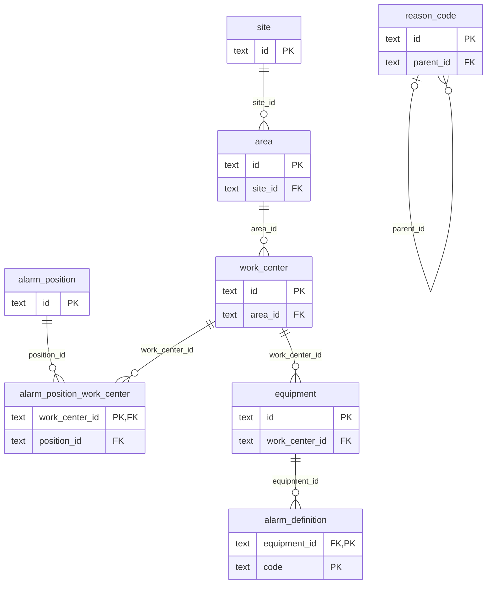
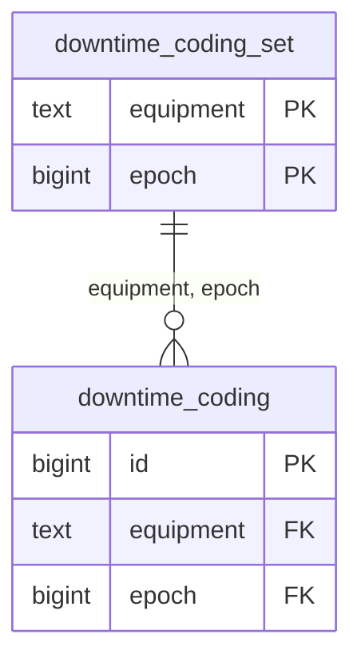

# Data model

<!-- Generated by apps/mes-server/src/db/data-model.ts; do not edit by hand. -->

The MES database after all migrations in `db/migrations`, read from the database itself (`pg_catalog` and `timescaledb_information`). Regenerate with `pnpm --filter @shopfloor/mes-server data-model`; a test in `apps/mes-server/src/db/db.test.ts` fails when this file is out of date.

Each schema belongs to exactly one module of `mes-server` (ADR-0016), and so do its views. Modules read each other only through their interfaces, so there are no foreign keys between schemas: a column named `equipment` holds a `master_data.equipment.id` by convention, and `ingest.state_anchor.arrival` is referenced from `equipment.interval_source.anchor_arrival` the same way, as are `ingest.data_quality_incident` ids from `equipment.bucket_finality.incident_ids`. Times are simulation time unless a column says otherwise (`received_at`, `ingested_at`, `recorded_at`, `updated_at`, `final_at`, `revised_at` and `applied_at` are wall time).

## Contents

- [`master_data`](#schema-master_data)
  - `master_data.alarm_definition`
  - `master_data.alarm_position`
  - `master_data.alarm_position_work_center`
  - `master_data.area`
  - `master_data.equipment`
  - `master_data.product`
  - `master_data.reason_code`
  - `master_data.shift_pattern`
  - `master_data.site`
  - `master_data.work_center`
- [`ingest`](#schema-ingest)
  - `ingest.alarm_anchor`
  - `ingest.alarm_snapshot`
  - `ingest.component_status`
  - `ingest.data_quality_incident`
  - `ingest.equipment_event`
  - `ingest.rejected_message`
  - `ingest.source_cursor`
  - `ingest.state_anchor`
  - `ingest.telemetry_sample`
  - `ingest.cycle_hourly` (view)
- [`equipment`](#schema-equipment)
  - `equipment.bucket_finality`
  - `equipment.downtime_audit`
  - `equipment.downtime_coding`
  - `equipment.downtime_coding_set`
  - `equipment.downtime_record`
  - `equipment.equipment_state_interval`
  - `equipment.interval_source`
  - `equipment.state_hourly` (view)
- [`alarms`](#schema-alarms)
  - `alarms.alarm_occurrence`
  - `alarms.kpi_revision`
  - `alarms.occurrence_source`
- [`public`](#schema-public)
  - `public.schema_migrations`

## Hypertables

| Table | Partitioned by | Chunk interval |
| --- | --- | --- |
| `equipment.equipment_state_interval` | `start_time` | 7 days |
| `ingest.equipment_event` | `source_time` | 7 days |
| `ingest.telemetry_sample` | `source_time` | 7 days |

A unique key or primary key on a hypertable must include its partitioning column (a TimescaleDB rule), which is why the fact tables are unique on `(…, seq, source_time)`.

## Continuous aggregates

| View | Over | Bucket | Real-time |
| --- | --- | --- | --- |
| `equipment.state_hourly` | `equipment.equipment_state_interval` | 01:00:00 | yes (`materialized_only = false`) |
| `ingest.cycle_hourly` | `ingest.equipment_event` | 01:00:00 | yes (`materialized_only = false`) |

Real-time: rows below the aggregate’s watermark come from its materialisation, rows above it from the table. There are no refresh policies: the owning module refreshes explicitly (ADR-0022).

## Relationships

Schema master_data:



Schema equipment:



The other schemas have no foreign keys; their references are by value, as described above.

## Schema master_data

Owner: master-data. The ISA-95 equipment hierarchy, products, the shift pattern, the downtime reason tree and the alarm definitions and operator positions, seeded from `config/plant`.

### master_data.alarm_definition

One alarm point per (equipment, code) from alarms.yaml: priority, operator text, consequence and response; inactive once the configuration drops it (#141, ADR-0024).

| Column | Type | Null | Default |
| --- | --- | --- | --- |
| `equipment_id` | `text` | not null |  |
| `code` | `text` | not null |  |
| `priority` | `text` | not null |  |
| `text` | `text` | not null |  |
| `consequence` | `text` | null |  |
| `response` | `text` | null |  |
| `position` | `integer` | not null |  |
| `active` | `boolean` | not null | `true` |

| Kind | Name | Definition |
| --- | --- | --- |
| Primary key | `alarm_definition_pkey` | `PRIMARY KEY (equipment_id, code)` |
| Foreign key | `alarm_definition_equipment_id_fkey` | `FOREIGN KEY (equipment_id) REFERENCES master_data.equipment(id)` |
| Check | `alarm_definition_priority_check` | `CHECK ((priority = ANY (ARRAY['high'::text, 'medium'::text, 'low'::text])))` |

### master_data.alarm_position

Operator positions for alarm KPIs from alarms.yaml (a set of work centers until operators log in); inactive once the configuration drops one (#141).

| Column | Type | Null | Default |
| --- | --- | --- | --- |
| `id` | `text` | not null |  |
| `name` | `text` | not null |  |
| `position` | `integer` | not null |  |
| `active` | `boolean` | not null | `true` |

| Kind | Name | Definition |
| --- | --- | --- |
| Primary key | `alarm_position_pkey` | `PRIMARY KEY (id)` |
| Check | `alarm_position_id_check` | `CHECK ((id <> 'plant'::text))` |

### master_data.alarm_position_work_center

The position each work center belongs to; rewritten on every seed (#141).

| Column | Type | Null | Default |
| --- | --- | --- | --- |
| `work_center_id` | `text` | not null |  |
| `position_id` | `text` | not null |  |

| Kind | Name | Definition |
| --- | --- | --- |
| Primary key | `alarm_position_work_center_pkey` | `PRIMARY KEY (work_center_id)` |
| Foreign key | `alarm_position_work_center_position_id_fkey` | `FOREIGN KEY (position_id) REFERENCES master_data.alarm_position(id)` |
| Foreign key | `alarm_position_work_center_work_center_id_fkey` | `FOREIGN KEY (work_center_id) REFERENCES master_data.work_center(id)` |

### master_data.area

Areas of the site.

| Column | Type | Null | Default |
| --- | --- | --- | --- |
| `id` | `text` | not null |  |
| `site_id` | `text` | not null |  |
| `name` | `text` | not null |  |

| Kind | Name | Definition |
| --- | --- | --- |
| Primary key | `area_pkey` | `PRIMARY KEY (id)` |
| Foreign key | `area_site_id_fkey` | `FOREIGN KEY (site_id) REFERENCES master_data.site(id)` |

### master_data.equipment

The machines, with their operation, interface and position in the line.

| Column | Type | Null | Default |
| --- | --- | --- | --- |
| `id` | `text` | not null |  |
| `work_center_id` | `text` | not null |  |
| `name` | `text` | not null |  |
| `operation` | `text` | not null |  |
| `interface` | `text` | not null |  |
| `position` | `integer` | not null |  |

| Kind | Name | Definition |
| --- | --- | --- |
| Primary key | `equipment_pkey` | `PRIMARY KEY (id)` |
| Foreign key | `equipment_work_center_id_fkey` | `FOREIGN KEY (work_center_id) REFERENCES master_data.work_center(id)` |
| Check | `equipment_interface_check` | `CHECK ((interface = ANY (ARRAY['opcua'::text, 'modbus'::text])))` |

### master_data.product

Products and their ideal cycle time per operation.

| Column | Type | Null | Default |
| --- | --- | --- | --- |
| `id` | `text` | not null |  |
| `name` | `text` | not null |  |
| `ideal_cycle_seconds` | `jsonb` | not null |  |

| Kind | Name | Definition |
| --- | --- | --- |
| Primary key | `product_pkey` | `PRIMARY KEY (id)` |

### master_data.reason_code

The downtime reason tree from reasons.yaml: id (its path), parent and name; inactive once the configuration drops it (#119).

| Column | Type | Null | Default |
| --- | --- | --- | --- |
| `id` | `text` | not null |  |
| `parent_id` | `text` | null |  |
| `name` | `text` | not null |  |
| `position` | `integer` | not null |  |
| `active` | `boolean` | not null | `true` |

| Kind | Name | Definition |
| --- | --- | --- |
| Primary key | `reason_code_pkey` | `PRIMARY KEY (id)` |
| Foreign key | `reason_code_parent_id_fkey` | `FOREIGN KEY (parent_id) REFERENCES master_data.reason_code(id)` |
| Check | `reason_code_check` | `CHECK ((((parent_id IS NULL) AND (POSITION(('/'::text) IN (id)) = 0)) OR ((parent_id IS NOT NULL) AND (id = ((parent_id \|\| '/'::text) \|\| split_part(id, '/'::text, '-1'::integer))))))` |

### master_data.shift_pattern

The shift pattern: time zone, workdays and shifts.

| Column | Type | Null | Default |
| --- | --- | --- | --- |
| `id` | `text` | not null |  |
| `time_zone` | `text` | not null |  |
| `workdays` | `text[]` | not null |  |
| `shifts` | `jsonb` | not null |  |

| Kind | Name | Definition |
| --- | --- | --- |
| Primary key | `shift_pattern_pkey` | `PRIMARY KEY (id)` |

### master_data.site

The site and its enterprise (ISA-95 levels 4 and 3).

| Column | Type | Null | Default |
| --- | --- | --- | --- |
| `id` | `text` | not null |  |
| `name` | `text` | not null |  |
| `enterprise_id` | `text` | not null |  |
| `enterprise_name` | `text` | not null |  |

| Kind | Name | Definition |
| --- | --- | --- |
| Primary key | `site_pkey` | `PRIMARY KEY (id)` |

### master_data.work_center

Work centers (lines) of an area.

| Column | Type | Null | Default |
| --- | --- | --- | --- |
| `id` | `text` | not null |  |
| `area_id` | `text` | not null |  |
| `name` | `text` | not null |  |

| Kind | Name | Definition |
| --- | --- | --- |
| Primary key | `work_center_pkey` | `PRIMARY KEY (id)` |
| Foreign key | `work_center_area_id_fkey` | `FOREIGN KEY (area_id) REFERENCES master_data.area(id)` |

## Schema ingest

Owner: ingest. Every UNS message the MES receives, stored idempotently (ADR-0015, ADR-0017), with dedup state, data-quality incidents and rejected messages.

### ingest.alarm_anchor

Retained alarm deliveries: the device’s last fact per (equipment, device epoch, code), highest seq wins; stale once a newer epoch of the equipment is known. Never a fact (#141).

| Column | Type | Null | Default |
| --- | --- | --- | --- |
| `equipment` | `text` | not null |  |
| `epoch` | `bigint` | not null |  |
| `code` | `text` | not null |  |
| `seq` | `bigint` | not null |  |
| `transition` | `text` | not null |  |
| `severity` | `integer` | not null |  |
| `source_time` | `timestamp with time zone` | not null |  |
| `quality` | `text` | not null |  |
| `received_at` | `timestamp with time zone` | not null |  |
| `ingested_at` | `timestamp with time zone` | not null | `now()` |
| `stale` | `boolean` | not null | `false` |
| `payload` | `jsonb` | not null |  |

| Kind | Name | Definition |
| --- | --- | --- |
| Primary key | `alarm_anchor_pkey` | `PRIMARY KEY (equipment, epoch, code)` |
| Check | `alarm_anchor_quality_check` | `CHECK ((quality = ANY (ARRAY['good'::text, 'uncertain'::text, 'bad'::text])))` |
| Check | `alarm_anchor_transition_check` | `CHECK ((transition = ANY (ARRAY['active'::text, 'cleared'::text])))` |

### ingest.alarm_snapshot

The gateway’s alarm snapshot on resync: active codes at a device sequence (asOfSeq), the latest per (equipment, device epoch); stale like anchors; outside dedup and gap checks (#141).

| Column | Type | Null | Default |
| --- | --- | --- | --- |
| `equipment` | `text` | not null |  |
| `device_epoch` | `bigint` | not null |  |
| `as_of_seq` | `bigint` | not null |  |
| `active` | `text[]` | not null |  |
| `epoch` | `bigint` | not null |  |
| `seq` | `bigint` | not null |  |
| `source_time` | `timestamp with time zone` | not null |  |
| `quality` | `text` | not null |  |
| `source_protocol` | `text` | not null |  |
| `received_at` | `timestamp with time zone` | not null |  |
| `ingested_at` | `timestamp with time zone` | not null | `now()` |
| `stale` | `boolean` | not null | `false` |
| `payload` | `jsonb` | not null |  |

| Kind | Name | Definition |
| --- | --- | --- |
| Primary key | `alarm_snapshot_pkey` | `PRIMARY KEY (equipment, device_epoch)` |
| Check | `alarm_snapshot_quality_check` | `CHECK ((quality = ANY (ARRAY['good'::text, 'uncertain'::text, 'bad'::text])))` |

### ingest.component_status

Latest online/offline status of each component (last will).

| Column | Type | Null | Default |
| --- | --- | --- | --- |
| `component` | `text` | not null |  |
| `instance` | `text` | not null |  |
| `status` | `text` | not null |  |
| `started_at` | `timestamp with time zone` | not null |  |
| `version` | `text` | not null |  |
| `source_time` | `timestamp with time zone` | not null |  |
| `received_at` | `timestamp with time zone` | not null | `now()` |
| `payload` | `jsonb` | not null |  |

| Kind | Name | Definition |
| --- | --- | --- |
| Primary key | `component_status_pkey` | `PRIMARY KEY (component, instance)` |
| Check | `component_status_status_check` | `CHECK ((status = ANY (ARRAY['online'::text, 'offline'::text])))` |

### ingest.data_quality_incident

Sequence gaps found by the MES and incidents reported by the gateway.

| Column | Type | Null | Default |
| --- | --- | --- | --- |
| `id` | `bigint` | not null | `generated always as identity` |
| `origin` | `text` | not null |  |
| `type` | `text` | not null |  |
| `stream` | `text` | not null |  |
| `epoch` | `bigint` | not null |  |
| `seq_from` | `bigint` | not null |  |
| `seq_to` | `bigint` | not null |  |
| `equipment` | `text` | null |  |
| `lost` | `bigint` | null |  |
| `message` | `text` | not null |  |
| `source_time` | `timestamp with time zone` | null |  |
| `detected_at` | `timestamp with time zone` | not null |  |
| `closed_at` | `timestamp with time zone` | null |  |
| `resolution` | `text` | null |  |
| `payload` | `jsonb` | null |  |

| Kind | Name | Definition |
| --- | --- | --- |
| Primary key | `data_quality_incident_pkey` | `PRIMARY KEY (id)` |
| Unique | `data_quality_incident_origin_stream_epoch_seq_from_key` | `UNIQUE (origin, stream, epoch, seq_from)` |
| Check | `data_quality_incident_origin_check` | `CHECK ((origin = ANY (ARRAY['mes'::text, 'gateway'::text])))` |
| Check | `data_quality_incident_resolution_check` | `CHECK ((resolution = ANY (ARRAY['filled'::text, 'epoch-ended'::text])))` |

### ingest.equipment_event

Device facts (state changes, cycles, alarm transitions), one stream per equipment; deduplicated by the unique key.

TimescaleDB hypertable, partitioned by `source_time` in chunks of 7 days.

| Column | Type | Null | Default |
| --- | --- | --- | --- |
| `equipment` | `text` | not null |  |
| `epoch` | `bigint` | not null |  |
| `seq` | `bigint` | not null |  |
| `source_time` | `timestamp with time zone` | not null |  |
| `event_type` | `text` | not null |  |
| `topic` | `text` | not null |  |
| `state` | `text` | null |  |
| `cause` | `text` | null |  |
| `quality` | `text` | not null |  |
| `source_protocol` | `text` | not null |  |
| `received_at` | `timestamp with time zone` | not null |  |
| `ingested_at` | `timestamp with time zone` | not null | `now()` |
| `payload` | `jsonb` | not null |  |

| Kind | Name | Definition |
| --- | --- | --- |
| Unique | `equipment_event_equipment_epoch_seq_source_time_key` | `UNIQUE (equipment, epoch, seq, source_time)` |
| Check | `equipment_event_check` | `CHECK (((event_type = 'state'::text) = (state IS NOT NULL)))` |
| Check | `equipment_event_event_type_check` | `CHECK ((event_type = ANY (ARRAY['state'::text, 'cycle'::text, 'alarm'::text])))` |
| Check | `equipment_event_quality_check` | `CHECK ((quality = ANY (ARRAY['good'::text, 'uncertain'::text, 'bad'::text])))` |
| Index | `equipment_event_alarm` | `ingest.equipment_event USING btree (equipment, epoch, seq) WHERE (event_type = 'alarm'::text)` |
| Index | `equipment_event_source_time_idx` | `ingest.equipment_event USING btree (source_time DESC)` |

### ingest.rejected_message

Messages that failed validation, came with a stale epoch or could not be stored: never dropped silently.

| Column | Type | Null | Default |
| --- | --- | --- | --- |
| `id` | `bigint` | not null | `generated always as identity` |
| `topic` | `text` | not null |  |
| `payload` | `text` | not null |  |
| `retained` | `boolean` | not null |  |
| `reason` | `text` | not null |  |
| `detail` | `text` | not null |  |
| `received_at` | `timestamp with time zone` | not null | `now()` |

| Kind | Name | Definition |
| --- | --- | --- |
| Primary key | `rejected_message_pkey` | `PRIMARY KEY (id)` |
| Check | `rejected_message_reason_check` | `CHECK ((reason = ANY (ARRAY['invalid-json'::text, 'invalid-payload'::text, 'topic-mismatch'::text, 'unexpected-topic'::text, 'stale-epoch'::text, 'unstorable'::text])))` |

### ingest.source_cursor

Durable dedup and gap state per stream: current epoch, sequence ranges seen, gaps already reported.

| Column | Type | Null | Default |
| --- | --- | --- | --- |
| `stream` | `text` | not null |  |
| `epoch` | `bigint` | not null |  |
| `seen` | `jsonb` | not null |  |
| `reported` | `jsonb` | not null |  |
| `updated_at` | `timestamp with time zone` | not null | `now()` |

| Kind | Name | Definition |
| --- | --- | --- |
| Primary key | `source_cursor_pkey` | `PRIMARY KEY (stream)` |

### ingest.state_anchor

Retained deliveries and state snapshots: the starting state of an (equipment, device epoch) when no fact gives one yet.

| Column | Type | Null | Default |
| --- | --- | --- | --- |
| `arrival` | `bigint` | not null | `generated always as identity` |
| `equipment` | `text` | not null |  |
| `kind` | `text` | not null |  |
| `retained` | `boolean` | not null |  |
| `scope` | `text` | not null |  |
| `epoch` | `bigint` | not null |  |
| `seq` | `bigint` | not null |  |
| `source_time` | `timestamp with time zone` | not null |  |
| `device_epoch` | `bigint` | null |  |
| `superseded` | `boolean` | not null | `false` |
| `state` | `text` | not null |  |
| `cause` | `text` | null |  |
| `quality` | `text` | not null |  |
| `received_at` | `timestamp with time zone` | not null |  |
| `ingested_at` | `timestamp with time zone` | not null | `now()` |
| `payload` | `jsonb` | not null |  |

| Kind | Name | Definition |
| --- | --- | --- |
| Primary key | `state_anchor_pkey` | `PRIMARY KEY (arrival)` |
| Unique | `state_anchor_equipment_scope_epoch_seq_key` | `UNIQUE (equipment, scope, epoch, seq)` |
| Check | `state_anchor_kind_check` | `CHECK ((kind = ANY (ARRAY['event'::text, 'snapshot'::text])))` |
| Check | `state_anchor_quality_check` | `CHECK ((quality = ANY (ARRAY['good'::text, 'uncertain'::text, 'bad'::text])))` |
| Check | `state_anchor_scope_check` | `CHECK ((scope = ANY (ARRAY['device'::text, 'topic'::text])))` |
| Index | `state_anchor_epoch` | `ingest.state_anchor USING btree (equipment, device_epoch, arrival)` |

### ingest.telemetry_sample

Sampled process values, one stream per telemetry topic.

TimescaleDB hypertable, partitioned by `source_time` in chunks of 7 days.

| Column | Type | Null | Default |
| --- | --- | --- | --- |
| `topic` | `text` | not null |  |
| `equipment` | `text` | not null |  |
| `name` | `text` | not null |  |
| `epoch` | `bigint` | not null |  |
| `seq` | `bigint` | not null |  |
| `source_time` | `timestamp with time zone` | not null |  |
| `value` | `double precision` | not null |  |
| `unit` | `text` | not null |  |
| `quality` | `text` | not null |  |
| `source_protocol` | `text` | not null |  |
| `received_at` | `timestamp with time zone` | not null |  |
| `ingested_at` | `timestamp with time zone` | not null | `now()` |
| `payload` | `jsonb` | not null |  |

| Kind | Name | Definition |
| --- | --- | --- |
| Unique | `telemetry_sample_topic_epoch_seq_source_time_key` | `UNIQUE (topic, epoch, seq, source_time)` |
| Check | `telemetry_sample_quality_check` | `CHECK ((quality = ANY (ARRAY['good'::text, 'uncertain'::text, 'bad'::text])))` |
| Index | `telemetry_sample_series` | `ingest.telemetry_sample USING btree (equipment, name, source_time DESC)` |
| Index | `telemetry_sample_source_time_idx` | `ingest.telemetry_sample USING btree (source_time DESC)` |

### ingest.cycle_hourly

Completed cycles per (equipment, epoch, UTC hour, product, result), from the cycle facts: an input of OEE (#118, ADR-0022).

TimescaleDB continuous aggregate over `ingest.equipment_event`, in buckets of 01:00:00, real-time (`materialized_only = false`).

| Column | Type |
| --- | --- |
| `equipment` | `text` |
| `epoch` | `bigint` |
| `hour` | `timestamp with time zone` |
| `product` | `text` |
| `result` | `text` |
| `cycles` | `bigint` |

```sql
SELECT equipment,
    epoch,
    time_bucket('01:00:00'::interval, source_time) AS hour,
    ((payload -> 'value'::text) ->> 'product'::text) AS product,
    ((payload -> 'value'::text) ->> 'result'::text) AS result,
    count(*) AS cycles
   FROM ingest.equipment_event
  WHERE (event_type = 'cycle'::text)
  GROUP BY equipment, epoch, (time_bucket('01:00:00'::interval, source_time)), ((payload -> 'value'::text) ->> 'product'::text), ((payload -> 'value'::text) ->> 'result'::text);
```

## Schema equipment

Owner: equipment. State intervals built from the state facts, cut at UTC hours and shift buckets (ADR-0018): the basis of OEE; the downtime records derived from them (ADR-0021); and the operator codings of downtime with their append-only audit (ADR-0023).

### equipment.bucket_finality

Per (equipment, epoch, UTC hour): when the hour became final, its revision (raised by each change after that) and the gap incidents over it.

| Column | Type | Null | Default |
| --- | --- | --- | --- |
| `equipment` | `text` | not null |  |
| `epoch` | `bigint` | not null |  |
| `hour` | `timestamp with time zone` | not null |  |
| `final_at` | `timestamp with time zone` | not null | `now()` |
| `revision` | `integer` | not null | `0` |
| `revised_at` | `timestamp with time zone` | null |  |
| `incident_ids` | `bigint[]` | not null | `'{}'::bigint[]` |
| `cycles` | `bigint` | null |  |

| Kind | Name | Definition |
| --- | --- | --- |
| Primary key | `bucket_finality_pkey` | `PRIMARY KEY (equipment, epoch, hour)` |
| Check | `bucket_finality_cycles_check` | `CHECK ((cycles >= 0))` |
| Check | `bucket_finality_hour_check` | `CHECK ((hour = date_trunc('hour'::text, hour, 'UTC'::text)))` |
| Check | `bucket_finality_revision_check` | `CHECK ((revision >= 0))` |

### equipment.downtime_audit

Append-only audit of coding writes and clips: action, before, after, actor, wall time and request id; a trigger refuses UPDATE, DELETE and TRUNCATE (#121, ADR-0023).

| Column | Type | Null | Default |
| --- | --- | --- | --- |
| `id` | `bigint` | not null | `generated always as identity` |
| `equipment` | `text` | not null |  |
| `epoch` | `bigint` | not null |  |
| `record_id` | `text` | null |  |
| `from_time` | `timestamp with time zone` | not null |  |
| `to_time` | `timestamp with time zone` | null |  |
| `action` | `text` | not null |  |
| `before` | `jsonb` | not null |  |
| `after` | `jsonb` | not null |  |
| `actor` | `text` | not null |  |
| `authenticated` | `boolean` | not null | `false` |
| `at` | `timestamp with time zone` | not null | `clock_timestamp()` |
| `request_id` | `text` | null |  |
| `version` | `bigint` | not null |  |

| Kind | Name | Definition |
| --- | --- | --- |
| Primary key | `downtime_audit_pkey` | `PRIMARY KEY (id)` |
| Check | `downtime_audit_action_check` | `CHECK ((action = ANY (ARRAY['coded'::text, 'cleared'::text, 'orphaned'::text])))` |
| Index | `downtime_audit_range` | `equipment.downtime_audit USING btree (equipment, epoch, from_time)` |

### equipment.downtime_coding

Operator codings: time ranges inside a record’s loss time with a reason, comment and `coded_by` (unauthenticated), stored by time so they survive a re-cut; clipped and flagged orphaned when a re-cut leaves their time outside every loss interval (#121).

| Column | Type | Null | Default |
| --- | --- | --- | --- |
| `id` | `bigint` | not null | `generated always as identity` |
| `equipment` | `text` | not null |  |
| `epoch` | `bigint` | not null |  |
| `from_time` | `timestamp with time zone` | not null |  |
| `to_time` | `timestamp with time zone` | not null |  |
| `reason` | `text` | not null |  |
| `comment` | `text` | not null | `''::text` |
| `coded_by` | `text` | not null |  |
| `coded_at` | `timestamp with time zone` | not null |  |
| `version` | `bigint` | not null |  |
| `orphaned` | `boolean` | not null | `false` |
| `orphaned_at` | `timestamp with time zone` | null |  |

| Kind | Name | Definition |
| --- | --- | --- |
| Primary key | `downtime_coding_pkey` | `PRIMARY KEY (id)` |
| Foreign key | `downtime_coding_equipment_epoch_fkey` | `FOREIGN KEY (equipment, epoch) REFERENCES equipment.downtime_coding_set(equipment, epoch)` |
| Check | `downtime_coding_check` | `CHECK ((to_time > from_time))` |
| Check | `downtime_coding_check1` | `CHECK ((orphaned = (orphaned_at IS NOT NULL)))` |
| Check | `downtime_coding_coded_by_check` | `CHECK (((length(coded_by) >= 1) AND (length(coded_by) <= 100)))` |
| Check | `downtime_coding_comment_check` | `CHECK ((length(comment) <= 500))` |
| Index | `downtime_coding_range` | `equipment.downtime_coding USING btree (equipment, epoch, from_time) WHERE (NOT orphaned)` |

### equipment.downtime_coding_set

The coding set of each (equipment, epoch): its version is the optimistic-concurrency token of every coding write (#121).

| Column | Type | Null | Default |
| --- | --- | --- | --- |
| `equipment` | `text` | not null |  |
| `epoch` | `bigint` | not null |  |
| `version` | `bigint` | not null | `0` |
| `updated_at` | `timestamp with time zone` | not null | `now()` |

| Kind | Name | Definition |
| --- | --- | --- |
| Primary key | `downtime_coding_set_pkey` | `PRIMARY KEY (equipment, epoch)` |
| Check | `downtime_coding_set_version_check` | `CHECK ((version >= 0))` |

### equipment.downtime_record

Downtime records: one per availability-loss interval per scheduled shift bucket, keyed by its start in the bucket, with the auto reason; derived and rebuilt with the intervals (#119).

| Column | Type | Null | Default |
| --- | --- | --- | --- |
| `equipment` | `text` | not null |  |
| `epoch` | `bigint` | not null |  |
| `start_time` | `timestamp with time zone` | not null |  |
| `end_time` | `timestamp with time zone` | null |  |
| `interval_start` | `timestamp with time zone` | not null |  |
| `shift_key` | `text` | not null |  |
| `state` | `text` | not null |  |
| `cause` | `text` | null |  |
| `auto_reason` | `text` | not null |  |
| `provisional` | `boolean` | not null |  |
| `recorded_at` | `timestamp with time zone` | not null | `now()` |

| Kind | Name | Definition |
| --- | --- | --- |
| Primary key | `downtime_record_pkey` | `PRIMARY KEY (equipment, epoch, start_time)` |
| Check | `downtime_record_check` | `CHECK (((end_time IS NULL) OR (end_time > start_time)))` |
| Check | `downtime_record_check1` | `CHECK ((interval_start <= start_time))` |
| Check | `downtime_record_check2` | `CHECK (((end_time IS NOT NULL) OR provisional))` |
| Check | `downtime_record_shift_key_check` | `CHECK ((shift_key <> 'no-shift'::text))` |
| Check | `downtime_record_state_check` | `CHECK ((state = ANY (ARRAY['Stopped'::text, 'Down'::text, 'Setup'::text, 'Idle'::text, 'Starved'::text, 'Blocked'::text])))` |
| Index | `downtime_record_range` | `equipment.downtime_record USING btree (equipment, start_time)` |
| Index | `downtime_record_uncoded` | `equipment.downtime_record USING btree (start_time) WHERE (auto_reason = 'UNCODED'::text)` |

### equipment.equipment_state_interval

State intervals cut into pieces inside one UTC hour and one shift bucket; the open interval is stored up to the plant watermark. A piece is provisional while it ends after the time its machine’s own facts have settled (#113).

TimescaleDB hypertable, partitioned by `start_time` in chunks of 7 days.

| Column | Type | Null | Default |
| --- | --- | --- | --- |
| `equipment` | `text` | not null |  |
| `epoch` | `bigint` | not null |  |
| `start_time` | `timestamp with time zone` | not null |  |
| `end_time` | `timestamp with time zone` | not null |  |
| `state` | `text` | not null |  |
| `cause` | `text` | null |  |
| `hour` | `timestamp with time zone` | not null |  |
| `shift_key` | `text` | not null |  |
| `provisional` | `boolean` | not null |  |
| `interval_start` | `timestamp with time zone` | not null |  |
| `start_seq` | `bigint` | null |  |
| `recorded_at` | `timestamp with time zone` | not null | `now()` |

| Kind | Name | Definition |
| --- | --- | --- |
| Primary key | `equipment_state_interval_pkey` | `PRIMARY KEY (equipment, epoch, start_time)` |
| Check | `equipment_state_interval_check` | `CHECK ((end_time > start_time))` |
| Check | `equipment_state_interval_check1` | `CHECK ((interval_start <= start_time))` |
| Check | `equipment_state_interval_check2` | `CHECK ((hour = date_trunc('hour'::text, start_time, 'UTC'::text)))` |
| Check | `equipment_state_interval_check3` | `CHECK ((end_time <= (hour + '01:00:00'::interval)))` |
| Index | `equipment_state_interval_range` | `equipment.equipment_state_interval USING btree (equipment, start_time DESC)` |
| Index | `equipment_state_interval_shift` | `equipment.equipment_state_interval USING btree (shift_key, equipment)` |
| Index | `equipment_state_interval_start_time_idx` | `equipment.equipment_state_interval USING btree (start_time DESC)` |

### equipment.interval_source

What the stored intervals of each (equipment, epoch) were computed from, so start-up catch-up can recompute what differs.

| Column | Type | Null | Default |
| --- | --- | --- | --- |
| `equipment` | `text` | not null |  |
| `epoch` | `bigint` | not null |  |
| `state_facts` | `bigint` | not null |  |
| `last_seq` | `bigint` | null |  |
| `anchor_arrival` | `bigint` | null |  |
| `closed` | `boolean` | not null |  |
| `closed_at` | `timestamp with time zone` | null |  |
| `clamped` | `boolean` | not null |  |
| `updated_at` | `timestamp with time zone` | not null | `now()` |
| `downtime_threshold_ms` | `bigint` | null |  |

| Kind | Name | Definition |
| --- | --- | --- |
| Primary key | `interval_source_pkey` | `PRIMARY KEY (equipment, epoch)` |

### equipment.state_hourly

Time per state (and its provisional part) per (equipment, epoch, UTC hour, shift bucket), from the pieces: an input of OEE (#118, ADR-0022).

TimescaleDB continuous aggregate over `equipment.equipment_state_interval`, in buckets of 01:00:00, real-time (`materialized_only = false`).

| Column | Type |
| --- | --- |
| `equipment` | `text` |
| `epoch` | `bigint` |
| `hour` | `timestamp with time zone` |
| `shift_key` | `text` |
| `state` | `text` |
| `ms` | `bigint` |
| `provisional_ms` | `bigint` |

```sql
SELECT equipment,
    epoch,
    time_bucket('01:00:00'::interval, start_time) AS hour,
    shift_key,
    state,
    (sum(((EXTRACT(epoch FROM (end_time - start_time)) * (1000)::numeric))::bigint))::bigint AS ms,
    (sum(
        CASE
            WHEN provisional THEN ((EXTRACT(epoch FROM (end_time - start_time)) * (1000)::numeric))::bigint
            ELSE (0)::bigint
        END))::bigint AS provisional_ms
   FROM equipment.equipment_state_interval
  GROUP BY equipment, epoch, (time_bucket('01:00:00'::interval, start_time)), shift_key, state;
```

## Schema alarms

Owner: alarms. Alarm occurrences derived from the device’s raise and clear facts, anchors and resync snapshots (ADR-0010, ADR-0024), what they were derived from, and the revisions of final alarm KPI hours. KPIs are computed on read.

### alarms.alarm_occurrence

One alarm occurrence per device raise, keyed (equipment, epoch, raise seq), with its end (cleared, lost, superseded, epoch-ended); derived, never edited (#142).

| Column | Type | Null | Default |
| --- | --- | --- | --- |
| `equipment` | `text` | not null |  |
| `epoch` | `bigint` | not null |  |
| `seq` | `bigint` | not null |  |
| `code` | `text` | not null |  |
| `severity` | `integer` | not null |  |
| `priority` | `text` | not null |  |
| `defined` | `boolean` | not null |  |
| `source` | `text` | not null |  |
| `raised_at` | `timestamp with time zone` | not null |  |
| `ended_at` | `timestamp with time zone` | null |  |
| `end_reason` | `text` | null |  |
| `end_seq` | `bigint` | null |  |
| `updated_at` | `timestamp with time zone` | not null | `now()` |

| Kind | Name | Definition |
| --- | --- | --- |
| Primary key | `alarm_occurrence_pkey` | `PRIMARY KEY (equipment, epoch, seq)` |
| Check | `alarm_occurrence_check` | `CHECK (((ended_at IS NULL) = (end_reason IS NULL)))` |
| Check | `alarm_occurrence_check1` | `CHECK (((ended_at IS NULL) OR (ended_at >= raised_at)))` |
| Check | `alarm_occurrence_end_reason_check` | `CHECK ((end_reason = ANY (ARRAY['cleared'::text, 'lost'::text, 'superseded'::text, 'epoch-ended'::text])))` |
| Check | `alarm_occurrence_priority_check` | `CHECK ((priority = ANY (ARRAY['high'::text, 'medium'::text, 'low'::text])))` |
| Check | `alarm_occurrence_severity_check` | `CHECK (((severity >= 1) AND (severity <= 1000)))` |
| Check | `alarm_occurrence_source_check` | `CHECK ((source = ANY (ARRAY['fact'::text, 'anchor'::text])))` |
| Index | `alarm_occurrence_active` | `alarms.alarm_occurrence USING btree (equipment, epoch) WHERE (ended_at IS NULL)` |
| Index | `alarm_occurrence_epoch_raised` | `alarms.alarm_occurrence USING btree (epoch, raised_at)` |
| Index | `alarm_occurrence_raised` | `alarms.alarm_occurrence USING btree (raised_at DESC)` |

### alarms.kpi_revision

Per (scope, epoch, UTC hour): how often a final alarm KPI hour changed after it was final; no row means revision 0 (#142, ADR-0024).

| Column | Type | Null | Default |
| --- | --- | --- | --- |
| `scope` | `text` | not null |  |
| `epoch` | `bigint` | not null |  |
| `hour` | `timestamp with time zone` | not null |  |
| `revision` | `integer` | not null |  |
| `revised_at` | `timestamp with time zone` | not null | `now()` |

| Kind | Name | Definition |
| --- | --- | --- |
| Primary key | `kpi_revision_pkey` | `PRIMARY KEY (scope, epoch, hour)` |
| Check | `kpi_revision_hour_check` | `CHECK ((hour = date_trunc('hour'::text, hour, 'UTC'::text)))` |
| Check | `kpi_revision_revision_check` | `CHECK ((revision > 0))` |

### alarms.occurrence_source

What the occurrences of each (equipment, epoch) were derived from (alarm fact count, anchors and snapshot used, epoch closing) and how far they were final, for catch-up (#142).

| Column | Type | Null | Default |
| --- | --- | --- | --- |
| `equipment` | `text` | not null |  |
| `epoch` | `bigint` | not null |  |
| `facts` | `integer` | not null |  |
| `anchors` | `jsonb` | not null | `'[]'::jsonb` |
| `snapshot` | `jsonb` | null |  |
| `closed` | `boolean` | not null | `false` |
| `closed_at` | `timestamp with time zone` | null |  |
| `final_through` | `timestamp with time zone` | null |  |
| `updated_at` | `timestamp with time zone` | not null | `now()` |

| Kind | Name | Definition |
| --- | --- | --- |
| Primary key | `occurrence_source_pkey` | `PRIMARY KEY (equipment, epoch)` |
| Check | `occurrence_source_facts_check` | `CHECK ((facts >= 0))` |

## Schema public

Owner: the migration runner. Bookkeeping of the migration runner (ADR-0016).

### public.schema_migrations

Applied migrations and their checksums.

| Column | Type | Null | Default |
| --- | --- | --- | --- |
| `name` | `text` | not null |  |
| `checksum` | `text` | not null |  |
| `applied_at` | `timestamp with time zone` | not null | `now()` |

| Kind | Name | Definition |
| --- | --- | --- |
| Primary key | `schema_migrations_pkey` | `PRIMARY KEY (name)` |
