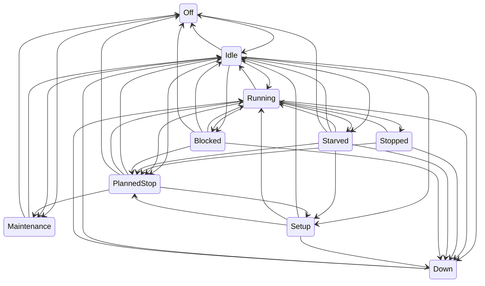

# Simulation model

Every model the simulator uses: what it represents, its parameters and default values, and how it is validated. Updated whenever simulator behaviour changes (plan section 10). Values marked as assumptions in `config/plant/` are simulation choices, not industry data.

## Machine states

Every machine is a state machine with ten states (plan section 4, rev. 2). The machine reports its state exactly as it happens; it never decides whether a stop counts as "micro". That classification belongs to the MES (plan section 7).

| State         | Meaning                                                | Typical cause                             |
| ------------- | ------------------------------------------------------ | ----------------------------------------- |
| `Off`         | Powered down                                           | Weekend, no shift                         |
| `Idle`        | Ready, not working, nothing preventing work            | Waiting for the next cycle to be started  |
| `Running`     | Producing                                              | A cycle in progress                       |
| `Stopped`     | Short, self-clearing stop with a known cause           | Door interlock, chip jam, operator pause  |
| `Starved`     | Cannot load: upstream buffer empty or material missing | Upstream breakdown, empty lot             |
| `Blocked`     | Cannot unload: downstream buffer full                  | Downstream breakdown or slower bottleneck |
| `Setup`       | Changeover between variants, or tool change            | Variant change in the schedule            |
| `Down`        | Failure that needs a technician                        | Weibull breakdown, injected fault         |
| `PlannedStop` | Planned break inside a shift                           | 30-minute shift break                     |
| `Maintenance` | Planned maintenance                                    | Calibration, scheduled service            |

Legal transitions (source of truth: `apps/simulator/src/plant/machine-state.ts`; a test fails if this diagram and the code disagree):

Rules behind the table:

- A breakdown can interrupt any active state, but a machine that is `Down` stays `Down` through breaks and shift ends until the repair finishes. Its time stays an availability loss, as in a real plant.
- `Stopped` returns to `Running` (the interrupted cycle continues), escalates to `Down`, or is overtaken by a planned break.
- `Setup` starts only from a machine that is not producing (`Idle`, `Starved` or `PlannedStop`).
- A transition to the same state is illegal: it would mean the model lost track of what the machine is doing.
- An illegal transition throws `IllegalTransitionError`, a programmer error that stops the run (plan section 4).

### Time accounting

Each machine accumulates the time spent in every state. At any moment, the durations of all states sum exactly to the time since the machine was created (plan section 4). Time is in integer milliseconds (ADR-0006), so the sum is exact. A property test generates random legal transition sequences and checks this.

## Random numbers and distributions

### Random streams

All randomness comes from `RandomSource(seed).stream(key)` in `sim-core` (ADR-0007): one xoshiro128** generator per entity, derived from the master seed and a key such as `cnc-01/failure/spindle-overload`. A stream depends only on the seed and its key, so adding, removing or reordering other entities never changes it. A key can be issued only once per run.

### Distributions

All functions are in `packages/sim-core/src/distributions.ts`. They return floating-point values; whoever schedules an event rounds the duration to whole milliseconds (ADR-0006).

| Function                   | Model                                             | Parameters                     | Used for (plan section 4)                            | Draws per call |
| -------------------------- | ------------------------------------------------- | ------------------------------ | ---------------------------------------------------- | -------------- |
| `uniform`                  | Uniform on [min, max)                             | min, max                       | General purpose                                      | 1              |
| `bernoulli`                | True with probability p                           | p                              | Defect at OP10, operator absence                     | 1              |
| `exponential`              | Inverse transform, −mean · ln(1 − u)              | mean                           | Minor-stop durations                                 | 1              |
| `poissonArrivalGap`        | Exponential gap with mean 1 / rate                | rate per unit time             | Minor-stop arrivals while running                    | 1              |
| `standardNormal`, `normal` | Box–Muller, one value per call                    | mean, sigma                    | Leak-test readings                                   | 2              |
| `logNormal`                | exp(mu + sigma · Z)                               | mu, sigma of ln X              | Base form                                            | 2              |
| `logNormalFromMedian`      | mu = ln(median)                                   | median, sigma of ln X          | Repair times (`repairMedianMinutes`, `repairSpread`) | 2              |
| `logNormalFromMeanCv`      | sigma² = ln(1 + CV²), mu = ln(mean) − sigma² / 2  | mean, coefficient of variation | Cycle times (`cycleTimeCv`)                          | 2              |
| `weibull`                  | Inverse transform, scale · (−ln(1 − u))^(1/shape) | shape, scale                   | Time to failure in running hours                     | 1              |

Each function always consumes the same number of draws, never a variable number (no rejection sampling, no cached second Box–Muller value). The sequence a stream delivers therefore never depends on which branch an earlier call took.

### Validation

`packages/sim-core/src/distributions.test.ts` draws 20,000 values per distribution from a fixed seed and checks them with the helpers in `packages/test-kit`:

- **Continuous distributions:** a one-sample Kolmogorov–Smirnov test against the exact CDF must give p > 0.01. Parameters are the plant defaults, for example Weibull(1.4, 160 h) for spindle failures and log-normal with median 45 min and sigma 0.6 for repairs.
- **Poisson arrivals:** counts per hour over 5,000 hours, chi-square test against the Poisson probabilities, p > 0.01.
- **Bernoulli:** chi-square test on hit and miss counts, p > 0.01.
- **Log-normal from mean and CV:** the sample mean and CV match the parameters.

The test helpers are themselves checked against published table values: erf, normal quantiles, Kolmogorov critical values (1.2238, 1.3581 and 1.6276 for alpha = 0.10, 0.05 and 0.01) and chi-square critical values. Long-run checks of MTBF and MTTR in the running plant follow with the breakdown model (#24).
