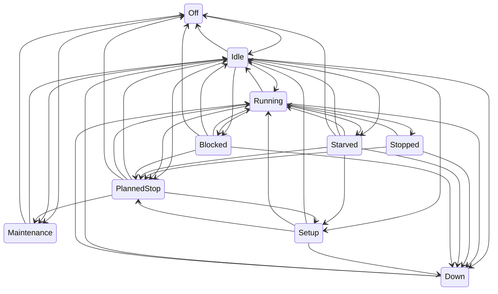

# Simulation model

Every model the simulator uses: what it represents, its parameters and default values, and how it is validated. Updated whenever simulator behaviour changes (plan section 10). Values marked as assumptions in `config/plant/` are simulation choices, not industry data.

## Machine states

Every machine is a state machine with ten states (plan section 4, rev. 2). The machine reports its state exactly as it happens; it never decides whether a stop counts as "micro". That classification belongs to the MES (plan section 7).

| State         | Meaning                                                | Typical cause                             |
| ------------- | ------------------------------------------------------ | ----------------------------------------- |
| `Off`         | Powered down                                           | Weekend, no shift                         |
| `Idle`        | Ready, not working, nothing preventing work            | Waiting for the next cycle to be started  |
| `Running`     | Producing                                              | A cycle in progress                       |
| `Stopped`     | Short, self-clearing stop with a known cause           | Door interlock, chip jam, operator pause  |
| `Starved`     | Cannot load: upstream buffer empty or material missing | Upstream breakdown, empty lot             |
| `Blocked`     | Cannot unload: downstream buffer full                  | Downstream breakdown or slower bottleneck |
| `Setup`       | Changeover between variants, or tool change            | Variant change in the schedule            |
| `Down`        | Failure that needs a technician                        | Weibull breakdown, injected fault         |
| `PlannedStop` | Planned break inside a shift                           | 30-minute shift break                     |
| `Maintenance` | Planned maintenance                                    | Calibration, scheduled service            |

Legal transitions (source of truth: `apps/simulator/src/plant/machine-state.ts`; a test fails if this diagram and the code disagree):

Rules behind the table:

- A breakdown can interrupt any active state, but a machine that is `Down` stays `Down` through breaks and shift ends until the repair finishes. Its time stays an availability loss, as in a real plant.
- `Stopped` returns to `Running` (the interrupted cycle continues), escalates to `Down`, or is overtaken by a planned break.
- `Setup` starts only from a machine that is not producing (`Idle`, `Starved` or `PlannedStop`).
- A transition to the same state is illegal: it would mean the model lost track of what the machine is doing.
- An illegal transition throws `IllegalTransitionError`, a programmer error that stops the run (plan section 4).

### Time accounting

Each machine accumulates the time spent in every state. At any moment, the durations of all states sum exactly to the time since the machine was created (plan section 4). Time is in integer milliseconds (ADR-0006), so the sum is exact. A property test generates random legal transition sequences and checks this.
