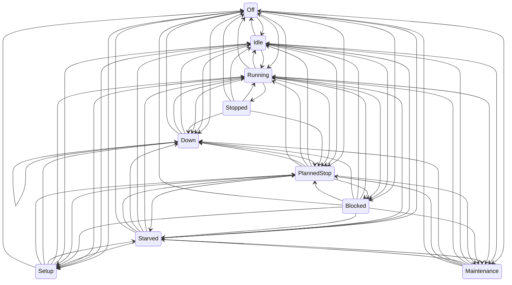

# Simulation model

Every model the simulator uses: what it represents, its parameters and default values, and how it is validated. Updated whenever simulator behaviour changes (plan section 10). Values marked as assumptions in `config/plant/` are simulation choices, not industry data.

## Machine states

Every machine is a state machine with ten states (plan section 4, rev. 2). The machine reports its state exactly as it happens; it never decides whether a stop counts as "micro". That classification belongs to the MES (plan section 7).

| State         | Meaning                                                | Typical cause                             |
| ------------- | ------------------------------------------------------ | ----------------------------------------- |
| `Off`         | Powered down                                           | Weekend, no shift                         |
| `Idle`        | Ready, not working, nothing preventing work            | Waiting for the next cycle to be started  |
| `Running`     | Producing                                              | A cycle in progress                       |
| `Stopped`     | Short, self-clearing stop with a known cause           | Door interlock, chip jam, operator pause  |
| `Starved`     | Cannot load: upstream buffer empty or material missing | Upstream breakdown, empty lot             |
| `Blocked`     | Cannot unload: downstream buffer full                  | Downstream breakdown or slower bottleneck |
| `Setup`       | Changeover between variants, or tool change            | Variant change in the schedule            |
| `Down`        | Failure that needs a technician                        | Weibull breakdown, injected fault         |
| `PlannedStop` | Planned break inside a shift                           | 30-minute shift break                     |
| `Maintenance` | Planned maintenance                                    | Calibration, scheduled service            |

Legal transitions (source of truth: `apps/simulator/src/plant/machine-state.ts`; a test fails if this diagram and the code disagree):

Rules behind the table:

- A breakdown can interrupt any active state, but a machine that is `Down` stays `Down` through breaks and shift ends until the repair finishes, then goes to `PlannedStop` or `Off` if the plant is not working. Its downtime stays an availability loss, as in a real plant.
- Breaks and shift ends move working machines (`Running`, `Stopped`, `Starved`, `Blocked`, `Idle`) to `PlannedStop` or `Off`. At the next shift start or break end they continue straight into whatever state they now need: `Off` and `PlannedStop` can lead directly to `Running`, `Starved`, `Blocked` or `Setup`.
- `Stopped` returns to `Running` (the interrupted cycle continues), escalates to `Down`, or is overtaken by a planned break.
- `Setup` starts only between cycles, never mid-cycle: right after a cycle ends (`Running` or `Blocked`, when the next campaign needs another product) or from `Idle`, `Starved` or `PlannedStop`.
- A transition to the same state is illegal: it would mean the model lost track of what the machine is doing. The one exception is `Down → Down`, which only a held failure injection uses (see "Failure injection"): at the end of a repair the machine stays `Down` with the injected code, so the new cause gets its own interval.
- `Off`, `PlannedStop` and `Maintenance` → `Down` are used only by a held failure injection, which takes effect where the machine would enter `Running`.
- An illegal transition throws `IllegalTransitionError`, a programmer error that stops the run (plan section 4).

### Time accounting

Each machine accumulates the time spent in every state. At any moment, the durations of all states sum exactly to the time since the machine was created (plan section 4). Time is in integer milliseconds (ADR-0006), so the sum is exact. A property test generates random legal transition sequences and checks this.

### Causes

A state change carries an optional `cause`. Every cause comes from one vocabulary in `@shopfloor/contracts` (`packages/contracts/src/causes.ts`, #119). The simulator emits these strings, and the MES's auto-classification rules (`config/plant/reasons.yaml`, ADR-0021) match against them. The strings are part of the golden event log, so changing one changes `events.sha256`.

| State         | Cause                    | Source                                                       |
| ------------- | ------------------------ | ------------------------------------------------------------ |
| `Down`        | a failure code           | `failures.yaml` (`failureModes[].code`)                      |
| `Stopped`     | a minor-stop cause       | `failures.yaml` (`minorStops.causes`)                        |
| `Setup`       | `TOOL-CHANGE`            | `CAUSES.toolChange`                                          |
| `Setup`       | `CHANGEOVER <from>→<to>` | `changeoverCause`; `<from>` is `none` when nothing is loaded |
| `Maintenance` | `CALIBRATION`            | `CAUSES.calibration`                                         |
| `Idle`        | `SCHEDULE-COMPLETE`      | `CAUSES.scheduleComplete`                                    |
| `Idle`        | `NO-OPERATOR`            | `CAUSES.noOperator`                                          |
| `Idle`        | `NO-ORDER`               | `CAUSES.noOrder` (orders mode only, #172)                    |
| `PlannedStop` | `BREAK`                  | `CAUSES.break`                                               |
| `Off`         | `SHIFT-END`              | `CAUSES.shiftEnd`                                            |
| `Starved`     | `MATERIAL:<material>`    | `materialCause`                                              |

Some changes carry no cause: `Running`, a `Starved` caused by an empty buffer, `Blocked`, and a return to `Idle`, `PlannedStop` or `Off` after a repair or setup. Snapshots (an OPC UA resync, a Modbus poll) also start an interval without a cause. `causeVocabulary` lists every (state, cause) pair a configuration can produce, with each changeover pair and each material spelled out. The plant-config cross-check uses that list. A test also runs the golden week and checks two things: every emitted cause appears in the list, and no pair is classified as UNCODED. The Modbus cause table (`modbusTables`) is built from the same failure codes and minor-stop causes, plus `BREAK`, `SHIFT-END` and `NO-OPERATOR`.

## Material flow

Source: `apps/simulator/src/plant/line.ts`. Failures, minor stops, shifts, operators and materials are added by later issues (#24–#27). This section describes the flow they build on.

### Stations and buffers

- One station per piece of equipment in `config/plant/plant.yaml`. Each station works on one part at a time.
- Finite FIFO buffers join consecutive operations, with capacities from `plant.yaml` (default 20, 30, 5 and 10). CNC-01 and CNC-02 both feed the OP10→OP20 buffer. PCK-01 delivers to finished goods, which is unbounded.
- A station whose input buffer is empty enters `Starved`. A station whose output buffer is full when a cycle ends keeps the finished part and enters `Blocked`. As soon as a slot frees up, it unloads and starts its next cycle at the same simulated millisecond.
- When several stations react at the same instant, they are handled in configuration order. The result is deterministic.

### What OP10 makes: the weekly schedule

Each CNC works through its campaigns in `config/plant/schedule.yaml` in order (plan rev. 5).

- A CNC starts the run already set up for its first campaign.
- When the next campaign is a different product, the CNC enters `Setup` for `changeoverMinutes` (default 25), with cause `CHANGEOVER <from>→<to>`. `<from>` is `none` when nothing is loaded: a validated schedule gives every CNC a first campaign, so this happens only to a CNC built without campaigns that then gets a program (#126).
- When all campaigns are done, the CNC goes to `Idle` with cause `SCHEDULE-COMPLETE`.
- In Phase 1 a CNC never runs out of blanks; material lots arrive with #27.

### What OP10 makes in production mode `orders` (#172)

The production mode is `schedule` (above, the default, also in Compose) or `orders` (ADR-0030): `production` in a scenario's `scenario.json`, `SIM_PRODUCTION` in live mode. In `orders` mode a CNC runs only the jobs it is given, by the OPC UA method `LoadOrder` (the MES's dispatch, through the gateway from #173) or, in a headless run, a scenario's `dispatches`. Nothing else changes: the stations, buffers, cycle times, failures, shifts, operators, tool wear, leak test, rework loop and lots are the same model, so the same seed draws the same numbers wherever the same work happens.

- **CNCs:** every first-operation machine (OP10) gets `campaigns: []`, not none: the line tells a CNC from other stations by its campaign list. `schedule.yaml` is not used, and nothing is loaded at the start, so each CNC's first job begins with `Setup` `CHANGEOVER none→<product>` (the existing path, #126). OPC UA `ShopFloor.Program` starts empty and is set when a changeover starts. `LoadProgram` is refused (`BadInvalidState`).
- **Jobs:** a job is a command id, an order id, a product, a quantity (blanks started: an OP10 scrap uses up a slot, so scrap makes an order short) and a `NotBefore` (plant time). A CNC keeps its jobs in a FIFO queue of at most 50 not completed. The head job runs: a changeover when its product isn't loaded, then one blank per cycle. Jobs never overtake each other, even when a later job's `NotBefore` has passed.
- **`Idle NO-ORDER`:** a CNC with no startable job (an empty queue, or a head job waiting for its `NotBefore`) is `Idle` with cause `NO-ORDER`. Accepting a job with a `NotBefore` in the future schedules a wake-up event at that time. A wake-up only calls the normal start path, and only while the CNC is `Idle` inside a shift and outside its break: a wake-up in a break, a planned stop or outside a shift starts nothing, and the job starts when the machine next leaves that state, as any start does. The calendar check also covers a wake-up that the event queue processes before a calendar boundary at the same instant (boundaries are scheduled a week at a time). A test puts `NotBefore` at the 10:00 break start, inside the break and at its 10:30 end: the job starts at 10:30 in every case, with no zero-length interval.
- **Job facts:** each job emits `job` events with `transition` `accepted` (when `LoadOrder` or a dispatch accepts it), `started` (its first blank taken, after any changeover) and `completed` (the end of its last OP10 cycle, whatever the result). They are in the device sequence on OPC UA (`ShopFloorJobEventType`), and the CNC shows `ShopFloor.ActiveOrder` and `ShopFloor.QueuedJobs`.
- **`LoadOrder`:** idempotent by command id within the run (the device epoch). The dedup table is checked first: the same id with the same job answers `Duplicate` with the original acceptance (`AcceptedSeq`, `AcceptedAt`), even when the call is late or names another epoch; with another job it is `command-conflict`. Only on a miss does the device check `DeviceEpoch` (`epoch-mismatch`) and `ExpiresAt` against its wall clock (`expired`), then the job's arguments. So a command not accepted before its expiry is never accepted later. Details: `docs/contracts/opcua-address-space.md`, "Methods".
- **Dispatches at the start (B3):** a scenario's `dispatches: [{ commandId, machine, orderId, product, quantity, notBefore }]` are applied right after `line.start` and before the injections, in list order, at the start time. That is the live order: the simulator is attached and idle at its start time (`SIM_AUTOSTART=false`), the test dispatches through `LoadOrder`, waits until every command is confirmed by its device fact, then posts the injections and resumes. Both runs put the same events in the queue with the same tie-breaking sequence (tested: a live run dispatched that way reproduces headless `orders-01` event for event). A CNC that enters `Idle NO-ORDER` at the start time and gets a job at that instant goes to `Setup` at the same instant; the zero-length `Idle` is dropped as a zero-length interval by the ground truth (and by the MES, ADR-0018).

### Cycle times

A cycle at an operation takes a log-normal time whose **mean** is the product's ideal cycle time (`products.yaml`) and whose coefficient of variation comes from `process.yaml`. A CV of 0 means exactly the ideal time. The time is rounded to whole milliseconds, with a minimum of 1 ms.

Assumption to review: with the mean equal to the ideal, individual cycles are sometimes faster than ideal, and performance over a long run is close to 100%. Performance losses come from minor stops (#24) and operator speed factors (#26), not from the cycle-time noise.

### Serial numbers

A part gets its serial when its OP10 cycle ends: `<product>-<six-digit sequence>`, for example `VB-100-000042`. The sequence is shared by both CNCs and follows the order in which parts were started. Every `cycle-complete` event after OP10 carries the same serial.

### Events

The line reports two kinds of events, which the event log (#28) will write out:

- `state`: every machine state change, with time, from, to and an optional cause;
- `cycle-complete`: time, machine, product, part id and serial.

### Validation

`apps/simulator/src/plant/line.test.ts`:

- **Bottleneck:** with failures off and only VB-100 scheduled, output over 24 h is within 2% of (24 h − fill time) / 150 s. ASM-01 runs more than 99% of the time. The same holds for VB-200 at 210 s.
- **Blocking and starving:** the faster upstream machines are blocked and the faster downstream ones are starved, as plan section 3 predicts.
- **Buffers** never exceed their capacity.
- **Serials** are unique, assigned at OP10, and arrive at the end of the line unchanged.
- **Changeover:** takes exactly 25 min and happens only on the CNC whose campaign changes.
- **Accounting:** time per state sums to elapsed time for every machine, and parts are conserved (produced = finished + buffered + in machines).
- **Determinism:** the same seed gives identical events.

A reference run with seed 1 over 24 h (VB-100 only) finished 572 parts, against 574 at the ideal bottleneck rate:

| Machine         | Running | Blocked | Starved |
| --------------- | ------- | ------- | ------- |
| CNC-01 / CNC-02 | 87%     | 13%     | –       |
| WSH-01          | 42%     | 48%     | 10%     |
| ASM-01          | 99.7%   | –       | 0.3%    |
| LKT-01          | 60%     | –       | 40%     |
| PCK-01          | 20%     | –       | 80%     |

## Breakdowns, minor stops and repairs

Source: `apps/simulator/src/plant/line.ts` and `running-clock.ts`. Parameters: `config/plant/failures.yaml` (all values are assumptions).

### Running-time clocks

Each machine has a `RunningClock` holding several countdowns that advance **only while the machine is `Running`**:

- `cycle`: the remaining time of the current cycle;
- `failure:<code>`: one per failure mode, the running time left until that mode fails;
- `minor-stop`: the running time left until the next minor stop.

When the machine leaves `Running` (stop, failure, block, starve, setup), every countdown pauses. When it returns, they continue. Three consequences:

- Failures are measured in running hours, as plan section 4 requires.
- A machine that is blocked or starved can't break down.
- An interrupted cycle resumes where it stopped and isn't restarted. This is checked: with a CV of 0 and frequent stops, running time per cycle is exactly 240 s.

When two countdowns end at the same millisecond, the cycle is handled first, then the others by name. The result is deterministic.

### Breakdowns (`Down`)

- Each failure mode has its own Weibull time to failure, in running hours (`weibullShape`, `weibullScaleHours`).
- When a mode fails, the machine enters `Down` with the failure code as cause. Only that mode gets a new time to failure. Other modes keep their elapsed running time ("as bad as old"), as independent components do.
- The machine joins a FIFO repair queue. A repair starts as soon as one of the `maintenanceTechnicians` (default 2) is free, and is logged as a `repair-start` event.
- The repair takes a log-normal time around `repairMedianMinutes`, with `repairSpread` as the sigma of its logarithm. A `repair-end` event follows, the machine returns to `Running` and the technician takes the next machine in the queue.
- Waiting for a technician is part of the `Down` time, as in a real plant. The waiting share is the difference between `Down` time and repair time.

### Failure injection

Source: `injectFailure` in `apps/simulator/src/plant/line.ts` (#140, Phase 6 plan "Fault injection"). A failure injection names a machine, one of its failure-mode codes, a simulation time and optionally an exact repair time. It comes from the control API (`POST /api/v1/faults/failure/{machine}`, docs/contracts/simulator-control-api.md) or from a golden scenario's `injections` list (below).

- **A simulation event:** the injection is scheduled as an `inject-failure` event at its time; without a time it is due at the current time, the next step.
- **Only in `Running`:** when it falls due and the machine is `Running`, the line does what a natural failure does, in the same order: halt the cycle (the running clock pauses), cancel the machine's pending clock event, then break down. The machine enters `Down` with the code as cause, raises the code's alarm (severity 700), joins the repair queue and clears the alarm when the repair ends. An `injection-applied` event comes first.
- **Held otherwise:** in any other state the injection is held on the machine (an `injection-held` event) and applied where the machine would next enter `Running`, before anything else happens to it at that instant. Several held injections apply in their order, one per entry to `Running`.
- **No zero-length `Running`:** the held injection is checked where the line would enter `Running` (`#run`, which `#startCycle`, the end of a minor stop, the end of a repair and the activation after a break or shift start all go through). The machine goes straight from its current state to `Down`; the cycle clock stays paused and no cycle event is scheduled. After the repair it resumes through the normal path. That needs the edges `Off`, `PlannedStop` and `Maintenance` → `Down`, and `Down → Down`: a held injection on a machine that is already down applies when its repair ends, and the machine stays `Down` with the injected code (a new interval with the new cause), as the transition table shows.
- **Guards:** `#tryStart` starts nothing on a machine with a failure, the `stop-end` handler resumes only a `Stopped` machine without one, and `#releaseUpstream` unloads only a `Blocked` machine without one, so a held or pending failure is neither lost nor doubled by the paths that bypass a natural failure.
- **Repair:** with `repairMs` the repair takes exactly that long once a technician starts it (at least 1 ms); without it the time is drawn from the mode's repair stream, as for a natural failure. Waiting for a technician still counts, so a fleeting injection needs a free technician.
- **Natural failures unchanged:** an injection doesn't redraw the mode's natural time to failure.
- **Limits:** `repairMs` is at most 365 days (`MAX_REPAIR_MS`); a headless run refuses an injection outside [start, end), and the control API refuses any injection once the run has finished (409).
- **Calendar boundaries:** an injection's time must not coincide with a shift start or end or a break start or end; `checkInjections` in `plant-config` refuses such a scenario and the control API answers 409. At a boundary the order of the injection and the calendar event would depend on how they were queued.

**Validation** (`apps/simulator/src/plant/injection.test.ts`): for each of `Running`, `Stopped`, `Starved`, `Blocked`, `Setup`, `Down`, `PlannedStop`, `Off` and `Maintenance`, an injection in the middle of a real interval of that state (from the default plant; the weekend before the golden Monday for `Off`, a daily calibration for `Maintenance`) is compared with the same run without it. The two event logs are identical up to the instant the plain run first enters `Running`; there the injected run goes to `Down` with the code from the same state (from `Down` after a natural repair), raises the alarm once and clears it after the repair; no machine has a `Running` interval of zero length; and the invariant checker passes after every step. Further tests: two held injections on one machine apply one per entry to `Running` (`Down → Down` at the first repair's end), `repairMs` is exact, and invalid requests are refused.

### Minor stops (`Stopped`)

- Arrivals follow a Poisson process in running time (`ratePerHour`).
- Each stop takes an exponential time (`meanSeconds`), with a cause drawn uniformly from `causes`. Then the machine returns to `Running`.
- Durations are not truncated. Some exceed the MES micro-stop threshold, and the MES then counts them as availability loss (plan section 7, rev. 2).

### Validation

`apps/simulator/src/plant/reliability.test.ts` uses a test model with frequent events: Weibull(1.4, 0.5 h), repair median 2 min, 6 minor stops per hour of 30 s each, over 400 simulated hours. It checks:

- Running time between failures follows the Weibull (KS test, p > 0.01).
- Repair durations follow the log-normal (KS test).
- Running time between minor stops and minor-stop durations are exponential (KS tests).

A mutation check during development showed that a 10% error in any of these parameters makes the tests fail.

It also checks, on the default plant:

- every failure starts from `Running`;
- the technician limit is never exceeded, and machines do wait when it is reached;
- time accounting and part conservation stay exact;
- the run is deterministic.

Reference week, default plant, seed 1, VB-100 only, running continuously (shifts arrive with #26): 3,929 parts finished against 4,032 at the ideal bottleneck rate (97.4%).

| Machine | Running | Stopped | Down | Blocked | Starved | Failures / minor stops |
| ------- | ------- | ------- | ---- | ------- | ------- | ---------------------- |
| CNC-01  | 79.3%   | 1.7%    | 0.6% | 18.4%   | 0.0%    | 3 / 259                |
| CNC-02  | 78.7%   | 1.6%    | 0.3% | 19.4%   | 0.0%    | 3 / 248                |
| WSH-01  | 39.3%   | 0.2%    | 0.0% | 59.0%   | 1.5%    | 0 / 23                 |
| ASM-01  | 97.3%   | 2.4%    | 0.0% | 0.2%    | 0.0%    | 0 / 514                |
| LKT-01  | 58.5%   | 0.8%    | 0.4% | 0.0%    | 40.4%   | 1 / 92                 |
| PCK-01  | 19.5%   | 0.9%    | 0.0% | 0.0%    | 79.6%   | 0 / 53                 |

## Shifts, breaks and operators

Source: `packages/shift-calendar` (shared with the MES, so both cut shifts identically), `apps/simulator/src/plant/crew.ts` and `line.ts`. Parameters: `config/plant/shifts.yaml` and `operators.yaml`.

### Calendar

- Shifts are defined in local time (`timeZone`, default Europe/Istanbul) and converted to UTC instants with `Temporal`. Start and end are wall-clock times: across a daylight-saving change, a night shift really is 7 or 9 hours long. A test with Europe/Berlin proves this.
- A shift belongs to the date it starts on, and only runs if that date is a workday (plan rev. 2). With the default Monday-to-Friday week, the Friday night shift ends Saturday 06:00, and there is no Sunday night shift.
- Back-to-back shifts hand over without a stop: no `shift-end` is emitted when another shift starts at the same instant. The only `shift-end` of the default week is Saturday 06:00.
- The line emits a `shift` event for every boundary: `shift-start`, `break-start`, `break-end`, `shift-end`. The MES will use these to split intervals by shift (plan section 7).
- Breaks are optional per shift in the schema. The defaults give every shift 30 minutes.

### What a break or shift end does

| Machine state at the boundary | Effect                                                                                                                                                                        |
| ----------------------------- | ----------------------------------------------------------------------------------------------------------------------------------------------------------------------------- |
| `Running`, `Stopped`          | Interrupted at once and moved to `PlannedStop` (break) or `Off` (shift end). Running-time clocks pause, so the cycle resumes afterwards; the rest of a minor stop is dropped. |
| `Starved`, `Blocked`, `Idle`  | Moved to `PlannedStop` or `Off`.                                                                                                                                              |
| `Setup`, `Down`               | Continue: setters and technicians work through the break. When they finish, the machine goes to `PlannedStop` or `Off`.                                                       |

Assumption to review: the whole line stops for the break. In many plants CNCs keep running unattended through breaks.

### Operators

- Stations with `requiresOperator: true` (default: ASM-01) need a qualified operator.
- At each shift start, every operator rostered on that shift is absent with probability `absenceProbabilityPerShift` (default 3%), with one draw per operator per shift from their own stream.
- The first present operator in roster order who is qualified for the station takes it, and an `operator` event records who, plus the list of absent operators.
- The operator's `speedFactor` multiplies the station's mean cycle time: 1.1 means 10% slower than ideal. This is the main source of performance loss at the manual bottleneck.
- With no qualified operator present, the station is `Idle` with cause `NO-OPERATOR` for the shift. Upstream fills up and blocks; downstream starves.

### Validation

`calendar.test.ts`:

- the boundaries of a normal day, including handovers and the break of the night shift;
- the weekend boundary;
- the shift at a given instant, with its date;
- the DST case.

`shifts.test.ts`:

- In a steady week, every machine is `Off` for exactly 48 h and in `PlannedStop` for exactly 15 × 30 min.
- `PlannedStop` only ever starts inside a break, and `Off` only outside shifts.
- Interrupted OP10 cycles still take exactly 240 s of running time.
- Repairs continue through breaks and end in `PlannedStop`.
- A speed factor of 1.2 gives exactly 180 s at ASM-01.
- With nobody present, ASM-01 never runs (`NO-OPERATOR`).
- Absences occur at the configured rate (chi-square test).
- Over two weeks with every model on, time accounting and conservation stay exact and the run is deterministic.

### Reference week

Default plant, seed 1: the full model so far, with the default schedule and its changeover, shifts, operators, failures and minor stops. The whole weekly program was finished: 1,500 VB-100 and 700 VB-200. Hours per state over the 168-hour week:

| Machine | Running | Stopped | Down | Setup | Blocked | Starved | Idle | PlannedStop | Off  |
| ------- | ------- | ------- | ---- | ----- | ------- | ------- | ---- | ----------- | ---- |
| CNC-01  | 82.2    | 1.9     | 0.6  | 0.4   | 18.1    | 0.0     | 9.2  | 7.5         | 48.0 |
| CNC-02  | 82.0    | 1.6     | 0.2  | 0.4   | 18.9    | 0.0     | 9.4  | 7.5         | 48.0 |
| WSH-01  | 36.7    | 0.1     | 0.0  | 0.0   | 65.1    | 10.6    | 0.0  | 7.5         | 48.0 |
| ASM-01  | 104.0   | 2.3     | 0.0  | 0.0   | 0.0     | 6.2     | 0.0  | 7.5         | 48.0 |
| LKT-01  | 55.0    | 0.8     | 0.0  | 0.0   | 0.0     | 56.7    | 0.0  | 7.5         | 48.0 |
| PCK-01  | 18.4    | 1.0     | 0.0  | 0.0   | 0.0     | 93.2    | 0.0  | 7.5         | 48.0 |

The CNCs are `Idle` for about 9 h at the end of the week because their schedule is finished. The default schedule and stock were raised in this change (1,500 + 700 instead of 1,200 + 500), because the first reference run finished the program by Thursday.

## Tool wear, scrap, leak test and rework

Source: `apps/simulator/src/plant/quality.ts` and `line.ts`. Parameters: `config/plant/process.yaml` (all values are assumptions).

### Tool wear and OP10 scrap

- Each CNC counts the cycles since its last tool change. Wear is `cycles / lifeCycles`.
- The defect probability of a cycle is read from the piecewise-linear `defectProbability` curve at the wear **before** that cycle. Defaults: 0.2% for a new tool, 0.5% at 80% wear, 5% at end of life.
- A defective part still gets its serial (the DMC is laser-marked at the end of the cycle). It is then scrapped at OP10 with reason `DIMENSIONAL` and never goes downstream.
- After `lifeCycles` (default 400), the next cycle waits for a tool change: `Setup` with cause `TOOL-CHANGE` for `changeMinutes` (default 8).
- The weekly schedule counts blanks started, so scrap reduces good output.

### Leak test (OP40)

- Reading = normal(mean + drift, sigma), where drift = `driftPerDay` × days since the last calibration (defaults: mean 2.0 Pa/min, sigma 0.45, drift 0.04 per day). It is rounded to the tester's `resolution` (0.001 Pa/min), as a real instrument reports it. A reading above `upperLimit` (3.2) fails.
- Every reading is reported on the LKT-01 `cycle-complete` event as a `measurement` (characteristic `leak-rate`, value, unit, upper limit). Phase 8's SPC will use it.
- First-test failure rate: about 0.4% right after calibration, rising to about 2% after 7 days of drift.
- Calibration every `calibrationIntervalDays` (7) is planned `Maintenance` with cause `CALIBRATION` for `calibrationMinutes` (20). It starts between parts, and resets the drift.

### Leak-test drift injection (#196)

Source: `injectLeakDrift` in `apps/simulator/src/plant/line.ts` and `LeakTester.addShift` in `quality.ts` (Phase 8 plan, "Leak drift injection and scenario stock", ADR-0033). The plan's "cause sensor drift" (section 4), as a sensor fault bounded in time: it names the leak tester, a `shift` in Pa/min, a start `at` and an end `until`. It comes from the control API (`POST /api/v1/faults/drift/{machine}`, 1.5) or from a scenario's `injections` list as `{ kind: "leak-drift", at, until, machine, shift }`.

- **What it does:** from `at` it adds `shift` to the mean of every LKT-01 reading, until `until` or the start of the tester's next calibration, whichever comes first. The reading still passes or fails against `upperLimit`, so a large drift makes reworks and leak scrap like any high reading.
- **Exact in integer steps:** `shift` must be a non-zero whole multiple of `resolution` (0.001 Pa/min; at most 1,000,000 steps, either sign). The tester adds `shift / resolution` steps to the rounded reading, which equals adding `shift` to the mean before rounding, without floating-point noise: the reading the same draw gives without the drift is exactly the logged steps minus `shift / resolution`.
- **No random draw changes:** the reading still draws one normal from `lkt-01/quality/leak`, so the run before `at` is identical to the run without the drift, and with readings that can't fail the two runs make the same parts (tested).
- **Events:** `leak-drift` `applied` at `at`; `leak-drift` `ended` with `endedBy: until` at `until`, or with `endedBy: calibration` at the calibration's start (the line just before LKT-01 enters `Maintenance CALIBRATION`); none if the drift is still active at the end of the run (`until` at or after the end is allowed: the drift then lasts to the end). Both are simulation events scheduled when the drift is accepted, after the failure injections of the same list position, sharing their numbering (`injection` id). Only runs with a drift write the event.
- **Calendar boundaries:** `at`, and `until` while it falls inside the run, must not coincide with a shift or break boundary (`driftIssues` in `plant-config`), the rule of failure injections. A headless run refuses an `at` outside [start, end).
- **Several drifts** on the tester add up while they overlap; a calibration ends every active one. A drift applied during a running calibration survives it and is ended by the next one; the reading of the cycle that frees the tester at the calibration's instant still carries the drift (it comes before the `ended` line).

**Validation** (`apps/simulator/src/plant/leak-drift.test.ts`, `quality.test.ts`): with readings that can't fail, the drifted run has the same events as the plain one except the readings' values, and exactly the readings between `applied` and `ended` are 600 steps higher; with the default limit the run is identical up to `at`; a drift past the run's end writes no `ended` line; a calibration inside the drift ends it with `endedBy: calibration` at the calibration's start; the shared numbering and the refusals.

### Alarms

The model raises alarms and clears them; the lifecycle (acknowledge, shelve, history) belongs to the MES (ADR-0010).

- **Failure alarms:** when a machine goes `Down`, the failure code becomes an active alarm (severity 700). It clears when the repair ends, at the same moment as the `repair-end` event.
- **`CALIBRATION-DUE` on LKT-01 (severity 300):** it becomes active when `calibrationIntervalDays` have passed since the last calibration (or the run start), and clears when the calibration ends. If the line is off when it falls due, it stays active until the calibration actually happens at the next start of work.
- Every transition is an `alarm` event. These events don't change the model's behaviour: the golden week gained 4 alarm events, and every other value stayed the same.

### Rework loop

- A first leak failure gives `cycle-complete` with result `rework`, reason `LEAK`. The part goes to a **rework queue at OP30**, separate from the OP20→OP30 buffer, as a rework rack would be. ASM-01 takes rework parts before new ones.
- After rework the part is tested again. A second failure gives result `scrap`, reason `LEAK`.
- The separate queue avoids a deadlock: with all buffers full, sending a part back into the normal OP20→OP30 buffer could block the line permanently.
- Rework consumes the product's `reworkComponents` (default: the seal kit); see "Material lots and consumption".

### Validation

`apps/simulator/src/plant/quality.test.ts`:

- curve interpolation, tool-life and calibration logic as unit tests;
- one tool change per 400 cycles on each CNC;
- scrap rate equal to the mean of the wear curve over a tool life (chi-square; run with 10× probabilities so that a 20% error is detected);
- scrapped parts never reach WSH-01;
- standardized leak readings, after removing the drift since the last calibration, follow N(0, 1) (KS test; a 0.1-sigma shift is detected);
- calibration every 7 days;
- with a strict limit, parts follow the three possible histories: pass; fail, rework, pass; fail, rework, fail, scrap. No part is reworked twice, and parts are conserved, counting scrap and the rework queue;
- the default first-test failure rate lies between 0.2% and 3%.

Reference week, default plant, seed 1, full model so far: 2,200 blanks started and 2,183 good parts finished.

| Quantity                         | Value                                                     |
| -------------------------------- | --------------------------------------------------------- |
| OP10 scrap (`DIMENSIONAL`)       | 17 of 2,200 (0.8%)                                        |
| Tool changes                     | 4 (2 per CNC)                                             |
| Leak tests / rework / leak scrap | 2,198 / 15 / 0                                            |
| First-pass leak yield            | 99.32%                                                    |
| Calibrations                     | 1 (start of the following Monday, 7 days after the start) |

## Material lots and consumption

Source: `apps/simulator/src/plant/materials.ts` and `line.ts`. Parameters: `config/plant/stock.yaml` and `products.yaml` (lot sizes and rework components are assumptions). In Phases 1–6 the stock comes from this file; from Phase 7 the ERP mock issues it (plan section 4).

### Consumption

- **OP10:** when a cycle starts, a CNC consumes one blank of the variant (`blank`).
- **`componentsOperation` (default OP30):** when a cycle starts, ASM-01 consumes one unit of each of the variant's `components` (seal kit and spool).
- **Rework:** a reworked part consumes only its `reworkComponents` (default: the seal kit). A reworked VB-100 therefore has two SK-1 consumptions and one SP-100.
- **Lot order:** lots of a material are used first in, first out, in file order.
- **Genealogy events:** every unit consumed emits a `material-consumed` event with machine, part id, material and lot. Joined with the serial on `cycle-complete`, this gives the serial → blank lot → component lots genealogy that the MES rebuilds in Phase 8 (plan section 3).
- **On the device (#196, ADR-0033):** `material-consumed` is not an OPC UA event. The machine server attaches each part's lots to that part's `CycleCompleteEventType` on the same machine (`LotMaterials`, `LotIds`), with ASM-01's operator at the cycle's start (the part's first consumption there), by `trace-core`'s `ConsumptionTracker`; no device sequence number moves. Material taken for a cycle still running at the end of a run is reported by no cycle.

### Shortage and blocked lots

- When no usable lot of a needed material is left, the station is `Starved` with cause `MATERIAL:<material>`, for example `MATERIAL:SK-1`.
- ASM-01 checks its components **before** taking the part from the buffer, so the part stays in the buffer and the line upstream fills and blocks, as it would in a real plant.
- A lot can be blocked and released (`ProductionLine.blockLot`, used by the control API in Phase 9 to simulate a quality hold). A blocked lot is skipped as if it were empty. Releasing it wakes every starved station.

### Scenario-local stock (#196)

A golden scenario may name its own stock file, `stock` in `scenario.json` (a file name in the scenario's folder), read in place of `config/plant/stock.yaml`; a live run reads `SIM_STOCK` (default: `stock.yaml` of `SIM_CONFIG_DIR`). It is validated and cross-checked like the plant's (`loadPlantConfig(dir, { stock })`), and it is what the run header's `configSha256` hashes, so only a scenario with its own stock has another hash. Small lots let a two-day scenario change lots mid-order (Phase 8's `quality-01`) without changing `stock.yaml`, a simulation input of every golden. A scenario with an ERP dataset whose `lots` are listed must list exactly its stock (tested for every golden scenario; without `lots` the ERP mock serves the plant's `stock.yaml`).

### Validation

`apps/simulator/src/plant/materials.test.ts`:

- FIFO, blocking and exhaustion in `Inventory`;
- every finished part links to exactly one blank lot and one spool lot, plus at least one seal-kit lot;
- blank lots are used strictly in order;
- running out of blanks or seal kits starves the right station with the right cause, and parts are still conserved;
- a blocked seal-kit lot stops output until it is released;
- reworked parts consume one extra seal kit per extra ASM-01 cycle and never an extra spool;
- for every lot, units consumed = initial quantity − remaining.

Reference week, default plant, seed 1, full Phase 1 model: no material starvation. Lots consumed:

| Lot           | Initial | Remaining |
| ------------- | ------- | --------- |
| BL100-2610-01 | 900     | 0         |
| BL100-2610-02 | 900     | 300       |
| BL200-2610-01 | 900     | 200       |
| SK1-2610-01   | 1,800   | 300       |
| SK2-2610-01   | 900     | 202       |
| SP100-2610-01 | 1,800   | 311       |
| SP200-2610-01 | 900     | 206       |

## Headless output

Source: `apps/simulator/src/headless/`. How to run it: `docs/runbook.md`.

### Event log (`events.jsonl`)

- **Line 1, the run header** (`schema: sim-run/1`): `seed`, `start`, `end` (ISO 8601, UTC) and `configSha256`, a SHA-256 hash of the simulation sections of the validated plant configuration (`SIMULATION_FILES` in `plant-config`). Any change to a value in those files changes the hash; `oee.yaml`, `reasons.yaml` and `alarms.yaml` are not simulation inputs and are not hashed (ADR-0021, ADR-0024). A run with failure injections also lists them (`injections: [{ at, machine, code, repairMs? }]`); a run without has no such field, so its header is unchanged (#140). A leak-test drift is listed in the same list, in scenario order, as `{ kind: "leak-drift", at, until, machine, shift }` (#196); an entry without `kind` is a failure injection, so existing headers are unchanged. An orders-mode run adds `production: "orders"` and its `dispatches` (#172); a schedule-mode header has neither, so `week-01`'s and `alarms-01`'s headers and `events.sha256` are unchanged. The event schema stays `sim-event/1`: `job` is a new event type that only orders-mode runs write.
- **Every other line is one event** with `schema: sim-event/1`, a run-wide sequence number `seq` starting at 1, and `at` in ISO 8601 UTC. Lines are in simulation-time order; events at the same millisecond keep the order in which the model produced them.
- **No raw floats leave the model:** durations are rounded to whole milliseconds before scheduling (ADR-0006), and measurements are rounded to instrument resolution. The last bits of `Math.log`, `Math.cos` and `**` can differ between CPU architectures; the first golden run in CI (Linux x86) differed from a local run (macOS ARM) in exactly the unrounded leak readings.
- **Byte stability:** keys are sorted at every level (string order, except that integer-like keys come first in numeric order, as JSON objects always do), and undefined fields are dropped. Values that are not plain JSON (`Map`, `Set`, `Temporal` objects, functions) are rejected instead of being written as `{}`. One function, `stableStringify`, writes every line, so the bytes depend only on the data, never on how an object was built.

| `type`                       | Fields besides `at`, `seq`, `schema`                                                                          | Emitted when                                                      |
| ---------------------------- | ------------------------------------------------------------------------------------------------------------- | ----------------------------------------------------------------- |
| `state`                      | `machineId`, `from`, `to`, `cause?`                                                                           | A machine changes state                                           |
| `cycle-complete`             | `machineId`, `product`, `partId`, `serial`, `result` (`good`, `scrap`, `rework`), `reason?`, `measurement?`   | A station finishes a cycle                                        |
| `material-consumed`          | `machineId`, `partId`, `material`, `lotId`                                                                    | A unit of a lot is consumed                                       |
| `repair-start`, `repair-end` | `machineId`, `failureCode`                                                                                    | A technician starts or finishes a repair                          |
| `alarm`                      | `machineId`, `code`, `transition` (`active`, `cleared`), `severity`                                           | An alarm is raised or cleared (see Alarms)                        |
| `program-loaded`             | `machineId`, `product`, `quantity`                                                                            | A program was loaded on a CNC from outside (OPC UA `LoadProgram`) |
| `shift`                      | `action` (`shift-start`, `break-start`, `break-end`, `shift-end`), `shiftId`, `shiftDate`                     | A calendar boundary is reached                                    |
| `operator`                   | `machineId`, `operatorId` (or null), `absent`                                                                 | A station is staffed at shift start                               |
| `injection-held`             | `machineId`, `injection` (its id), `code`                                                                     | A failure injection falls due while the machine is not `Running`  |
| `injection-applied`          | `machineId`, `injection`, `code`                                                                              | A failure injection takes effect: the machine goes `Down` now     |
| `job`                        | `machineId`, `transition` (`accepted`, `started`, `completed`), `commandId`, `orderId`, `product`, `quantity` | Orders mode only (#172): a job is accepted, started or completed  |
| `leak-drift`                 | `machineId`, `injection`, `transition` (`applied`, `ended`), `shift`, `endedBy?` (`until`, `calibration`)     | Only runs with a drift (#196): a leak-test drift starts or ends   |

These are the simulator's internal facts, the "truth". They are not the UNS payloads of plan section 5; the MES sees the plant only through OPC UA and MQTT from Phase 2 on.

### Ground-truth summary (`summary.json`)

- `machines.<id>.stateMs`: milliseconds in each of the ten states. They sum to the run length.
- `machines.<id>.byShift`: the same, split per shift instance (`2026-10-13/B`, …), plus `no-shift` for time outside shifts. Intervals are cut exactly at shift boundaries, as the MES must do (plan section 7).
- `machines.<id>.cycles`: completed cycles by result.
- `production`: parts started (blanks consumed), finished per product, and scrapped per product and reason.
- `lots`: remaining quantity of every lot.
- `oee`: the ground-truth OEE (#117), below.
- `alarms`: the alarm ground truth (#140), below.
- `orders`: jobs, orders and units of an orders-mode run (#172), below; empty in schedule mode.
- `analysisConfigSha256`: a SHA-256 hash of `oee.yaml`, `reasons.yaml` and `alarms.yaml` as loaded (#140): the files that shape the analysis but not the simulation. The summary says which analysis configuration produced it, while `configSha256` and the event log stay as they are.

`GroundTruth` builds the state times and cycle counts only from the events; `production` and `lots` are read from the model at the end of the run. A test runs the same seed through the plant directly and checks that every machine's own time accounting equals the summary exactly.

A run covers the half-open interval [start, end): no event at or after `end` is written. The shift running at `start` (and its break, if the run starts inside one) is announced by `shift` events at `start`, so the log is self-contained.

The format is `sim-summary/4` since #172: it adds `orders` (empty in schedule mode) and the optional `noOrderIdleMs` of the OEE inputs, and every other field is unchanged; `week-01`'s and `alarms-01`'s summaries differ from `/3` only in the schema line, the empty `orders` section, `analysisConfigSha256` and `oee.config.scheduledTime` (`oee.yaml` switched to `orders`, which moves no value of a schedule-mode run; asserted field by field). `/3` (#140) added `alarms` and `analysisConfigSha256`, `/2` (#117) `oee`; `/1` had neither.

#### Ground-truth OEE (`oee`)

`GroundTruth` computes OEE with `oee-core` and `config/plant/oee.yaml`, the same code and configuration as the MES (ADR-0021, plan section 7):

- `oee.config`: the micro-stop threshold and the scheduled-time rule used.
- `oee.machines.<id>`:
  - `operation` and `idealCycleMs` (the ideal cycle time of each product at that operation, integer ms);
  - `shifts.<bucket>.inputs`: the `oee-core` inputs of the shift bucket: `scheduled` (false for `no-shift`), `stateMs` (equal to `byShift`), `noOrderIdleMs` (the part of Idle with cause `NO-ORDER`, #172; only when above 0, so schedule-mode buckets are unchanged), `stops` and `cycles`;
  - `shifts.<bucket>.result`: `bucketOee` of those inputs: `availability`, `performance`, `quality` and `oee`, each `{ fraction: "num/den", decimal: "0.9778" }` (exact reduced fraction, rounded half-up to four decimals) or `null`; `anomaly`, `provisional`, `totals` (PBT, APT, excluded, long-stop and micro-stop ms, ideal ms, good, scrap, rework, produced), `unplanned` (cycles of the no-shift bucket, outside P and Q) and `losses` (`null` when PBT = 0);
  - `hours.<ISO hour>`: the same inputs per UTC hour, with `shift`, the bucket the hour lies in (shifts start and end on whole hours). Inputs only: `bucketOee` of them gives the hour's result, which keeps the week's file at about 40,000 lines.
- `oee.workCenters.<id>`: `equipment` and, per shift bucket, `workCenterOee` of the member machines' inputs (ΣAPT/ΣPBT, Σideal/ΣAPT, Σgood/Σproduced).

How the inputs are built:

- **Time per state per hour** is cut at UTC hours as events close each machine's time. The shift bucket's `stateMs` is `byShift`, which is cut at the shift events rather than at UTC hours, so the two are built separately; a test over the golden week checks that the `bucketTotals` of a bucket's hours sum to those of the bucket.
- **Stopped intervals** are held while open and filed when they close: one piece per hour and one per shift bucket, each with the interval's whole length (`wholeMs`), so the threshold applies to the whole interval and each piece is still credited to its own hour. While an interval is open, a summary or snapshot includes it with `open: true` and `wholeMs` running to the snapshot time (ADR-0021); such a bucket can be `provisional`. A run that ends inside a Stopped interval reports it open in the same way.
- **Cycles** are bucketed by their time (`shiftKeyAt` of the cycle's UTC hour; buckets are half-open), not by the last shift event seen, so a cycle exactly at a boundary lands where the MES puts it. Before #117 the summary counted cycles only per machine in total, so no count changed; in the golden week no cycle completes on an hour boundary, and the time-based and event-based buckets agree for all 10,988 cycles.
- **Work centers** are Cell M1 (CNC-01, CNC-02, WSH-01) and Line A1 (ASM-01, LKT-01, PCK-01), from `plant.yaml`.

**Scheduled time (#172, ADR-0021 amendment):** `oee.yaml` says `scheduledTime: orders`. Inside a shift, Idle with cause `NO-ORDER` is excluded from planned busy time, like a planned stop; everything else is as `shift-calendar`. `SCHEDULE-COMPLETE` and `NO-OPERATOR` stay availability losses, so a schedule-mode run (no `NO-ORDER`) has exactly the OEE it had under `shift-calendar`. The ground truth keeps the `NO-ORDER` time per hour and per shift bucket from the state events' causes. Downstream machines get no dispatch: their `Starved` while no order runs stays an external availability loss (a known limit; per-order and line OEE are Phase 8's).

#### Ground-truth orders (`orders`)

`OrderTruth` (`apps/simulator/src/headless/order-truth.ts`, #172, ADR-0030) is built from the events only, as the MES must build it from device facts; only the WIP at the end is read from the line's buffers and stations:

- **Attribution:** a part belongs to the job whose `started` fact is the latest one on its CNC before its OP10 cycle (one part at a time on a CNC, so this is exact). Every later cycle of the part inherits the order.
- `orders.jobs`: every accepted job in acceptance order: command id, order, machine, product, quantity, `acceptedAt`, `startedAt` and `completedAt` (null until then).
- `orders.orders.<order>`: `product`, its `jobs`, `quantity` (Σ of its jobs), `started` (blanks taken), `scrap` per operation and reason (OP10 `DIMENSIONAL`, OP40 second `LEAK`), `reworkPasses` (leak-test failures, each opening pass 2 at OP30 and OP40), `packedGood`, `wip` per place at the end (a station id, a buffer `OP20→OP30`, or `asm-01 rework`), `lastTerminalAt` (the last unit packed or scrapped so far), `completedAt` (that time once every job is completed and no unit is in WIP; null otherwise), `operations.<op>` with `in`, `good`, `scrap`, `rework` counted in completed cycles of every pass (`in = good + scrap + rework`), `material` and `materialInProcess`.
- **Material, at the point the MES can see it (H2):** consumption is booked when the consuming cycle completes: a blank with the part's OP10 cycle, components with its OP30 cycle of that pass (rework components on pass 2), because the MES knows a cycle only from its completion fact. What was taken for a cycle still running at the end (`material-consumed` before its `cycle-complete`) is `materialInProcess` and is not reconciled.
- `orders.units`: every unit's operation records (operation, equipment, pass, completion time, result, reason) as their `count` and the SHA-256 of their canonical JSON (`unitsDocument`: units by part id, records in order). The tests derive the full list from the event log and compare it with the hash.

The live run serves the section in `GET /api/v1/ground-truth` (control API 1.4), with the run's `productionMode`.

#### Ground-truth alarms (`alarms`)

`AlarmTruth` (`apps/simulator/src/headless/alarm-truth.ts`) records every `alarm` event and computes the alarm KPIs with `alarm-core` and `config/plant/alarms.yaml`, the same code, configuration and conventions as the MES (#142, ADR-0024):

- **Occurrences:** one per raise, paired with the next clear of the same (equipment, code). Its `seq` for `alarm-core` is its index among the machine's alarm events: it rises with the machine's emission order, which is all `alarm-core` needs of the device sequence (ADR-0024). It is not the device's number, so the summary never shows it.
- **Priorities** from the definitions of `alarms.yaml`; a code without a definition gets `priorityFromSeverity`.
- **Scopes:** `plant` (every occurrence) and each operator position of `alarms.yaml` (`cell-m1`, `line-a1`), through `scopeOccurrences`.
- **Horizon:** the run's time so far (`asOf`); the epoch is not closed. At the end of a headless run every bucket is over, so only an open occurrence younger than `fleetingMs` can keep a bucket provisional.

The section holds:

- `alarms.config`: the KPI thresholds used; `alarms.positions`: each position's work centers;
- `alarms.occurrences`: every occurrence in raise order (time, equipment, machine order, code): `equipment`, `code`, `priority`, `severity`, `raisedAt`, `clearedAt` (null while active) and `endReason` (`cleared`, or null);
- `alarms.scopes.<scope>.hours.<ISO hour>`: `kpisOfBucket` of every UTC hour where something happened (a raise, active time or a flood), and of the hour in progress in a live snapshot (provisional, even when empty); any other hour is the empty bucket (no raises, 6 windows, nothing active), which keeps the week's file small;
- `alarms.scopes.<scope>.shifts.<bucket>`: every shift instance (`2026-10-12/A`) and `no-shift` stretch of the run, composed from its hours with `composeBuckets`. A `no-shift` stretch is keyed `no-shift/{start}` by where the calendar starts it (the last shift end, for example `no-shift/2026-10-17T03:00:00.000Z` for the weekend), not by the run's start. Only when no shift ended in the 7 days before the stretch does the key fall back to the stretch's start in the run. Unlike the OEE buckets and `/ground-truth`'s `buckets` (one plain `no-shift`), each stretch is its own alarm bucket (ADR-0024). The OEE section keeps one `no-shift` bucket; alarm buckets need a contiguous range, because standing alarms and `activeAtEnd` are taken at the bucket's end;
- `alarms.scopes.<scope>.floods`: every flood episode (`floodEpisodes`) with id, start, starting point, end, peak and raises;
- `alarms.scopes.<scope>.badActors`: the top 10 (`badActors`) of the run so far and of each shift bucket.

Every KPI is as `alarm-core` returns it, with times in ISO 8601 UTC, ratios as `{ fraction, decimal }`, and standing alarms without the `seq`. The live run serves the same section in `GET /api/v1/ground-truth` (control API 1.3), with `simulation.now` as the horizon.

In the golden week the section has two occurrences, CNC-01 `COOLANT-PRESSURE` and `SPINDLE-OVERLOAD`; `alarms-01` (below) has the floods, chattering, fleeting and standing alarms.

The inputs are kept incrementally while events are recorded; ratios and losses are computed only when a summary or snapshot is read. A snapshot costs about 0.2 ms after one shift and about 3 ms after a full week (measured on an M3, JSON serialization included), well within 5 Hz polling; the response is about 30 KB after a shift and about 450 KB after a week.

## Process values (telemetry)

Source: `apps/simulator/src/plant/process-values.ts`. Parameters: `processValues` in `config/plant/process.yaml` (all assumptions). Machines: CNC-01 and CNC-02, plus the washer WSH-01 (`processValues.washer`).

| Value                         | Model                                                                                                                                                                                                                                                                                    | Default                                           |
| ----------------------------- | ---------------------------------------------------------------------------------------------------------------------------------------------------------------------------------------------------------------------------------------------------------------------------------------- | ------------------------------------------------- |
| Spindle load (%)              | 0 unless `Running`. While running: mean + sigma × N(0, 1), with a new value each simulated second; clamped to 0–100                                                                                                                                                                      | 65 ± 5 %                                          |
| Coolant temperature (°C)      | First-order lag towards a target: running → `runningCelsius`, otherwise → `ambientCelsius`. Closed form T(t) = target + (T₀ − target) · e^(−Δt/τ), re-anchored at every state change                                                                                                     | 22 → 30 °C, τ = 20 min                            |
| Washer bath temperature (°C)  | Heater on unless the washer is `Off` or `Down` with `HEATER-FAULT`. First-order lag towards `setpointCelsius` with τ = `heatTauMinutes` while heating, towards `ambientCelsius` with τ = `coolTauMinutes` while not; plus `sigmaCelsius` × N(0, 1) per second. It starts at the setpoint | 60 °C, heat τ = 15 min, cool τ = 45 min, ± 0.2 °C |
| Washer conveyor speed (m/min) | 0 unless `Running`; then the configured speed + sigma × N(0, 1) per second                                                                                                                                                                                                               | 2.00 ± 0.02 m/min                                 |

All are rounded to their `resolution` (0.1, or 0.01 for the conveyor). The heater fault is the existing failure mode `HEATER-FAULT` of WSH-01 (`failures.yaml`), so it also raises its alarm (#53). With the heater off, the bath falls about 18 °C during a typical 30-minute heater repair (24 °C after 45 minutes), which a quality engineer could correlate with wash results later. Assumption: there is no preheating. After the weekend the heater comes on with the line, so on Monday morning the first parts, for about three heat τ (45 minutes), are washed below the setpoint.

**Why pure functions of time:** in live mode the OPC UA layer samples telemetry whenever a client asks, so how often depends on wall time. If each sample drew from a random stream, the number of draws, and with it everything later in the run, would depend on the sampling rate. Instead:

- the spindle-load noise comes from `hashedStandardNormal(seed, "<machine>/spindle-load", second)` in `sim-core`, a hash of seed, key and simulated second turned into a normal value;
- the coolant temperature is a closed-form function of the time since the last state change.

Reading a value never changes the simulation. Once all events up to time t are processed, a read at t always gives the same value. The model keeps only the current state, not a history, so a read before the last state change returns no value.

In live mode `pacer.simNow()` can lie slightly ahead of the last processed step, past an event that hasn't been handled yet. Readers that must agree with the event log, such as the OPC UA layer (#51), therefore read at `simulation.now`, the last processed step.

Process values are telemetry, not facts. They aren't in the event log or the golden snapshot; plan section 5 allows them to be sampled and decimated.

**Validation** (`process-values.test.ts`):

- the spindle load is 0 when not running, and normal around the configured mean when running (KS test);
- the same value comes back for the same time, in any read order and however often;
- the coolant reaches the e^(−1) point after τ and settles at the target;
- values are at sensor resolution;
- readings in a paced live run equal those from a headless run fed the same events;
- the washer bath holds its setpoint with the configured noise, through breaks; it cools with its own τ when the line is Off or the heater fails, and reheats after; other breakdowns leave the heater on;
- the washer conveyor runs at its speed only while `Running`.

## Live mode

Source: `apps/simulator/src/live/`. Plan section 4: "two run modes, one engine".

`LivePacer` drives the same `Simulation` and `ProductionLine` as headless mode, but paces simulation time to wall time:

`simNow = simAnchor + floor((wallNow − wallAnchor) × speed)`, with a speed from 0.5× to 60×.

- On each wake-up it processes every simulation event up to `simNow`, then sets a timer for the next event, or for at most 1 s ahead, so the clock stays fresh even when nothing happens.
- **Pause** freezes simulation time and **resume** re-anchors. **Speed changes** take effect at once without a jump. **Step** (while paused, or before the first start) processes exactly the next event.
- Control calls made from _inside_ an event handler (pause, resume, speed, stop) are deferred until the current step has finished, so they can never nest a second run inside the first. `step()` from a handler is an error.
- An optional end time makes the run half-open, [start, end), as in headless mode.

**Pacing decides only _when_ a step runs, never _what_ happens.** A scripted test, and a property test with 40 random sequences of advance, pause, step, resume and speed changes (including a step before the start and an end exactly on an event time), check that the event stream is identical to the headless run with the same seed and end. Determinism and the golden scenario therefore also cover live mode. External commands (such as OPC UA `LoadProgram`) change the run's future; a live run with commands is reproducible only together with its recorded `program-loaded` events. `LoadOrder` jobs given while the run is idle at its start time are the exception the reconciliation relies on: they are applied as a headless run applies a scenario's `dispatches` (#172, B3), so such a run equals its headless scenario. `createLiveRun` also takes `production` and `dispatches` itself. Replaying those is part of the Phase 9 scenarios.

**Two clocks:**

- `pacer.simNow()` is the current simulation time, for clocks and displays.
- `simulation.now` is the time of the last processed step. It can trail `simNow()` by about 1 s × speed between events, plus any timer lateness.

OPC UA values use the timestamp of the event that changed them (ADR-0009).

**Timeliness** (test with the real clock at 60×, after a warm-up of two simulated hours): events are never processed before their time, and 95% of them are processed less than 100 ms of wall time after it. `status().lagMs` is a rough indicator: how late the earliest overdue event was at the last wake-up.

**Live ground truth** (#100): a live run keeps the headless `GroundTruth` too, fed by the same events. `run.groundTruth()` returns the summary as `finish` would write it if the run ended at `simulation.now` (the open state of each machine counted up to there, nothing closed), with the current shift bucket, which buckets are complete and each machine's current state, and the OEE section at that time. It only reads, so it can't change the run; tests check that a run read every few seconds emits the same events as one never read, that every completed bucket, OEE included, equals the headless summary of the same seed, and that a ground truth read hundreds of times during a run ends equal to one never read. The control API serves it as `GET /api/v1/ground-truth`.

The wall clock is injected (`WallClock`), so tests use a manual clock and are exact. Only `systemClock` reads `performance.now()`, and it lives outside `src/plant`, which the determinism lint rule still guards.

## Invariants and golden scenarios

Source: `apps/simulator/src/headless/invariants.ts` and `golden.ts`.

`InvariantChecker` runs after **every** simulation step, once the step has been handled. In the middle of a step a part can legitimately be in transit, for example taken from a buffer but not yet in the machine, which is why it doesn't run after every emitted event. Each check verifies four things (plan section 4, built-in validation):

1. **Conservation of parts, by identity:** every part started (ids 1 … n) is in exactly one place: finished, scrapped, a buffer, a machine or the rework queue. A count alone could hide one lost part plus one duplicated part.
2. **Time accounting from two independent sources:** the checker rebuilds every machine's time per state from the emitted `state` events and compares it, state by state, with the machine's own accounting. Both must also sum to the elapsed time. Every `state` event must also start from the state the log last reported.
3. **Conservation of material:** for every lot, units consumed (from `material-consumed` events) + remaining = initial quantity.
4. **Alarms:** each alarm alternates between active and cleared in the log, the active set rebuilt from the log equals every station's own, and a machine that is down has its failure alarm active.
5. **Jobs (orders mode, #172):** every blank taken belongs to a job (Σ blanks taken = parts started), no job takes more than its quantity, and each CNC's queue holds exactly its jobs not completed, in acceptance order.

The first violation stops the run with an `InvariantViolation` naming the time and the quantities. Tests prove the checker catches each kind of violation: a lost part, a part in two places, a state change missing from the event log, time charged to the wrong state, a unit consumed without an event, an alarm transition missing from the log, and an alarm raised twice.

Coverage:

- the three 5-day production weeks (Monday 06:00 to Saturday 06:00, seeds 1–3) in the test suite;
- the golden scenario `week-01` (seed 20261012, 7 days, default plant), about 12,600 checks per run;
- the golden scenario `alarms-01` (#140), about 2,000 checks per run;
- the golden scenario `orders-01` (#172), about 2,300 checks per run.

The golden snapshot pins each run byte for byte: its summary file, and the SHA-256 of its event log (35,764 lines for `week-01`, 5,332 for `alarms-01`, 6,622 for `orders-01`). CI runs them on every pull request.

**Scenario injections (#140):** a scenario's `scenario.json` may carry `injections: [{ at, machine, code, repairMs? }]` (`at` ISO 8601 with an offset or `Z`). `checkInjections` refuses an unknown machine or code, a bad repair time and a time on a calendar boundary. The headless run schedules them right after `line.start`, in list order, exactly as the live control API does when a test posts them in that order before the run starts, so both put the same events in the queue with the same tie-breaking sequence.

**`alarms-01`:** the week-01 seed and start, two days (Monday 06:00 to Wednesday 06:00 Istanbul), with 15 injections:

- **Flood and chattering, Cell M1, Monday 08:00 Istanbul (05:00Z):** 13 injections between 05:00:05Z and 05:04:40Z on CNC-01 (`COOLANT-PRESSURE` at :05, :25 and :45 of 05:00, then `SPINDLE-OVERLOAD` at 05:02:05 and 05:03:05), CNC-02 (`SPINDLE-OVERLOAD` every minute from 05:00:15 to 05:03:15, `COOLANT-PRESSURE` at 05:04:15) and WSH-01 (`HEATER-FAULT` at 05:00:40, 05:02:40 and 05:04:40), with repairs of 3 to 5 s. Two of the washer's are held while it is starved and raise at 05:00:42.403Z and 05:04:53.262Z. 13 raises in the 05:00 window: one flood window and one flood episode (`1791781395000~cnc-02~SPINDLE-OVERLOAD`, 05:03:15Z to 05:10:25Z, peak 13); CNC-01 `COOLANT-PRESSURE` raises three times in 40 s, so it chatters. CNC-02's raises are exactly 60 s apart and, by the window convention, don't.
- **Fleeting, LKT-01, Monday 09:20 Istanbul (06:20Z):** `FIXTURE-SEAL` with `repairMs: 500`, raised and cleared 500 ms apart with a technician free.
- **Standing, PCK-01, Monday 16:30 Istanbul (13:30Z), in shift B and off every boundary:** `PRINTER-FAULT` with `repairMs` 118,800,000 (33 h). PCK-01 is not `Running` at 13:30Z, so the injection is held and raises at 13:30:20.030Z; it clears at Tuesday 22:30:20.030Z, so it is active at the end of Tuesday's shift B (22:00 Istanbul, 29.5 h after the raise) and standing there. It holds one of the two technicians for 33 hours and blocks Line A1 upstream, which lowers Line A1's OEE on Monday and Tuesday; both effects are part of the ground truth.

**`orders-01` (#172):** the week-01 seed and start, two days, production mode `orders`, `alarms-01`'s 14 shift A injections (its shift B injection is left out), the ERP dataset `orders.json` (every order version in feed order; the lots are `stock.yaml`'s) and the `dispatches` of the orders the scenario releases (`erp.release`). `orders.json` and `erp` are not simulation inputs: the simulator runs the `dispatches`, and a test checks that they are exactly the plan's dispatch rule applied to the released orders (planned-start order, ties by order number; each whole order to the CNC whose queue with it appended finishes first by ideal time, with `NotBefore` waits and changeovers counted; ties to the lower id), which the MES's dispatch must reproduce (#174). By construction, and asserted in `apps/simulator/src/headless/orders-01.test.ts`:

- six small and large orders planned for Monday 06:00: PO-2610-001 (VB-100 × 12) and -004 (VB-100 × 12) on CNC-01, -002 (VB-200 × 10), -003 (VB-200 × 8) and -006 (VB-100 × 6, after a changeover VB-200→VB-100) on CNC-02, all complete inside Monday's shift A, and -005 (VB-100 × 150) on CNC-01, complete Monday 19:25 Istanbul;
- PO-2610-006 has revision 2 in the dataset (quantity 5 → 6) before release; PO-2610-008 is never released;
- both CNCs run dry on Monday (CNC-02 at 08:55, CNC-01 at 19:20 Istanbul), so `Idle NO-ORDER` fills shifts until Tuesday 11:17 Istanbul (outside the 10:00–10:30 break), the planned start of PO-2610-007 (VB-200 × 20, CNC-01) and -009 (VB-200 × 200, CNC-02);
- PO-2610-007 ends short: one OP10 `DIMENSIONAL` scrap, 19 packed of 20, complete Tuesday 14:06;
- PO-2610-009 is still in WIP at the end (Wednesday 06:00), with material in process, its job not completed;
- the stock covers every dispatched job; the flood, the chattering point and the fleeting alarm of `alarms-01` are still there.

A headless test asserts that `alarms-01`'s event log is byte-identical to `week-01`'s up to the first injection (05:00:05Z; the header differs only by its `injections`), so week-01's live evidence carries over, and that its ground truth holds the flood episode, the chattering point, the fleeting and the standing alarm. A control API test posts the shift A injections live and checks that shift A's alarm KPIs and state times equal the headless `alarms-01`.

## Random numbers and distributions

### Random streams

All randomness comes from `RandomSource(seed).stream(key)` in `sim-core` (ADR-0007): one xoshiro128** generator per entity, derived from the master seed and a key such as `cnc-01/failure/spindle-overload`. A stream depends only on the seed and its key, so adding, removing or reordering other entities never changes it. A key can be issued only once per run.

### Distributions

All functions are in `packages/sim-core/src/distributions.ts`. They return floating-point values; whoever schedules an event rounds the duration to whole milliseconds (ADR-0006).

| Function                   | Model                                             | Parameters                     | Used for (plan section 4)                            | Draws per call |
| -------------------------- | ------------------------------------------------- | ------------------------------ | ---------------------------------------------------- | -------------- |
| `uniform`                  | Uniform on [min, max)                             | min, max                       | General purpose                                      | 1              |
| `bernoulli`                | True with probability p                           | p                              | Defect at OP10, operator absence                     | 1              |
| `exponential`              | Inverse transform, −mean · ln(1 − u)              | mean                           | Minor-stop durations                                 | 1              |
| `poissonArrivalGap`        | Exponential gap with mean 1 / rate                | rate per unit time             | Minor-stop arrivals while running                    | 1              |
| `standardNormal`, `normal` | Box–Muller, one value per call                    | mean, sigma                    | Leak-test readings                                   | 2              |
| `logNormal`                | exp(mu + sigma · Z)                               | mu, sigma of ln X              | Base form                                            | 2              |
| `logNormalFromMedian`      | mu = ln(median)                                   | median, sigma of ln X          | Repair times (`repairMedianMinutes`, `repairSpread`) | 2              |
| `logNormalFromMeanCv`      | sigma² = ln(1 + CV²), mu = ln(mean) − sigma² / 2  | mean, coefficient of variation | Cycle times (`cycleTimeCv`)                          | 2              |
| `weibull`                  | Inverse transform, scale · (−ln(1 − u))^(1/shape) | shape, scale                   | Time to failure in running hours                     | 1              |

Each function always consumes the same number of draws, never a variable number (no rejection sampling, no cached second Box–Muller value). The sequence a stream delivers therefore never depends on which branch an earlier call took.

### Validation

`packages/sim-core/src/distributions.test.ts` draws 20,000 values per distribution from a fixed seed and checks them with the helpers in `packages/test-kit`:

- **Continuous distributions:** a one-sample Kolmogorov–Smirnov test against the exact CDF must give p > 0.01. Parameters are the plant defaults, for example Weibull(1.4, 160 h) for spindle failures and log-normal with median 45 min and sigma 0.6 for repairs.
- **Poisson arrivals:** counts per hour over 5,000 hours, chi-square test against the Poisson probabilities, p > 0.01.
- **Bernoulli:** chi-square test on hit and miss counts, p > 0.01.
- **Log-normal from mean and CV:** the sample mean and CV match the parameters.

The test helpers are themselves checked against published table values: erf, normal quantiles, Kolmogorov critical values (1.2238, 1.3581 and 1.6276 for alpha = 0.10, 0.05 and 0.01) and chi-square critical values. Long-run checks of MTBF and MTTR in the running plant are in the breakdown section above.
