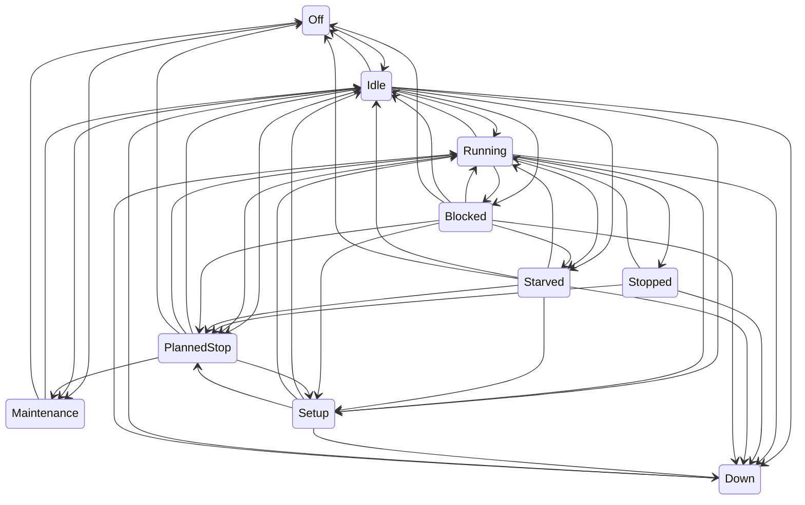

# Simulation model

Every model the simulator uses: what it represents, its parameters and default values, and how it is validated. Updated whenever simulator behaviour changes (plan section 10). Values marked as assumptions in `config/plant/` are simulation choices, not industry data.

## Machine states

Every machine is a state machine with ten states (plan section 4, rev. 2). The machine reports its state exactly as it happens; it never decides whether a stop counts as "micro". That classification belongs to the MES (plan section 7).

| State         | Meaning                                                | Typical cause                             |
| ------------- | ------------------------------------------------------ | ----------------------------------------- |
| `Off`         | Powered down                                           | Weekend, no shift                         |
| `Idle`        | Ready, not working, nothing preventing work            | Waiting for the next cycle to be started  |
| `Running`     | Producing                                              | A cycle in progress                       |
| `Stopped`     | Short, self-clearing stop with a known cause           | Door interlock, chip jam, operator pause  |
| `Starved`     | Cannot load: upstream buffer empty or material missing | Upstream breakdown, empty lot             |
| `Blocked`     | Cannot unload: downstream buffer full                  | Downstream breakdown or slower bottleneck |
| `Setup`       | Changeover between variants, or tool change            | Variant change in the schedule            |
| `Down`        | Failure that needs a technician                        | Weibull breakdown, injected fault         |
| `PlannedStop` | Planned break inside a shift                           | 30-minute shift break                     |
| `Maintenance` | Planned maintenance                                    | Calibration, scheduled service            |

Legal transitions (source of truth: `apps/simulator/src/plant/machine-state.ts`; a test fails if this diagram and the code disagree):

Rules behind the table:

- A breakdown can interrupt any active state, but a machine that is `Down` stays `Down` through breaks and shift ends until the repair finishes. Its time stays an availability loss, as in a real plant.
- `Stopped` returns to `Running` (the interrupted cycle continues), escalates to `Down`, or is overtaken by a planned break.
- `Setup` starts only between cycles, never mid-cycle: right after a cycle ends (`Running` or `Blocked`, when the next campaign needs another product) or from `Idle`, `Starved` or `PlannedStop`.
- A transition to the same state is illegal: it would mean the model lost track of what the machine is doing.
- An illegal transition throws `IllegalTransitionError`, a programmer error that stops the run (plan section 4).

### Time accounting

Each machine accumulates the time spent in every state. At any moment, the durations of all states sum exactly to the time since the machine was created (plan section 4). Time is in integer milliseconds (ADR-0006), so the sum is exact. A property test generates random legal transition sequences and checks this.

## Material flow

Source: `apps/simulator/src/plant/line.ts`. Failures, minor stops, shifts, operators and materials are added by later issues (#24–#27). This section describes the flow they build on.

### Stations and buffers

- One station per piece of equipment in `config/plant/plant.yaml`. Each station works on one part at a time.
- Finite FIFO buffers join consecutive operations, with capacities from `plant.yaml` (default 20, 30, 5 and 10). CNC-01 and CNC-02 both feed the OP10→OP20 buffer. PCK-01 delivers to finished goods, which is unbounded.
- A station whose input buffer is empty enters `Starved`. A station whose output buffer is full when a cycle ends keeps the finished part and enters `Blocked`. As soon as a slot frees up, it unloads and starts its next cycle at the same simulated millisecond.
- When several stations react at the same instant, they are handled in configuration order. The result is deterministic.

### What OP10 makes: the weekly schedule

Each CNC works through its campaigns in `config/plant/schedule.yaml` in order (plan rev. 5).

- A CNC starts the run already set up for its first campaign.
- When the next campaign is a different product, the CNC enters `Setup` for `changeoverMinutes` (default 25), with cause `CHANGEOVER <from>→<to>`.
- When all campaigns are done, the CNC goes to `Idle` with cause `SCHEDULE-COMPLETE`.
- In Phase 1 a CNC never runs out of blanks; material lots arrive with #27.

### Cycle times

A cycle at an operation takes a log-normal time whose **mean** is the product's ideal cycle time (`products.yaml`) and whose coefficient of variation comes from `process.yaml`. A CV of 0 means exactly the ideal time. The time is rounded to whole milliseconds, with a minimum of 1 ms.

Assumption to review: with the mean equal to the ideal, individual cycles are sometimes faster than ideal, and performance over a long run is close to 100%. Performance losses come from minor stops (#24) and operator speed factors (#26), not from the cycle-time noise.

### Serial numbers

A part gets its serial when its OP10 cycle ends: `<product>-<six-digit sequence>`, for example `VB-100-000042`. The sequence is shared by both CNCs and follows the order in which parts were started. Every `cycle-complete` event after OP10 carries the same serial.

### Events

The line reports two kinds of events, which the event log (#28) will write out:

- `state`: every machine state change, with time, from, to and an optional cause;
- `cycle-complete`: time, machine, product, part id and serial.

### Validation

`apps/simulator/src/plant/line.test.ts`:

- **Bottleneck:** with failures off and only VB-100 scheduled, output over 24 h is within 2% of (24 h − fill time) / 150 s. ASM-01 runs more than 99% of the time. The same holds for VB-200 at 210 s.
- **Blocking and starving:** the faster upstream machines are blocked and the faster downstream ones are starved, as plan section 3 predicts.
- **Buffers** never exceed their capacity.
- **Serials** are unique, assigned at OP10, and arrive at the end of the line unchanged.
- **Changeover:** takes exactly 25 min and happens only on the CNC whose campaign changes.
- **Accounting:** time per state sums to elapsed time for every machine, and parts are conserved (produced = finished + buffered + in machines).
- **Determinism:** the same seed gives identical events.

A reference run with seed 1 over 24 h (VB-100 only) finished 572 parts, against 574 at the ideal bottleneck rate:

| Machine         | Running | Blocked | Starved |
| --------------- | ------- | ------- | ------- |
| CNC-01 / CNC-02 | 87%     | 13%     | –       |
| WSH-01          | 42%     | 48%     | 10%     |
| ASM-01          | 99.7%   | –       | 0.3%    |
| LKT-01          | 60%     | –       | 40%     |
| PCK-01          | 20%     | –       | 80%     |

## Breakdowns, minor stops and repairs

Source: `apps/simulator/src/plant/line.ts` and `running-clock.ts`. Parameters: `config/plant/failures.yaml` (all values are assumptions).

### Running-time clocks

Each machine has a `RunningClock` holding several countdowns that advance **only while the machine is `Running`**:

- `cycle`: the remaining time of the current cycle;
- `failure:<code>`: one per failure mode, the running time left until that mode fails;
- `minor-stop`: the running time left until the next minor stop.

When the machine leaves `Running` (stop, failure, block, starve, setup), every countdown pauses. When it returns, they continue. Three consequences:

- Failures are measured in running hours, as plan section 4 requires.
- A machine that is blocked or starved can't break down.
- An interrupted cycle resumes where it stopped and isn't restarted. This is checked: with a CV of 0 and frequent stops, running time per cycle is exactly 240 s.

When two countdowns end at the same millisecond, the cycle is handled first, then the others by name. The result is deterministic.

### Breakdowns (`Down`)

- Each failure mode has its own Weibull time to failure, in running hours (`weibullShape`, `weibullScaleHours`).
- When a mode fails, the machine enters `Down` with the failure code as cause. Only that mode gets a new time to failure. Other modes keep their elapsed running time ("as bad as old"), as independent components do.
- The machine joins a FIFO repair queue. A repair starts as soon as one of the `maintenanceTechnicians` (default 2) is free, and is logged as a `repair-start` event.
- The repair takes a log-normal time around `repairMedianMinutes`, with `repairSpread` as the sigma of its logarithm. A `repair-end` event follows, the machine returns to `Running` and the technician takes the next machine in the queue.
- Waiting for a technician is part of the `Down` time, as in a real plant. The waiting share is the difference between `Down` time and repair time.

### Minor stops (`Stopped`)

- Arrivals follow a Poisson process in running time (`ratePerHour`).
- Each stop takes an exponential time (`meanSeconds`), with a cause drawn uniformly from `causes`. Then the machine returns to `Running`.
- Durations are not truncated. Some exceed the MES micro-stop threshold, and the MES then counts them as availability loss (plan section 7, rev. 2).

### Validation

`apps/simulator/src/plant/reliability.test.ts` uses a test model with frequent events: Weibull(1.4, 0.5 h), repair median 2 min, 6 minor stops per hour of 30 s each, over 400 simulated hours. It checks:

- Running time between failures follows the Weibull (KS test, p > 0.01).
- Repair durations follow the log-normal (KS test).
- Running time between minor stops and minor-stop durations are exponential (KS tests).

A mutation check during development showed that a 10% error in any of these parameters makes the tests fail.

It also checks, on the default plant:

- every failure starts from `Running`;
- the technician limit is never exceeded, and machines do wait when it is reached;
- time accounting and part conservation stay exact;
- the run is deterministic.

Reference week, default plant, seed 1, VB-100 only, running continuously (shifts arrive with #26): 3,929 parts finished against 4,032 at the ideal bottleneck rate (97.4%).

| Machine | Running | Stopped | Down | Blocked | Starved | Failures / minor stops |
| ------- | ------- | ------- | ---- | ------- | ------- | ---------------------- |
| CNC-01  | 79.3%   | 1.7%    | 0.6% | 18.4%   | 0.0%    | 3 / 259                |
| CNC-02  | 78.7%   | 1.6%    | 0.3% | 19.4%   | 0.0%    | 3 / 248                |
| WSH-01  | 39.3%   | 0.2%    | 0.0% | 59.0%   | 1.5%    | 0 / 23                 |
| ASM-01  | 97.3%   | 2.4%    | 0.0% | 0.2%    | 0.0%    | 0 / 514                |
| LKT-01  | 58.5%   | 0.8%    | 0.4% | 0.0%    | 40.4%   | 1 / 92                 |
| PCK-01  | 19.5%   | 0.9%    | 0.0% | 0.0%    | 79.6%   | 0 / 53                 |

## Random numbers and distributions

### Random streams

All randomness comes from `RandomSource(seed).stream(key)` in `sim-core` (ADR-0007): one xoshiro128** generator per entity, derived from the master seed and a key such as `cnc-01/failure/spindle-overload`. A stream depends only on the seed and its key, so adding, removing or reordering other entities never changes it. A key can be issued only once per run.

### Distributions

All functions are in `packages/sim-core/src/distributions.ts`. They return floating-point values; whoever schedules an event rounds the duration to whole milliseconds (ADR-0006).

| Function                   | Model                                             | Parameters                     | Used for (plan section 4)                            | Draws per call |
| -------------------------- | ------------------------------------------------- | ------------------------------ | ---------------------------------------------------- | -------------- |
| `uniform`                  | Uniform on [min, max)                             | min, max                       | General purpose                                      | 1              |
| `bernoulli`                | True with probability p                           | p                              | Defect at OP10, operator absence                     | 1              |
| `exponential`              | Inverse transform, −mean · ln(1 − u)              | mean                           | Minor-stop durations                                 | 1              |
| `poissonArrivalGap`        | Exponential gap with mean 1 / rate                | rate per unit time             | Minor-stop arrivals while running                    | 1              |
| `standardNormal`, `normal` | Box–Muller, one value per call                    | mean, sigma                    | Leak-test readings                                   | 2              |
| `logNormal`                | exp(mu + sigma · Z)                               | mu, sigma of ln X              | Base form                                            | 2              |
| `logNormalFromMedian`      | mu = ln(median)                                   | median, sigma of ln X          | Repair times (`repairMedianMinutes`, `repairSpread`) | 2              |
| `logNormalFromMeanCv`      | sigma² = ln(1 + CV²), mu = ln(mean) − sigma² / 2  | mean, coefficient of variation | Cycle times (`cycleTimeCv`)                          | 2              |
| `weibull`                  | Inverse transform, scale · (−ln(1 − u))^(1/shape) | shape, scale                   | Time to failure in running hours                     | 1              |

Each function always consumes the same number of draws, never a variable number (no rejection sampling, no cached second Box–Muller value). The sequence a stream delivers therefore never depends on which branch an earlier call took.

### Validation

`packages/sim-core/src/distributions.test.ts` draws 20,000 values per distribution from a fixed seed and checks them with the helpers in `packages/test-kit`:

- **Continuous distributions:** a one-sample Kolmogorov–Smirnov test against the exact CDF must give p > 0.01. Parameters are the plant defaults, for example Weibull(1.4, 160 h) for spindle failures and log-normal with median 45 min and sigma 0.6 for repairs.
- **Poisson arrivals:** counts per hour over 5,000 hours, chi-square test against the Poisson probabilities, p > 0.01.
- **Bernoulli:** chi-square test on hit and miss counts, p > 0.01.
- **Log-normal from mean and CV:** the sample mean and CV match the parameters.

The test helpers are themselves checked against published table values: erf, normal quantiles, Kolmogorov critical values (1.2238, 1.3581 and 1.6276 for alpha = 0.10, 0.05 and 0.01) and chi-square critical values. Long-run checks of MTBF and MTTR in the running plant are in the breakdown section above.
