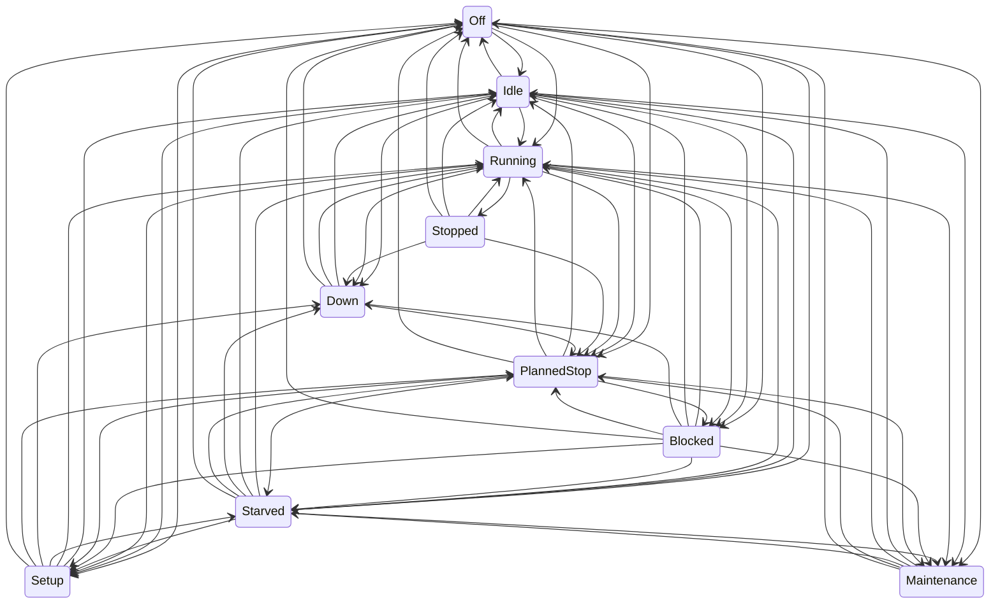

# Simulation model

Every model the simulator uses: what it represents, its parameters and default values, and how it is validated. Updated whenever simulator behaviour changes (plan section 10). Values marked as assumptions in `config/plant/` are simulation choices, not industry data.

## Machine states

Every machine is a state machine with ten states (plan section 4, rev. 2). The machine reports its state exactly as it happens; it never decides whether a stop counts as "micro". That classification belongs to the MES (plan section 7).

| State         | Meaning                                                | Typical cause                             |
| ------------- | ------------------------------------------------------ | ----------------------------------------- |
| `Off`         | Powered down                                           | Weekend, no shift                         |
| `Idle`        | Ready, not working, nothing preventing work            | Waiting for the next cycle to be started  |
| `Running`     | Producing                                              | A cycle in progress                       |
| `Stopped`     | Short, self-clearing stop with a known cause           | Door interlock, chip jam, operator pause  |
| `Starved`     | Cannot load: upstream buffer empty or material missing | Upstream breakdown, empty lot             |
| `Blocked`     | Cannot unload: downstream buffer full                  | Downstream breakdown or slower bottleneck |
| `Setup`       | Changeover between variants, or tool change            | Variant change in the schedule            |
| `Down`        | Failure that needs a technician                        | Weibull breakdown, injected fault         |
| `PlannedStop` | Planned break inside a shift                           | 30-minute shift break                     |
| `Maintenance` | Planned maintenance                                    | Calibration, scheduled service            |

Legal transitions (source of truth: `apps/simulator/src/plant/machine-state.ts`; a test fails if this diagram and the code disagree):

Rules behind the table:

- A breakdown can interrupt any active state, but a machine that is `Down` stays `Down` through breaks and shift ends until the repair finishes, then goes to `PlannedStop` or `Off` if the plant is not working. Its downtime stays an availability loss, as in a real plant.
- Breaks and shift ends move working machines (`Running`, `Stopped`, `Starved`, `Blocked`, `Idle`) to `PlannedStop` or `Off`. At the next shift start or break end they continue straight into whatever state they now need: `Off` and `PlannedStop` can lead directly to `Running`, `Starved`, `Blocked` or `Setup`.
- `Stopped` returns to `Running` (the interrupted cycle continues), escalates to `Down`, or is overtaken by a planned break.
- `Setup` starts only between cycles, never mid-cycle: right after a cycle ends (`Running` or `Blocked`, when the next campaign needs another product) or from `Idle`, `Starved` or `PlannedStop`.
- A transition to the same state is illegal: it would mean the model lost track of what the machine is doing.
- An illegal transition throws `IllegalTransitionError`, a programmer error that stops the run (plan section 4).

### Time accounting

Each machine accumulates the time spent in every state. At any moment, the durations of all states sum exactly to the time since the machine was created (plan section 4). Time is in integer milliseconds (ADR-0006), so the sum is exact. A property test generates random legal transition sequences and checks this.

## Material flow

Source: `apps/simulator/src/plant/line.ts`. Failures, minor stops, shifts, operators and materials are added by later issues (#24–#27). This section describes the flow they build on.

### Stations and buffers

- One station per piece of equipment in `config/plant/plant.yaml`. Each station works on one part at a time.
- Finite FIFO buffers join consecutive operations, with capacities from `plant.yaml` (default 20, 30, 5 and 10). CNC-01 and CNC-02 both feed the OP10→OP20 buffer. PCK-01 delivers to finished goods, which is unbounded.
- A station whose input buffer is empty enters `Starved`. A station whose output buffer is full when a cycle ends keeps the finished part and enters `Blocked`. As soon as a slot frees up, it unloads and starts its next cycle at the same simulated millisecond.
- When several stations react at the same instant, they are handled in configuration order. The result is deterministic.

### What OP10 makes: the weekly schedule

Each CNC works through its campaigns in `config/plant/schedule.yaml` in order (plan rev. 5).

- A CNC starts the run already set up for its first campaign.
- When the next campaign is a different product, the CNC enters `Setup` for `changeoverMinutes` (default 25), with cause `CHANGEOVER <from>→<to>`.
- When all campaigns are done, the CNC goes to `Idle` with cause `SCHEDULE-COMPLETE`.
- In Phase 1 a CNC never runs out of blanks; material lots arrive with #27.

### Cycle times

A cycle at an operation takes a log-normal time whose **mean** is the product's ideal cycle time (`products.yaml`) and whose coefficient of variation comes from `process.yaml`. A CV of 0 means exactly the ideal time. The time is rounded to whole milliseconds, with a minimum of 1 ms.

Assumption to review: with the mean equal to the ideal, individual cycles are sometimes faster than ideal, and performance over a long run is close to 100%. Performance losses come from minor stops (#24) and operator speed factors (#26), not from the cycle-time noise.

### Serial numbers

A part gets its serial when its OP10 cycle ends: `<product>-<six-digit sequence>`, for example `VB-100-000042`. The sequence is shared by both CNCs and follows the order in which parts were started. Every `cycle-complete` event after OP10 carries the same serial.

### Events

The line reports two kinds of events, which the event log (#28) will write out:

- `state`: every machine state change, with time, from, to and an optional cause;
- `cycle-complete`: time, machine, product, part id and serial.

### Validation

`apps/simulator/src/plant/line.test.ts`:

- **Bottleneck:** with failures off and only VB-100 scheduled, output over 24 h is within 2% of (24 h − fill time) / 150 s. ASM-01 runs more than 99% of the time. The same holds for VB-200 at 210 s.
- **Blocking and starving:** the faster upstream machines are blocked and the faster downstream ones are starved, as plan section 3 predicts.
- **Buffers** never exceed their capacity.
- **Serials** are unique, assigned at OP10, and arrive at the end of the line unchanged.
- **Changeover:** takes exactly 25 min and happens only on the CNC whose campaign changes.
- **Accounting:** time per state sums to elapsed time for every machine, and parts are conserved (produced = finished + buffered + in machines).
- **Determinism:** the same seed gives identical events.

A reference run with seed 1 over 24 h (VB-100 only) finished 572 parts, against 574 at the ideal bottleneck rate:

| Machine         | Running | Blocked | Starved |
| --------------- | ------- | ------- | ------- |
| CNC-01 / CNC-02 | 87%     | 13%     | –       |
| WSH-01          | 42%     | 48%     | 10%     |
| ASM-01          | 99.7%   | –       | 0.3%    |
| LKT-01          | 60%     | –       | 40%     |
| PCK-01          | 20%     | –       | 80%     |

## Breakdowns, minor stops and repairs

Source: `apps/simulator/src/plant/line.ts` and `running-clock.ts`. Parameters: `config/plant/failures.yaml` (all values are assumptions).

### Running-time clocks

Each machine has a `RunningClock` holding several countdowns that advance **only while the machine is `Running`**:

- `cycle`: the remaining time of the current cycle;
- `failure:<code>`: one per failure mode, the running time left until that mode fails;
- `minor-stop`: the running time left until the next minor stop.

When the machine leaves `Running` (stop, failure, block, starve, setup), every countdown pauses. When it returns, they continue. Three consequences:

- Failures are measured in running hours, as plan section 4 requires.
- A machine that is blocked or starved can't break down.
- An interrupted cycle resumes where it stopped and isn't restarted. This is checked: with a CV of 0 and frequent stops, running time per cycle is exactly 240 s.

When two countdowns end at the same millisecond, the cycle is handled first, then the others by name. The result is deterministic.

### Breakdowns (`Down`)

- Each failure mode has its own Weibull time to failure, in running hours (`weibullShape`, `weibullScaleHours`).
- When a mode fails, the machine enters `Down` with the failure code as cause. Only that mode gets a new time to failure. Other modes keep their elapsed running time ("as bad as old"), as independent components do.
- The machine joins a FIFO repair queue. A repair starts as soon as one of the `maintenanceTechnicians` (default 2) is free, and is logged as a `repair-start` event.
- The repair takes a log-normal time around `repairMedianMinutes`, with `repairSpread` as the sigma of its logarithm. A `repair-end` event follows, the machine returns to `Running` and the technician takes the next machine in the queue.
- Waiting for a technician is part of the `Down` time, as in a real plant. The waiting share is the difference between `Down` time and repair time.

### Minor stops (`Stopped`)

- Arrivals follow a Poisson process in running time (`ratePerHour`).
- Each stop takes an exponential time (`meanSeconds`), with a cause drawn uniformly from `causes`. Then the machine returns to `Running`.
- Durations are not truncated. Some exceed the MES micro-stop threshold, and the MES then counts them as availability loss (plan section 7, rev. 2).

### Validation

`apps/simulator/src/plant/reliability.test.ts` uses a test model with frequent events: Weibull(1.4, 0.5 h), repair median 2 min, 6 minor stops per hour of 30 s each, over 400 simulated hours. It checks:

- Running time between failures follows the Weibull (KS test, p > 0.01).
- Repair durations follow the log-normal (KS test).
- Running time between minor stops and minor-stop durations are exponential (KS tests).

A mutation check during development showed that a 10% error in any of these parameters makes the tests fail.

It also checks, on the default plant:

- every failure starts from `Running`;
- the technician limit is never exceeded, and machines do wait when it is reached;
- time accounting and part conservation stay exact;
- the run is deterministic.

Reference week, default plant, seed 1, VB-100 only, running continuously (shifts arrive with #26): 3,929 parts finished against 4,032 at the ideal bottleneck rate (97.4%).

| Machine | Running | Stopped | Down | Blocked | Starved | Failures / minor stops |
| ------- | ------- | ------- | ---- | ------- | ------- | ---------------------- |
| CNC-01  | 79.3%   | 1.7%    | 0.6% | 18.4%   | 0.0%    | 3 / 259                |
| CNC-02  | 78.7%   | 1.6%    | 0.3% | 19.4%   | 0.0%    | 3 / 248                |
| WSH-01  | 39.3%   | 0.2%    | 0.0% | 59.0%   | 1.5%    | 0 / 23                 |
| ASM-01  | 97.3%   | 2.4%    | 0.0% | 0.2%    | 0.0%    | 0 / 514                |
| LKT-01  | 58.5%   | 0.8%    | 0.4% | 0.0%    | 40.4%   | 1 / 92                 |
| PCK-01  | 19.5%   | 0.9%    | 0.0% | 0.0%    | 79.6%   | 0 / 53                 |

## Shifts, breaks and operators

Source: `apps/simulator/src/plant/calendar.ts`, `crew.ts` and `line.ts`. Parameters: `config/plant/shifts.yaml` and `operators.yaml`.

### Calendar

- Shifts are defined in local time (`timeZone`, default Europe/Istanbul) and converted to UTC instants with `Temporal`. Start and end are wall-clock times: across a daylight-saving change, a night shift really is 7 or 9 hours long. A test with Europe/Berlin proves this.
- A shift belongs to the date it starts on, and only runs if that date is a workday (plan rev. 2). With the default Monday-to-Friday week, the Friday night shift ends Saturday 06:00, and there is no Sunday night shift.
- Back-to-back shifts hand over without a stop: no `shift-end` is emitted when another shift starts at the same instant. The only `shift-end` of the default week is Saturday 06:00.
- The line emits a `shift` event for every boundary: `shift-start`, `break-start`, `break-end`, `shift-end`. The MES will use these to split intervals by shift (plan section 7).
- Breaks are optional per shift in the schema. The defaults give every shift 30 minutes.

### What a break or shift end does

| Machine state at the boundary | Effect                                                                                                                                                                        |
| ----------------------------- | ----------------------------------------------------------------------------------------------------------------------------------------------------------------------------- |
| `Running`, `Stopped`          | Interrupted at once and moved to `PlannedStop` (break) or `Off` (shift end). Running-time clocks pause, so the cycle resumes afterwards; the rest of a minor stop is dropped. |
| `Starved`, `Blocked`, `Idle`  | Moved to `PlannedStop` or `Off`.                                                                                                                                              |
| `Setup`, `Down`               | Continue: setters and technicians work through the break. When they finish, the machine goes to `PlannedStop` or `Off`.                                                       |

Assumption to review: the whole line stops for the break. In many plants CNCs keep running unattended through breaks.

### Operators

- Stations with `requiresOperator: true` (default: ASM-01) need a qualified operator.
- At each shift start, every operator rostered on that shift is absent with probability `absenceProbabilityPerShift` (default 3%), with one draw per operator per shift from their own stream.
- The first present operator in roster order who is qualified for the station takes it, and an `operator` event records who, plus the list of absent operators.
- The operator's `speedFactor` multiplies the station's mean cycle time: 1.1 means 10% slower than ideal. This is the main source of performance loss at the manual bottleneck.
- With no qualified operator present, the station is `Idle` with cause `NO-OPERATOR` for the shift. Upstream fills up and blocks; downstream starves.

### Validation

`calendar.test.ts`:

- the boundaries of a normal day, including handovers and the break of the night shift;
- the weekend boundary;
- the shift at a given instant, with its date;
- the DST case.

`shifts.test.ts`:

- In a steady week, every machine is `Off` for exactly 48 h and in `PlannedStop` for exactly 15 × 30 min.
- `PlannedStop` only ever starts inside a break, and `Off` only outside shifts.
- Interrupted OP10 cycles still take exactly 240 s of running time.
- Repairs continue through breaks and end in `PlannedStop`.
- A speed factor of 1.2 gives exactly 180 s at ASM-01.
- With nobody present, ASM-01 never runs (`NO-OPERATOR`).
- Absences occur at the configured rate (chi-square test).
- Over two weeks with every model on, time accounting and conservation stay exact and the run is deterministic.

### Reference week

Default plant, seed 1: the full model so far, with the default schedule and its changeover, shifts, operators, failures and minor stops. The whole weekly program was finished: 1,500 VB-100 and 700 VB-200. Hours per state over the 168-hour week:

| Machine | Running | Stopped | Down | Setup | Blocked | Starved | Idle | PlannedStop | Off  |
| ------- | ------- | ------- | ---- | ----- | ------- | ------- | ---- | ----------- | ---- |
| CNC-01  | 82.2    | 1.9     | 0.6  | 0.4   | 18.1    | 0.0     | 9.2  | 7.5         | 48.0 |
| CNC-02  | 82.0    | 1.6     | 0.2  | 0.4   | 18.9    | 0.0     | 9.4  | 7.5         | 48.0 |
| WSH-01  | 36.7    | 0.1     | 0.0  | 0.0   | 65.1    | 10.6    | 0.0  | 7.5         | 48.0 |
| ASM-01  | 104.0   | 2.3     | 0.0  | 0.0   | 0.0     | 6.2     | 0.0  | 7.5         | 48.0 |
| LKT-01  | 55.0    | 0.8     | 0.0  | 0.0   | 0.0     | 56.7    | 0.0  | 7.5         | 48.0 |
| PCK-01  | 18.4    | 1.0     | 0.0  | 0.0   | 0.0     | 93.2    | 0.0  | 7.5         | 48.0 |

The CNCs are `Idle` for about 9 h at the end of the week because their schedule is finished. The default schedule and stock were raised in this change (1,500 + 700 instead of 1,200 + 500), because the first reference run finished the program by Thursday.

## Tool wear, scrap, leak test and rework

Source: `apps/simulator/src/plant/quality.ts` and `line.ts`. Parameters: `config/plant/process.yaml` (all values are assumptions).

### Tool wear and OP10 scrap

- Each CNC counts the cycles since its last tool change. Wear is `cycles / lifeCycles`.
- The defect probability of a cycle is read from the piecewise-linear `defectProbability` curve at the wear **before** that cycle. Defaults: 0.2% for a new tool, 0.5% at 80% wear, 5% at end of life.
- A defective part still gets its serial (the DMC is laser-marked at the end of the cycle). It is then scrapped at OP10 with reason `DIMENSIONAL` and never goes downstream.
- After `lifeCycles` (default 400), the next cycle waits for a tool change: `Setup` with cause `TOOL-CHANGE` for `changeMinutes` (default 8).
- The weekly schedule counts blanks started, so scrap reduces good output.

### Leak test (OP40)

- Reading = normal(mean + drift, sigma), where drift = `driftPerDay` × days since the last calibration (defaults: mean 2.0 Pa/min, sigma 0.45, drift 0.04 per day). A reading above `upperLimit` (3.2) fails.
- Every reading is reported on the LKT-01 `cycle-complete` event as a `measurement` (characteristic `leak-rate`, value, unit, upper limit). Phase 8's SPC will use it.
- First-test failure rate: about 0.4% right after calibration, rising to about 2% after 7 days of drift.
- Calibration every `calibrationIntervalDays` (7) is planned `Maintenance` with cause `CALIBRATION` for `calibrationMinutes` (20). It starts between parts, and resets the drift.

### Rework loop

- A first leak failure gives `cycle-complete` with result `rework`, reason `LEAK`. The part goes to a **rework queue at OP30**, separate from the OP20→OP30 buffer, as a rework rack would be. ASM-01 takes rework parts before new ones.
- After rework the part is tested again. A second failure gives result `scrap`, reason `LEAK`.
- The separate queue avoids a deadlock: with all buffers full, sending a part back into the normal OP20→OP30 buffer could block the line permanently.
- Rework consumes the product's `reworkComponents` (default: the seal kit); see "Material lots and consumption".

### Validation

`apps/simulator/src/plant/quality.test.ts`:

- curve interpolation, tool-life and calibration logic as unit tests;
- one tool change per 400 cycles on each CNC;
- scrap rate equal to the mean of the wear curve over a tool life (chi-square; run with 10× probabilities so that a 20% error is detected);
- scrapped parts never reach WSH-01;
- standardized leak readings, after removing the drift since the last calibration, follow N(0, 1) (KS test; a 0.1-sigma shift is detected);
- calibration every 7 days;
- with a strict limit, parts follow the three possible histories: pass; fail, rework, pass; fail, rework, fail, scrap. No part is reworked twice, and parts are conserved, counting scrap and the rework queue;
- the default first-test failure rate lies between 0.2% and 3%.

Reference week, default plant, seed 1, full model so far: 2,200 blanks started and 2,183 good parts finished.

| Quantity                         | Value                                                     |
| -------------------------------- | --------------------------------------------------------- |
| OP10 scrap (`DIMENSIONAL`)       | 17 of 2,200 (0.8%)                                        |
| Tool changes                     | 4 (2 per CNC)                                             |
| Leak tests / rework / leak scrap | 2,198 / 15 / 0                                            |
| First-pass leak yield            | 99.32%                                                    |
| Calibrations                     | 1 (start of the following Monday, 7 days after the start) |

## Material lots and consumption

Source: `apps/simulator/src/plant/materials.ts` and `line.ts`. Parameters: `config/plant/stock.yaml` and `products.yaml` (lot sizes and rework components are assumptions). In Phases 1–6 the stock comes from this file; from Phase 7 the ERP mock issues it (plan section 4).

### Consumption

- **OP10:** when a cycle starts, a CNC consumes one blank of the variant (`blank`).
- **`componentsOperation` (default OP30):** when a cycle starts, ASM-01 consumes one unit of each of the variant's `components` (seal kit and spool).
- **Rework:** a reworked part consumes only its `reworkComponents` (default: the seal kit). A reworked VB-100 therefore has two SK-1 consumptions and one SP-100.
- **Lot order:** lots of a material are used first in, first out, in file order.
- **Genealogy events:** every unit consumed emits a `material-consumed` event with machine, part id, material and lot. Joined with the serial on `cycle-complete`, this gives the serial → blank lot → component lots genealogy that the MES rebuilds in Phase 8 (plan section 3).

### Shortage and blocked lots

- When no usable lot of a needed material is left, the station is `Starved` with cause `MATERIAL:<material>`, for example `MATERIAL:SK-1`.
- ASM-01 checks its components **before** taking the part from the buffer, so the part stays in the buffer and the line upstream fills and blocks, as it would in a real plant.
- A lot can be blocked and released (`ProductionLine.blockLot`, used by the control API in Phase 9 to simulate a quality hold). A blocked lot is skipped as if it were empty. Releasing it wakes every starved station.

### Validation

`apps/simulator/src/plant/materials.test.ts`:

- FIFO, blocking and exhaustion in `Inventory`;
- every finished part links to exactly one blank lot and one spool lot, plus at least one seal-kit lot;
- blank lots are used strictly in order;
- running out of blanks or seal kits starves the right station with the right cause, and parts are still conserved;
- a blocked seal-kit lot stops output until it is released;
- reworked parts consume one extra seal kit per extra ASM-01 cycle and never an extra spool;
- for every lot, units consumed = initial quantity − remaining.

Reference week, default plant, seed 1, full Phase 1 model: no material starvation. Lots consumed:

| Lot           | Initial | Remaining |
| ------------- | ------- | --------- |
| BL100-2610-01 | 900     | 0         |
| BL100-2610-02 | 900     | 300       |
| BL200-2610-01 | 900     | 200       |
| SK1-2610-01   | 1,800   | 300       |
| SK2-2610-01   | 900     | 202       |
| SP100-2610-01 | 1,800   | 311       |
| SP200-2610-01 | 900     | 206       |

## Headless output

Source: `apps/simulator/src/headless/`. How to run it: `docs/runbook.md`.

### Event log (`events.jsonl`)

- **Line 1, the run header** (`schema: sim-run/1`): `seed`, `start`, `end` (ISO 8601, UTC) and `configSha256`, a SHA-256 hash of the validated plant configuration. Any change to a YAML value changes the hash.
- **Every other line is one event** with `schema: sim-event/1`, a run-wide sequence number `seq` starting at 1, and `at` in ISO 8601 UTC. Lines are in simulation-time order; events at the same millisecond keep the order in which the model produced them.
- **Byte stability:** keys are sorted at every level (string order, except that integer-like keys come first in numeric order, as JSON objects always do), and undefined fields are dropped. Values that are not plain JSON (`Map`, `Set`, `Temporal` objects, functions) are rejected instead of being written as `{}`. One function, `stableStringify`, writes every line, so the bytes depend only on the data, never on how an object was built.

| `type`                       | Fields besides `at`, `seq`, `schema`                                                                        | Emitted when                             |
| ---------------------------- | ----------------------------------------------------------------------------------------------------------- | ---------------------------------------- |
| `state`                      | `machineId`, `from`, `to`, `cause?`                                                                         | A machine changes state                  |
| `cycle-complete`             | `machineId`, `product`, `partId`, `serial`, `result` (`good`, `scrap`, `rework`), `reason?`, `measurement?` | A station finishes a cycle               |
| `material-consumed`          | `machineId`, `partId`, `material`, `lotId`                                                                  | A unit of a lot is consumed              |
| `repair-start`, `repair-end` | `machineId`, `failureCode`                                                                                  | A technician starts or finishes a repair |
| `shift`                      | `action` (`shift-start`, `break-start`, `break-end`, `shift-end`), `shiftId`, `shiftDate`                   | A calendar boundary is reached           |
| `operator`                   | `machineId`, `operatorId` (or null), `absent`                                                               | A station is staffed at shift start      |

These are the simulator's internal facts, the "truth". They are not the UNS payloads of plan section 5; the MES sees the plant only through OPC UA and MQTT from Phase 2 on.

### Ground-truth summary (`summary.json`)

- `machines.<id>.stateMs`: milliseconds in each of the ten states. They sum to the run length.
- `machines.<id>.byShift`: the same, split per shift instance (`2026-10-13/B`, …), plus `no-shift` for time outside shifts. Intervals are cut exactly at shift boundaries, as the MES must do (plan section 7).
- `machines.<id>.cycles`: completed cycles by result.
- `production`: parts started (blanks consumed), finished per product, and scrapped per product and reason.
- `lots`: remaining quantity of every lot.

`GroundTruth` builds the state times and cycle counts only from the events; `production` and `lots` are read from the model at the end of the run. A test runs the same seed through the plant directly and checks that every machine's own time accounting equals the summary exactly.

A run covers the half-open interval [start, end): no event at or after `end` is written. The shift running at `start` (and its break, if the run starts inside one) is announced by `shift` events at `start`, so the log is self-contained. From Phase 5 on, the summary also gets KPIs computed with `oee-core` (plan rev. 2).

## Invariants and golden scenarios

Source: `apps/simulator/src/headless/invariants.ts` and `golden.ts`.

`InvariantChecker` runs after **every** simulation step, once the step has been handled. In the middle of a step a part can legitimately be in transit, for example taken from a buffer but not yet in the machine, which is why it doesn't run after every emitted event. Each check verifies three things (plan section 4, built-in validation):

1. **Conservation of parts:** parts started = finished + scrapped + in buffers + in machines + in the rework queue.
2. **Time accounting:** for every machine, the time in all states sums exactly to the elapsed time.
3. **Conservation of material:** for every lot, units consumed (from `material-consumed` events) + remaining = initial quantity.

The first violation stops the run with an `InvariantViolation` naming the time and the quantities. Tests prove the checker catches each kind of violation: a lost part, a wrong start time, a unit consumed without an event.

Coverage:

- the three 5-day production weeks (Monday 06:00 to Saturday 06:00, seeds 1–3) in the test suite;
- the golden scenario `week-01` (seed 20261012, 7 days, default plant), about 12,600 checks per run.

The golden snapshot pins the run byte for byte: its summary file, and the SHA-256 of its 35,760-line event log. CI runs it on every pull request.

## Random numbers and distributions

### Random streams

All randomness comes from `RandomSource(seed).stream(key)` in `sim-core` (ADR-0007): one xoshiro128** generator per entity, derived from the master seed and a key such as `cnc-01/failure/spindle-overload`. A stream depends only on the seed and its key, so adding, removing or reordering other entities never changes it. A key can be issued only once per run.

### Distributions

All functions are in `packages/sim-core/src/distributions.ts`. They return floating-point values; whoever schedules an event rounds the duration to whole milliseconds (ADR-0006).

| Function                   | Model                                             | Parameters                     | Used for (plan section 4)                            | Draws per call |
| -------------------------- | ------------------------------------------------- | ------------------------------ | ---------------------------------------------------- | -------------- |
| `uniform`                  | Uniform on [min, max)                             | min, max                       | General purpose                                      | 1              |
| `bernoulli`                | True with probability p                           | p                              | Defect at OP10, operator absence                     | 1              |
| `exponential`              | Inverse transform, −mean · ln(1 − u)              | mean                           | Minor-stop durations                                 | 1              |
| `poissonArrivalGap`        | Exponential gap with mean 1 / rate                | rate per unit time             | Minor-stop arrivals while running                    | 1              |
| `standardNormal`, `normal` | Box–Muller, one value per call                    | mean, sigma                    | Leak-test readings                                   | 2              |
| `logNormal`                | exp(mu + sigma · Z)                               | mu, sigma of ln X              | Base form                                            | 2              |
| `logNormalFromMedian`      | mu = ln(median)                                   | median, sigma of ln X          | Repair times (`repairMedianMinutes`, `repairSpread`) | 2              |
| `logNormalFromMeanCv`      | sigma² = ln(1 + CV²), mu = ln(mean) − sigma² / 2  | mean, coefficient of variation | Cycle times (`cycleTimeCv`)                          | 2              |
| `weibull`                  | Inverse transform, scale · (−ln(1 − u))^(1/shape) | shape, scale                   | Time to failure in running hours                     | 1              |

Each function always consumes the same number of draws, never a variable number (no rejection sampling, no cached second Box–Muller value). The sequence a stream delivers therefore never depends on which branch an earlier call took.

### Validation

`packages/sim-core/src/distributions.test.ts` draws 20,000 values per distribution from a fixed seed and checks them with the helpers in `packages/test-kit`:

- **Continuous distributions:** a one-sample Kolmogorov–Smirnov test against the exact CDF must give p > 0.01. Parameters are the plant defaults, for example Weibull(1.4, 160 h) for spindle failures and log-normal with median 45 min and sigma 0.6 for repairs.
- **Poisson arrivals:** counts per hour over 5,000 hours, chi-square test against the Poisson probabilities, p > 0.01.
- **Bernoulli:** chi-square test on hit and miss counts, p > 0.01.
- **Log-normal from mean and CV:** the sample mean and CV match the parameters.

The test helpers are themselves checked against published table values: erf, normal quantiles, Kolmogorov critical values (1.2238, 1.3581 and 1.6276 for alpha = 0.10, 0.05 and 0.01) and chi-square critical values. Long-run checks of MTBF and MTTR in the running plant are in the breakdown section above.
